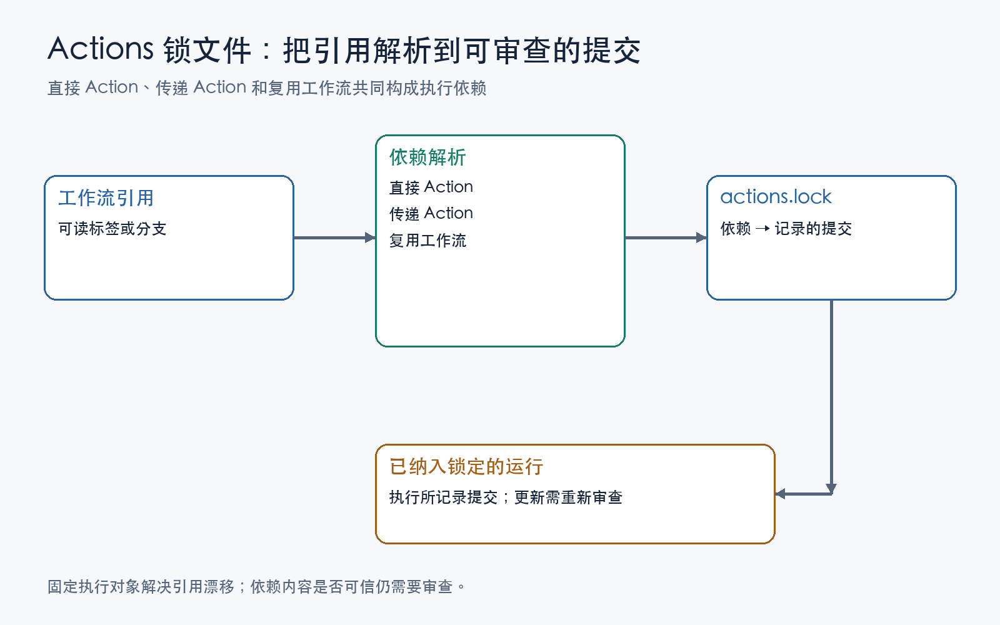

GitHub Actions 的工作流除了运行本仓库的代码，还会运行它引用的 Action。`uses: actions/checkout@v7` 这样的写法好读，但 `v7` 是一个 tag，tag 可以被改指到另一个提交。今天和下个月跑同一份工作流，执行的可能不是同一份代码。

GitHub 为此提供了工作流依赖锁文件。官方的 `gh-actions-lock` 扩展把每个 Action 实际解析到的提交写进 `.github/workflows/actions.lock`，Action 内部引用的其他 Action 也一并记录。YAML 里照旧写可读的版本号，运行时按锁文件里的提交执行，并校验代码来源。依赖换没换、换成了什么，从此会出现在 diff 里，可以像代码一样审查。

用它要弄清两件事：哪些依赖被锁住了，哪些没有；依赖升级时怎样审查。本文按这个顺序讲。

## 直接依赖与传递依赖

工作流可以直接调用一个 Action；复合 Action 内部还可以调用其他 Action。固定外层提交只固定外层源码，内部 `uses` 若仍使用可移动引用，下一次解析仍可能选择另一份内层代码。因此，追踪执行对象需要沿依赖关系继续走。

GitHub 官方 `gh-actions-lock` 仓库自身提供了真实样本。`v0.4.0` 的锁文件中，发布工作流依赖 `cli/gh-extension-precompile@v2.2.0`；相应依赖继续列出构建和证明相关的 Action。清单里还能看到 `actions/attest-build-provenance` 的 `uses` 指向 `actions/attest`。这些内部边和顶层引用一起记录，审查才能知道一次发布实际引入了哪些代码。

工作流文件描述要做什么，Action 源码描述具体怎样做，锁文件则记录这条调用链选中了哪些提交。固定之后，审查对象从“未来启动时 tag 恰好指向什么”变成一份可打开、可比较的提交及其依赖图。

## 锁文件中的提交与仓库身份

官方锁文件包含两部分。`workflows` 记录每份已加入工作流使用的依赖；`dependencies` 把引用接到具体的 `ref`、`commit`、`owner_id` 和 `repo_id`，并可继续列出子依赖。

下面节选官方 v0.4.0 仓库的真实锁记录，保留一条传递依赖及目标记录：

```yaml
dependencies:
    'actions/attest-build-provenance@a2bbfa25375fe432b6a289bc6b6cd05ecd0c4c32':
        ref: 'v4.1.0'
        commit: 'sha1-a2bbfa25375fe432b6a289bc6b6cd05ecd0c4c32'
        owner_id: 44036562
        repo_id: 760702757
        uses:
            - 'actions/attest@59d89421af93a897026c735860bf21b6eb4f7b26'
    'actions/attest@59d89421af93a897026c735860bf21b6eb4f7b26':
        ref: 'v4.1.0'
        commit: 'sha1-59d89421af93a897026c735860bf21b6eb4f7b26'
        owner_id: 44036562
        repo_id: 760701061
```

`attest-build-provenance` 的记录先给出选定提交，再用 `uses` 连接到 `attest` 的另一条记录。审核者可以继续打开后者的提交，而不是从外层的版本号猜它用了什么。两项 `repo_id` 不同，表示它们分别来自两个仓库；相同 `owner_id` 则将它们关联到同一所有者身份。完整文件的 `workflows` 部分再把顶层工作流接到这张依赖图。

这些字段承担不同职责。commit 指定代码对象；ref 保留它来自哪个 tag 或 branch；数值仓库身份用于检查仓库名称背后是否仍是原来源。引用的显示名称相同，不代表来源身份一定没变。

运行时还会检查锁定提交在对应仓库中能否从记录的引用到达。仅存在于 fork 的提交，或已经无法从该引用到达的对象，不符合这一要求。这比“填入一个看似完整的 SHA”多了来源与可达性检查。

锁文件由官方扩展生成，格式随预览版本演进。`v0.4.0` 仓库样本使用 `v0.0.3`；编辑时应修改工作流意图并运行工具，再审查生成差异。手工填字段既容易遗漏传递边，也绕过了工具负责的解析和验证。



图中实线表示受支持 Action 的解析与执行关系。外部可复用工作流不在调用方的锁定范围内，要另行管理。

## 可复用工作流的版本固定

`jobs.<job_id>.uses` 调用的是可复用工作流，不是某个步骤的 Action。当前官方文档与 `gh-actions-lock v0.4.0` 都明确：锁文件不固定这种调用。固定它的方式是将工作流引用写成完整提交 SHA。

外部工作流内部再调用的 Action，由定义该工作流的仓库及其锁文件管理。调用方给共享工作流固定了 SHA，只说明选择了哪份工作流源码；要判断其中的 Action 是否固定，还需要检查被调用方的依赖治理。

共享 CI 的审查需要两级材料。调用方展示共享工作流版本的变化；共享仓库展示内部 Action 和传递关系的变化。两份材料各自有负责人，调用仓库的 `actions.lock` 覆盖不到后一份。

本地 Action 也有独立规则。`./…` 路径不会被当作远端 Action 自动跟踪和锁定；其中再引用远端 Action 时，工具需要按支持的同仓引用方式迁移，或明确忽略。选择忽略会留下覆盖外范围，应把这部分的依赖固定责任留在原有流程中。

接入前可以把引用分成 step Action、job 可复用工作流、本地复合 Action 和容器，分别确定锁文件、完整提交 SHA 或容器 digest 等管理方式。生成之后，再按这份分类检查覆盖范围。

## 锁文件生成、校验与升级

官方扩展要求已认证的 GitHub CLI，支持 github.com 与具有 data residency 的 GitHub Enterprise Cloud；GitHub Enterprise Server 不在当前支持范围。安装及首轮生成入口如下：

```bash
gh extension install github/gh-actions-lock
gh actions-lock .github/workflows/ci.yml
```

第二条命令只选择一份工作流，适合从小范围接入。检查工具产生的工作流和锁文件差异后，将它们一起提交；全目录运行还承担清理已删除工作流条目的职责，局部运行不做这件事。

后续操作应根据意图选择：

| 命令 | 是否写文件 / 用网络 | 负责的事 |
|---|---|---|
| `gh actions-lock` | 写入 / 联网 | 加入新工作流，修复或补充记录 |
| `gh actions-lock --verify-local` | 不写 / 离线 | 检查引用是否有覆盖，便于提交前检查 |
| `gh actions-lock --verify` | 不写 / 联网 | 检查固定对象及来源，适合 CI |
| `gh actions-lock --relock` | 写入 / 联网 | 按当前上游引用重新选择提交 |

引用前进与历史改写会触发不同处理。按官方机制推演：若 `main` 分支原来选中 A，后来前进到包含 A 的 B，既有锁仍可使用 A；`--verify` 检查它的覆盖与来源，不主动升级。`--relock` 则重新解析该分支，提出 B 及其传递依赖的新记录。

若引用移动后已经无法到达 A，旧记录的来源检查会失败，`--relock` 也不会自动替换这条不可达记录。先调查移动原因；由工作流直接持有的引用，可在核实后显式使用 `--accept-moved` 接受变化；由复合 Action 持有的引用，还需要更新或替换相应上层依赖。离线 `--verify-local` 不读远端，发现不了这类变化。把“检查旧选择”和“接受新选择”分开，团队就能在审查中明确哪一次变化真正更新了执行代码。

离线检查只回答覆盖是否齐全。它不查询远端，因此无法独自确认来源和可达性。流水线应让检查名称反映这项范围，远端校验也需要有正确的认证条件。Enterprise Cloud 租户读取公共 github.com Action 时，公共来源认证与租户 token 不能混用。

## 依赖升级的代码审查

依赖升级的审查要核对选中提交的变化、来源身份是否保持，以及子依赖增删和代码变化将获得的运行权限。锁文件给出入口，代码审查完成判断。

Dependabot 能为受支持的依赖更新同步锁条目。阅读这类 PR 时，先从旧、新 commit 找出代码差异，再沿 `uses` 看内部依赖是否也改变；发布步骤增加网络调用、权限请求发生变化，都能沿这一组材料继续核对。

当前工具还明确列出一种需要人工留意的情况：浮动引用若在历史中回到更旧提交，锁文件变更不会仅因“回退”而被自动识别成错误。审查者仍要看提交关系和更新理由。`--accept-moved` 也只适合确认原因后的显式处理，不能作为自动化默认补救。

锁文件把变化定位到具体提交、来源和内部依赖边，审查者再据此检查代码与运行权限。绿色校验表示锁记录通过了相应检查，接受这次升级还需要对代码变化作出判断。

## 包、镜像与运行环境的独立管理

Action 的代码固定之后，它仍可能安装包、拉取镜像、下载文件或查询外部服务。包依赖由包管理器及对应锁文件约束；容器镜像需要 digest 等固定方式；runner 镜像、环境变量和 secrets 也会改变运行结果。这些输入需要各自的版本与配置记录。

权限与固定版本也有不同作用。同一份代码在只读凭据与发布凭据下，能造成的影响不同。选择执行哪份代码、是否信任它、允许它影响什么资源，需要分别管理。

建议先在一小组工作流上试：这些工作流有人维护依赖升级的 PR，权限策略明确，依赖关系说得清。试的时候看三点：新加的 Action 会不会被覆盖检查发现，一次升级能不能追到具体提交和内部依赖，可复用工作流有没有另外固定版本。没问题再扩大范围。锁文件管的只是“执行哪份 Action 代码”，包、镜像、runner 和权限仍要各自管理。

## 主要参考资料

- GitHub Docs：Workflow dependency lockfiles；Lock workflow dependencies。
- gh-actions-lock v0.4.0：README、官方 actions.lock、workflowfile 与 resolve 实现。
- gh-actions-lock v0.4.0 release notes。
