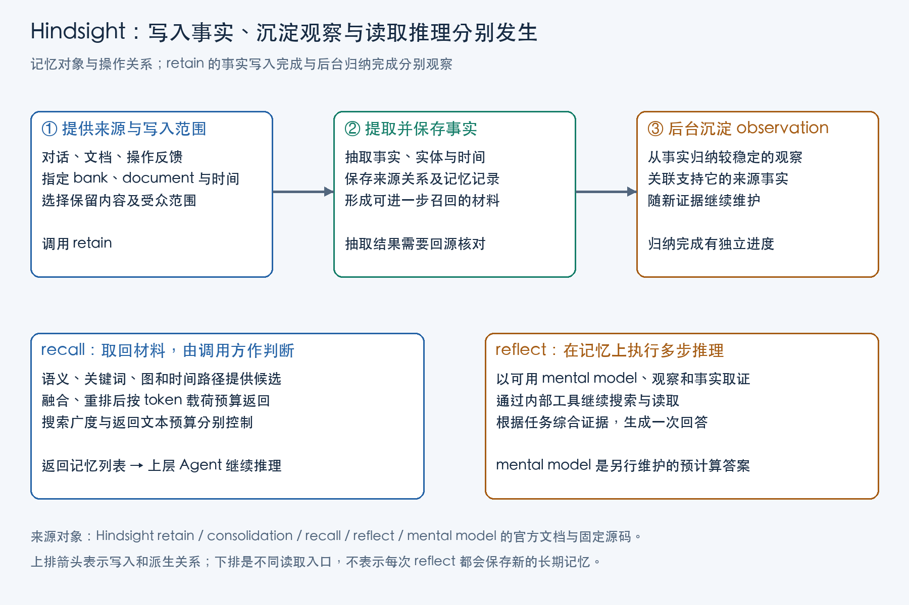

Hindsight 是供 Agent 调用的长期记忆服务。应用将选择保留的对话、文档和反馈交给它加工、保存，在后续任务中检索相关事实，或让它基于记忆继续推理。已有 Agent 仍负责自己的模型调用、工具和行动。

跨会话使用过去的信息，应用希望保留的往往不只是“上次说过什么”：有些事件和约定需要下次立即查到，有些认识要结合多次记录才能形成，还有些问题会在每场任务中反复出现。把历史放到上下文窗口之外，只解决了保存位置；怎样组织这些材料，决定了后续任务要重新阅读和判断多少内容。

## 从下次任务需要什么，决定记忆怎样组织

跨会话保留信息，首先要能留下具体事件、状态与约定。后续任务可能需要确认谁做过什么、事情发生在何时、某项要求适用于哪些条件。保存对话和文档原文能够保留这些细节，但每次使用都要重新从整段叙述中寻找它们。若将这些陈述抽取为可单独检索的事实，并关联人物、时间和来源，下次就能针对当前问题取材。刚收到的新信息也能先以事实形式参与查询，不必等到它已经成为某种经验。

当相关记录逐渐增加，任务又会需要跨记录的认识：同一对象目前处于什么状态，哪些要求反复出现，哪些做法在什么条件下适用。每次读取零散事实后重新整理，会重复消耗推理与上下文。将相关事实综合为持续维护的归纳，可以把这部分整理提前完成。事实保留某次记录的具体内容，归纳则需要比较新旧材料、保留适用条件，并在认识变化时更新。

还有一种重复发生在问题本身：应用每次启动都要问同一套流程应怎样执行，或同一主题目前有哪些可用认识。即使已有归纳，仍要从多条材料中组织一次完整答案。若这个问题足够稳定、答案会被频繁使用，就可以明确保存一份围绕它的综合结果，再随依据变化刷新。问题多变、需要临场判断时，则可以在本次任务中搜索和综合，不必为每次回答维护长期副本。

抽取与综合都可能省略条件，因此还需要保留回到来源的路径。对归纳产生疑问时，先看它依据了哪些事实；对事实的理解有疑问时，再读当时的原文。源材料在这里承担核查依据的作用，不能被一份更简短的总结完全替代。需要保留多少原文，则取决于应用的复核要求与数据保留策略。

Hindsight 用不同对象承接这些要求。Bank 提供存储与处理配置的空间；document 与 chunk 组织来源；facts、observations 和 mental models 则保存不同加工结果：

| 职责 | 对象 | 对应的使用要求 |
| --- | --- | --- |
| 空间与配置 | Bank | 承载应用选择的记忆空间，以及抽取、归纳、反思等配置与访问边界 |
| 来源组织 | Document | 标识一份来源材料，保存 `document_id`、内容哈希和允许保留的源文本等 |
| 来源组织 | Chunk | 保留材料分块后的文本与顺序，供抽取和回源阅读使用 |
| 加工内容 | World / experience fact | 保存从材料抽取的原子记忆，关联实体、时间及 document、chunk，供具体问题检索 |
| 加工内容 | Observation | 后台综合相关事实与已有归纳，持续维护某个实体或方面的认识 |
| 持久综合内容 | Mental model | 保存围绕应用明确指定的长期问题生成的答案，并按需要刷新 |

这里的加工与维护分别由不同入口承担。`retain` 把来源转成事实，后台 consolidation 维护 observations；`recall` 把选出的材料交给调用方，`reflect` 使用记忆工具围绕本次问题继续取证。应用决定维护固定问题时，再创建 mental model，利用反思过程搜索、阅读相关归纳与事实，保存综合结果。事实与归纳的时效不同，持久答案也有独立刷新进度，应用应按本次任务对细节、复用和新鲜度的要求选择读取内容。

## retain：将来源材料加工为可检索事实

写入的起点是应用选择的一份材料，而不是模型的所有输出。官方 Cookbook 的 CableConnect 客服助手模拟原型提供了一个有用参照：客服人员否决助手建议后，应用组织客户对话、已查工具及结果、原建议与拒绝理由，再提交给记忆服务。原型关闭自动存储对话与自动注入记忆，把反馈的选择权留给应用。

拒绝反馈带有场景类别、`context` 和 `feedback` 标签。它们帮助加工阶段识别材料中的角色和用途。例如“派技术人员之前应怎样调查、是否先运行诊断”是原型预设的调查主题，保存时需要保留适用问题及客服纠正的理由，不能只留下最后一句建议。

材料提交以后，服务先分块，由模型从块中提取事实、实体、发生时间及关联，再计算向量、解析实体，将事实和关系写入存储。v1.1.0 中，这条处理链从 Python 客户端的 `retain`、`retain_batch` 经 HTTP `retain_memories`，进入 `MemoryEngine.retain_batch_async` 和 `engine/retain/orchestrator.py::retain_batch`。

向量使改换措辞后的问题仍可能找到这条反馈；实体与关系让同一个对象的不同记录能够相互连接；来源关系则让使用者有机会检查抽取是否漏掉条件。因此，Hindsight 的写入工作已经超出“把对话文本放进向量库”，它在主动改变材料的组织方式。

这种加工也引入了需要控制的解释。`world` 描述外部世界，`experience` 描述 bank 所代表 Agent 的经历。用户在聊天中用“我”叙述一件事，抽取时仍应理解为用户的外部事实。说话者与 bank 的身份关系，比句子里有没有第一人称更重要。同样，实体解析依据名称、共现等信号连接记录；应用若有权威业务身份，应在输入阶段交代，不能期待姓名相近就总能对应正确对象。

时间也有类似的层次。输入的 `timestamp` 是理解相对时间的锚；`occurred_start`、`occurred_end` 描述事实发生时间，`mentioned_at` 描述何时被提及，写入时间另有记录。后补的一份旧反馈，可能今天入库，却在描述更早的规则或事件。把这些时间保留下来，后续归纳才有依据判断变化方向。

### 等待写入时，要观察具体完成了哪一步

应用接好 `retain` 后，首先遇到的工程问题通常是：什么时候可以进入下一场任务？

Python 的 `await client.aretain(...)` 只说明客户端使用了协程。其默认请求仍让服务端等待事实抽取和写入完成；显式使用 `retain_async=True`，服务端才会先提交后台工作，返回 `operation_id`。后者应查询 operation 的状态，才能知道工作是否真正完成。

即使事实已经写入，后台的 consolidation——把事实归纳为 observations——仍有独立进度。持久 mental models 若要吸收这次变化，还要经历自己的刷新。因此，一次反馈可能依次处于“已受理”“事实可检索”“归纳已更新”“长期答案已刷新”四种状态。

下一次任务若很快开始，只读取 observations 可能尚未看到新反馈。应用可以等待归纳完成，也可以同时召回新写入的 facts，由上层整理尚未归纳的材料。前者增加等待，后者增加本次上下文的处理工作，应按反馈需要多快生效选择。

源文本的保留策略还决定了以后能核对到哪一层。v1.1.0 的 `store_document_text` 默认开启；关闭后，系统仍可保存抽取事实和内容哈希，但 `original_text` 与块文本不再提供同样的回读材料。若任务需要复核“客服当时到底纠正了什么”，应在数据最小化要求与可核查性之间作明确选择。保存提取文本与归档原始 PDF、图片等文件，也应分别安排。

图的上排是写入与派生关系：应用提交来源，系统形成事实，后台再维护观察。下排是不同读取入口：`recall` 把材料交还上层 Agent，`reflect` 在记忆上继续搜索、阅读并形成一次回答。Mental model 另行维护，图中没有把普通反思画成一次自动的长期写入。

## consolidation：根据事实创建和更新归纳

一份客服反馈可能同时包含特定客户状态、某次诊断结果，以及可复用的调查顺序。下一场任务需要的是与当前条件相关的部分。若每次都把所有旧对话重新读一遍，模型要不断重新完成从具体记录到一般认识的整理。

Hindsight 的 consolidation 将这部分工作移到后台。稳定版 `engine/consolidation/consolidator.py` 将新 facts 与相同 scope 中的已有 observations 一起处理，围绕实体及其某个方面进行比较，由模型提出创建、更新或删除归纳的动作。

归纳先要找到值得比较的旧认识。`_find_related_observations` 用新事实查询 observation 类型的记忆，在相应标签范围内取回候选及其来源事实。随后把一批新 facts 与合并后的候选 observations 交给模型。旧观察提供 ID、正文、支持数量与可得的时间、来源材料，模型因此能判断是在补充已有认识，还是记录另一件事。

提示中的匹配单位是“实体及其某一方面”，而非宽泛主题。重复出现同一项决定，优先更新那条观察并增加依据；同一人的另一项独立信息，则创建新的观察。官方提示示例将 Alice 出售既有汽车与 Alice 工作时间较长放在同一批输入：前一事实更新汽车的状态并保留出售日期，后一事实建立工作时间的独立观察。两项都关于 Alice，却不应合成一条笼统的人物总结。

模型返回 `creates`、`updates`、`deletes` 三个数组。更新项给出目标 `observation_id`、替换后的完整 `text`、本批支持它的 `source_fact_ids` 与理由；创建项提供新正文及来源。程序解析这些结构，核对可用的事实引用，准备文本向量，再应用记录与支持关系的变更。更新正文要保留未被新事实改变的内容，所以它不是把最新一句直接追加上去。

这套设计让内容判断与存储操作分开：模型负责判定两份陈述是否描述同一方面、怎样保留变化；程序负责将指定 ID、正文与依据写入可查询记录。下一次检索得到的 observation 因而能够沿支持关系回到事实，再回到原文。

对“先诊断再派单”这个原型主题，应用应检查归纳有没有保留反馈适用的调查条件，以及客服纠正的理由。不能因为多个记录都提到了派单，就把它们压成一个无条件操作规则。`proof_count` 记录支持事实的数量，适合观察证据来源规模；把同一错误重复写入，也会增加记录数，因此它不能直接作为正确概率。

## 归纳的标签范围与访问控制

Consolidation 负责更新归纳内容。应用还需配置 observation scope，指定派生观察采用哪些标签。标签决定查询时如何筛选记录；调用者是否有权读取这些记录，则由访问控制校验。

稳定版提供几种派生方式。`combined` 按输入整组标签归纳；`per_tag` 为各标签分别生成对应范围的观察；`all_combinations` 覆盖非空标签子集，标签增加时最多形成 `2^n−1` 个组合；`shared` 则把归纳写到无标签范围。派生范围越多，需要生成和维护的观察就越多。生成后的观察携带哪些标签，又决定了它们能否匹配后续查询的标签筛选条件。

尤其是 shared：源事实即使带有局部标签，派生观察仍可能进入共享范围。只核对源记录的标签，无法判断归纳后的内容会流向哪里。应用必须先决定哪些经历可以跨用户、团队或任务共享，再选择派生策略；需要去标识化的材料，应有明确的数据处理与审查过程，不能单靠归纳提示词要求“不要泄露”。

读取标签也有实际语义。稳定 Python SDK 使用字符串列表作为 `tags`；默认 `tags_match=any` 以及 `all` 都可能包含无标签记录。严格模式可以排除无标签记录，但其生效仍取决于实际传入的非空标签。应用应根据已认证身份确定 bank 与允许的标签范围，再让 Agent 在这个范围内提问。

服务端的 tenant、bank 读校验和授权 tag scope，才承担访问控制的相应职责。调用者自行填写一个用户标签，只提供了筛选输入。采用时，应同时检查源 facts、派生 observations 与调用者的真实授权，尤其是在局部经验要沉淀成公共知识的场合。

## recall：多路检索、重排与返回预算

CableConnect 在新场景开始时，通过 `_get_memory_query` 构造记忆查询。调查场景会询问派技术人员之前应做什么、是否需要诊断，以及有哪些排错步骤。这一步把“当前客户说了什么”转成“历史反馈中哪种知识对当前决策有帮助”。

查询设计因此属于应用的一部分。只搜索当前故障描述，可能找到相似事件，却遗漏客服对操作顺序的纠正；把调查步骤与反馈目标说清楚，检索才有更合适的相关性对象。随后 Hindsight 负责从已保存的事实与观察中寻找候选。

稳定版 `MemoryEngine.recall_async` 的检索链组合了四类信号：

- **语义信号**寻找表达不同但含义接近的事实。
- **关键词信号**保留专名、术语等精确匹配线索。
- **图关系信号**从相关节点沿实体、语义、时间或因果关联扩展。
- **时间信号**在解析或传入的时间窗口内寻找候选，并利用时间关系扩展。

这是四种寻找材料的方式，实际执行随配置和查询变化。PostgreSQL 路径可以把语义与关键词检索合在一条查询中；原生关键词实现使用文本索引与 `ts_rank_cd`。理解信号分工，比把架构想象成固定四个独立检索服务更有用。

不同信号的原始分数不在同一量纲。`engine/search/fusion.py` 中的 reciprocal rank fusion 按排名累加 `1 / (60 + rank)`，让在多条候选列表中都靠前的事实获得更高融合分。之后，系统按实际配置进行重排，或者使用相应的排名传递路径。

这个过程优化的是“哪些材料最可能与问题有关”。同一次错误抽取若同时被关键词与向量命中，仍然只是同一条错误材料。多路命中有助于相关性覆盖，事实是否可靠还要回到来源及反馈身份。

### 搜索预算与返回长度

`recall` 的 `budget` 影响候选探索深度，`max_tokens` 影响返回事实文本的载荷。把搜索预算提高，再压小返回文本，可以让系统从更大候选范围里挑少量材料；只放宽返回长度，则无法补回没有搜索到的内容。

稳定版会尽量装入完整事实，过长的一项放不下时还可以继续考虑后面的短项。正预算下如果所有项都放不下，实现还可能完整返回最高项作为保底。因此 `max_tokens` 应理解为事实载荷控制，不能直接当成整个响应 JSON 或下一次模型上下文的严格总上限。应用仍需要自己的上下文组装策略。

读取 observation 时，还有两种不同的补证材料。`include_source_facts` 提供支撑归纳的抽取事实，适合检查“这条归纳根据什么”；`include_chunks` 提供保存的来源文本块，适合核对“抽取时有没有漏掉原话中的条件”。两者有各自预算和截断状态。更进一步需要整篇文本时，可以再读取保存的 document。

来源 ID 提供定位入口，继续读取 facts、chunks 或 document，才能检查归纳省略了什么。[企业级知识库设计与治理](/posts/enterprise-knowledge-governance/)讨论了定位后继续读材料的通用设计；在记忆系统中，这种能力还承担对抽取与归纳进行核查的职责。读到的是系统当时保存的材料，外部来源此后是否变化，需要另外同步。

### 时间查询与日期筛选

`query_timestamp` 给“最近”“此前”等表达提供本次提问的时间锚，它与事实发生时间、陈述时间各自承担不同作用。`temporal_window` 约束时间检索路径，其他检索路径仍可带回窗口之外的相关事实。

因此，“优先寻找这个时段相关的记忆”与“结果只能包含该日期范围”需要分别实现。若任务要严格列举一个日期范围内的记录，应采用具有日期过滤与分页的列表操作，再按任务要求组织证据，不能把多路召回当成范围内的穷尽扫描。

### 优先返回归纳

`prefer_observations` 改变返回的材料组成：同时检索归纳与 raw facts 时，它可以移除已经被返回 observation 覆盖的原始事实，给后面的候选腾出空间。这样能减少重复占用，也会让 Agent 更依赖已有归纳。刚写入的事实尚未完成 consolidation 时，仍需留出能够读到新材料的路径。

读取稳定做法时，可以优先使用已有归纳；刚发生的纠正需要立即生效时，还要保留 raw facts 的读取路径。任务需要的细节与时效，决定了召回类型、搜索预算和回读范围，增加返回条数只会改变其中一部分。

## reflect：检索证据并生成回答

`recall` 返回材料后，上层 Agent 可以自行推理。若希望记忆服务承担进一步取证与综合，Hindsight 提供 `reflect`。

稳定实现中，`MemoryEngine.reflect_async` 为内部推理 Agent 绑定 `search_mental_models`、`read_mental_models`、`search_observations`、`recall` 与 `expand` 等工具，再调用 `run_reflect_agent`。模型可以先寻找已有长期答案和归纳，需要更细依据时继续召回事实，或通过 `expand` 阅读相应 chunk、document。

这使“基于记忆回答”成为一个有工具的取证过程：已有综合足够时可以结束；遇到条件不清或证据不足时，可以继续阅读。具体走哪些步骤由本次推理决定，同时受配置的迭代、时间与上下文预算约束。

`expand` 按来源层次检查读取权限：调用者能够看到某条 fact，展开整篇时仍要通过 document 的读取范围校验。源文本也必须已经保存；关闭源文本保存后，就无法通过该入口回读相应原文。

reflect 返回的引用会与本次实际取回的记忆集合核对，便于沿 ID 回读。检查回答时，可以直接比较结论、所引用事实及原反馈中的适用条件；在客服原型里，操作建议随后仍经过客服审批。

Bank 的 mission 与 disposition 可以调整处理取向。`retain_mission` 影响抽取什么，`observations_mission` 影响怎样归纳，`reflect_mission` 影响怎样围绕问题推理。把业务要求写进 directives，可以让模型在生成时参考；CableConnect 的客服审批门则在执行侧实际决定动作是否放行。它们适合共同使用，分别承担建议形成与行动控制。

普通 reflect 返回的是这次问题的推理结果。若希望同一个问题的答案以后可以直接读取，还需要明确维护一个 mental model。

## Mental model：持久答案的生成与刷新

Mental model 保存围绕一个固定问题生成的综合答案。应用指定 `name`、`source_query` 和范围，创建过程提交后台反思，结果保存为内容。之后 `get_mental_model` 读取已有答案，不必每次重新完成同样的模型综合。

CableConnect 就预先选择了沟通方式、结束流程、调查排错、政策规则几个长期问题。调查主题关心派单前怎样诊断；这来自应用的业务设计。它把“每场任务重复综合所有相关反馈”的工作，部分转化为“后台维护一份可注入的调查知识”。原型按场景计数到一定间隔或手动刷新，再检查相应后台状态。

对反复出现的固定问题，读取已有 mental model 可以省去当场重新综合，但答案需要跟随记忆更新。稳定版提供 full 和 delta 刷新：full 重新综合；delta 读取输入水位之后的变化，以结构操作修改已有内容的相应部分。两种方式都在更新保存的知识文档，都需要模型理解变化。

两个时间字段有助于判断答案跟上了哪里。`last_refreshed_at` 表示刷新何时完成；`last_memory_seen_at` 表示这次刷新实际看到的输入水位。刷新过程中又进来一条反馈，完成时间可以晚于这条反馈的写入时间，答案却未必已吸收它。应该将输入水位、来源范围与刷新状态一起看。

自动刷新也需要显式选择。稳定版 `refresh_after_consolidation` 默认关闭；可以配置归纳后刷新，或按 `refresh_cron` 定期刷新，两种触发方式互斥。最小刷新间隔可以合并密集变化，降低重复综合成本，同时增加新材料进入长期答案的等待时间。自动任务失败时，已有答案仍可能继续被读到，恢复与刷新状态应进入应用的可观察范围。

`recall` 与 `reflect` 是调用操作，mental model 是需要创建和维护的持久内容。应用按任务选择取回材料、当次生成答案，或读取已经保存的答案：

| 当前需要 | 使用方式 | 应观察什么 |
| --- | --- | --- |
| 由自己的 Agent 决定怎样用证据 | 调用 recall 取回材料 | 事实、来源、类型、范围与返回预算 |
| 围绕本次问题继续搜索、阅读并综合 | 调用 reflect 生成回答 | 实际工具调用、依据、回答与本次成本 |
| 反复使用同一个长期问题的综合结果 | 读取已保存的 mental model | 来源问题、输入水位、刷新状态与内容变化 |

应用可以组合它们。启动时读长期答案，处理具体任务时再召回新反馈，遇到复杂判断再进一步取证。组合的依据应是每一步需要什么材料和谁负责判断，而不是默认每次调用全部接口。

## 来源修订、事实纠错与派生内容更新

一套能够长期使用的记忆系统，还要处理“先前保存的内容后来不再成立”。来源记录更新、抽取出错、规则变化和资料撤回，分别改变这条链的不同位置。

### 用 document_id 标识来源，用 operation_id 标识异步任务

`document_id` 使应用能够指向同一份来源。默认 `replace` 用新材料更新该文档；`append` 将新材料接到已保存文本之后。稳定实现可以依据 chunk hash 复用未变部分，减少重复处理。关闭源文本保存后，append 也失去了自然拼接已有全文的基础。

若每次反馈同步都生成一个新 document，系统会把它们视为新的来源材料，后续归纳还可能把重复内容当作多份支持。应用应把源线程、事件或文件身份稳定映射到文档，再决定它是整体修订还是新增内容。

并发更新有另一层控制。稳定 `retain` orchestrator 读取基底内容哈希，写入时进行锁与比较检查；append 的基底若在处理中变化，会抛出 `ConcurrentAppendConflict` 供调用方重试。这让应用有机会重新读取最新基底再追加，语义上的矛盾仍需依赖材料和时间进行处理。

`operation_id` 则对应后台任务重试。异步 retain 可以由客户端先生成它，在响应丢失后复用同一个 ID，避免把同一次工作重新提交成另一项任务；同步 retain 不使用这套去重。文档身份解决“更新哪个来源”，operation 身份解决“是否已提交这项工作”，两者应分别记录。

### 修订来源与编辑事实的区别

若原反馈已经被作者纠正，应更新来源，或提交有清楚时间与关系的新材料，让后续加工有新的依据。若来源正确，只是抽取把人物、日期或条件理解错了，则可以在事实层处理。

稳定版允许编辑 world、experience facts 的文本、上下文、日期、实体等，重新计算向量并触发相关派生处理。`invalidate` 将事实从活跃记忆移到可恢复归档，使后续召回与归纳不再使用它；需要时可以 restore。

这类人工修订仍与源文档分开。重新处理文档会从来源再次抽取，并重置相应人工修订。管理者若只改了 fact、没有修复会导致同样抽取的来源或配置，下次 reprocess 就可能重新遇到问题。界面应让操作者清楚自己正在改哪一层，而不只显示一个笼统的“编辑记忆”按钮。

归纳本身则应沿来源关系重建。Consolidation 比较新旧事实后，可以调整已有 observation，保留支持关系及历史。面对迟到材料，发生时间与提及时间因此尤其关键。稳定版已有时间顺序相关处理；截至本文核查的主线中，`6da3b8a5` 又增强了旧事实同日修订覆盖的保护，给已有归纳提供“比输入更新”的标记。这项更新说明时间冲突仍在持续完善，采用时应固定版本，并用迟到旧资料检查自己的规则变化场景。

### 删除依据后的清理与答案刷新

删除 document 会清理相应事实、关系及失去支持的派生观察。附件文件的物理清理是后置、尽力执行的工作；逻辑记忆已删除，与所有备份、导出和外部副本完成擦除，属于不同的观察范围。可恢复的 invalidate 也应保留它的归档语义。

Mental model 已经是独立保存的内容。稳定版会检查其 `based_on` 事实是否仍然活跃：`compute_mental_model_is_stale` 除了比较输入水位，也会调用撤回依据检查；删除或人工修订路径还会尝试为启用了相应自动刷新的模型安排更新。

于是撤回可以沿着“来源或事实变化 → 支持关系失效 → 判断长期答案过时 → 按配置重新综合”传播。这里有真实的异步间隔：需要等相关归纳或刷新完成，自动工作还可能失败；手动维护的模型则由拥有者决定何时刷新。批量列表采用较便宜的水位判断，显示状态也可能与逐个检查撤回依据存在短暂差异。

采用时真正需要核对的是下游内容：撤回后 raw fact 是否不再召回，observation 是否已经改变，mental model 是否仍在陈述旧结论，以及对应刷新工作是否成功。把这几个结果连起来，才知道依据变化已经传到了下一次决策会读取的位置。

## 接入与验收：检查反馈是否改变后续行动

接入时，先部署或选择 Hindsight 服务，并为应用配置模型、embedding、存储与访问身份；已有 Agent 调用自己的模型，不会因为接入记忆服务就被替换。应用为相应用户或任务范围选择 bank，在完成反馈采集后调用 retain，在下一轮模型调用前按当前问题调用 recall，将返回材料作为有来源的上下文。需要由记忆服务继续取证时，再调用 reflect；频繁重复的固定问题则可以维护 mental model。

CableConnect 将写入与动作控制分开：客服先审批建议，应用选择性保存纠正，后续相关任务再读取这些反馈。检查这一集成时，需要分别看反馈是否留下、下一次是否取到，以及建议是否受到反馈影响。

首先检查保存材料。拒绝理由、适用条件和已查工具结果是否存在，来源身份与时间是否正确？然后检查加工结果：facts 有没有误认说话者，observation 是否把局部条件过度概括？这一层失败，后续检索越积极，反而可能让错误传播得更广。

接着检查下一场的取材。实际查询是否针对调查流程，允许的 scope 是否覆盖这条经验，候选是否被召回，返回预算有没有挤掉关键条件？若调用 reflect，还应查看它实际搜索与展开了什么，而不只看最终引用列表。

最后回到动作：助手是否真的先完成需要的诊断，再提出派单；出现新证据后是否调整建议；客服否决是否仍能阻止执行。把反馈写入并在回答里复述，只证明材料参与了生成。实际工具调用与审批结果，才说明经验是否影响了这次行为。

更新与撤回也应该进入同一组回归：修订来源、迟到旧反馈、归档抽取错误和撤回长期答案依据，分别检查原始事实、归纳与持久内容怎样变化。采用不同输入的相似任务，能帮助区分“机械复述上一条反馈”与“按条件使用经验”。[Agent 评测体系设计](/posts/agent-evaluation-system-design/)进一步讨论了执行验证、重复运行与持续回归的组织方法。

成本也应按这条链估计。retain 需要抽取与向量处理，consolidation 和长期答案刷新需要模型综合；recall 可能使用 embedding 与重排；reflect 增加多步取证推理。读取一份已保存 mental model，则把反复综合转移到了后台维护。需要比较的是任务频率、更新频率与可接受的新鲜度，而不是把所有记忆操作都当成一次数据库查询。

Hindsight 更适合这样的需求：跨会话保留经过选择的反馈，让具体事件形成可追溯归纳，按实体、关系与时间取回依据，并维护一部分反复使用的长期答案。接入可以从一类有明确反馈和动作检查的任务开始：先把来源、身份和完成状态接清，再观察归纳、召回与行动的关系，最后决定是否引入持久综合与共享知识。

记忆是否有用，最终要回到后续任务的行为。来源更新或撤回后，Agent 读到的依据和采取的动作是否随之改变，是这套外部记忆持续维护的目标。

## 主要参考资料

1. Hindsight 官方《Retain》《Observations》《Retrieval》《Reflect》与 API 文档，核查日期 2026-10-29；正文实现以稳定版 v1.1.0、提交 `a5a619b5` 为主。
2. 稳定源码：`hindsight-clients/python/hindsight_client/hindsight_client.py`；`hindsight-api-slim/hindsight_api/api/http.py`；`engine/retain/orchestrator.py`、`fact_storage.py`，用于核对输入、任务状态、文本保留及更新。
3. 稳定源码：`engine/consolidation/consolidator.py`、`prompts.py`；`engine/search/retrieval.py`、`fusion.py`、`tags.py` 与 `engine/fact_budget.py`，用于核对归纳范围、检索融合及预算。
4. 稳定源码：`engine/memory_engine.py`、`engine/reflect/agent.py`、`tools.py` 与 `engine/mental_model_refresh.py`，用于核对临时反思、持久答案刷新、人工修订与撤回依赖；以上 engine 相对路径均位于 `hindsight-api-slim/hindsight_api/` 下。
5. 官方 Cookbook《CableConnect — AI Customer Service Copilot Demo》，固定提交 `38e17c65`；`applications/cable-co/backend/app/services/agent_service.py`、`memory_service.py`。
6. Hindsight 主线截至提交 `6decc291` 的更新对照，其中 `6da3b8a5` 用于说明迟到旧事实处理的后续增强，未混入稳定版能力。
