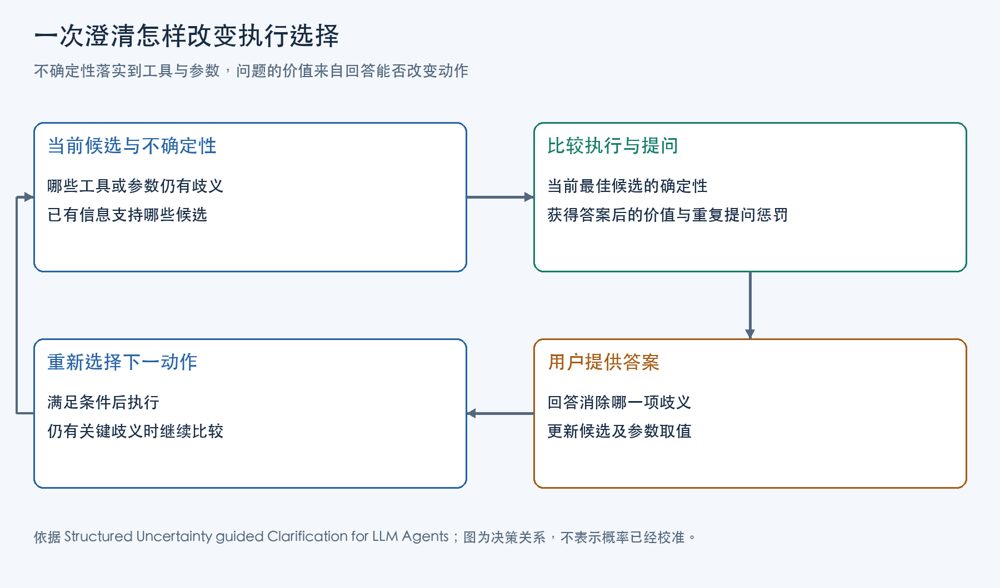

用户向 Agent 说明的是想完成的目标，工具接收的却是具体调用：选哪个函数、操作哪个对象、每个参数填什么。自然语言可以省略双方以为已经知道的内容，API 的必填字段却必须得到一个值。澄清决策处理的，正是目标描述与可执行调用之间的信息缺口。

不过，“字段还没填”只描述了调用的表面状态。值可能已经藏在请求或已有观察里；也可能是系统尚未查询的客观事实；还可能是用户没有表明的意图。前一种需要提取和合并信息，第二种可以查询有权读取的状态，第三种才需要用户作出选择。把三者都交给用户，会重复确认系统本可查明的内容，推迟执行；直接由模型补齐，则可能把未定意图悄悄变成默认动作。两条调用即使都符合参数类型，也可能操作不同对象、产生不同后果。

因此，判断是否追问，需要先知道还剩哪些可行调用、它们的差别来自哪里，再判断回答能否帮助选定动作。Manan Suri 等人的《Structured Uncertainty guided Clarification for LLM Agents》为后半个问题提供了具体机制：SAGE-Agent 在“询问用户”与“执行当前最佳候选”之间选择，以最佳候选的结构权重增量衡量问题价值，再扣除重复询问同一参数的惩罚。这是一种围绕候选区分的评分目标；等待时间、隐私和错误动作的损失，还需要产品另作取舍。

## 通讯录里的两个 Alex，是否都要问

论文 Figure 1 给出一个通讯录示意：用户希望拨打工作上的 Alex，通讯录中有 Alex C. 的工作号码和 Alex M. 的家庭号码。如果系统已经取得这些记录，“work”就能排除只有家庭号码的候选。此时再问“你指哪个 Alex”，没有利用已有信息。

关键在于把请求与工具需要的参数放到一起。自然语言里出现两个同名联系人，看起来有歧义；工具调用所需的是具体联系人与号码类型，用户给出的“work”已约束其中一项，而通讯录又提供了它与联系人之间的关系。两个约束合用，候选可以缩到一个。

这也把两类未知分开了。联系人有哪些号码，是通讯录中的客观状态；用户想联系哪一位，是执行意图。当现有状态和请求能唯一确定目标时，系统可以继续调用。假如仍有两位 Alex 都有工作号码，需要用户补充的才是这两位之间的选择。后一个变化是依据论文示意作出的机制推导：增加一个同样满足条件的联系人，原本足够的限定词便不再足够。

这里的查询与询问承担不同职责：查询补充系统可读取的事实，询问取得事实仍不能确定的用户选择。检索在 SAGE-Agent 的工具集合里属于一次可执行调用；论文评估的是 ask/execute，没有单独验证一套通用的执行、检索、追问三路政策。

澄清系统首先要保留这种差别。若模型只是判断一句话“模糊程度很高”，它没有说明哪个字段阻碍调用；若直接填入最熟悉的联系人，候选差异又被隐藏了。把未知保留在参数上，系统才能计算下一句话是否有用。

## 用候选调用表示工具与参数的不确定性

SAGE-Agent 的输入包括用户请求、工具定义和已有观察。模型据此生成若干候选调用；可以确定的参数填写具体值，无法确定的参数保留为 `<UNK>`。候选描述了某个工具以及它的一组参数赋值，因此“工具选错”和“工具对、目标参数错”都能在同一表示中出现。

候选能取什么值，要先有依据。[工具定义](/posts/pi-mcp-tool-exposure/)提供参数类型、必填要求和允许范围；请求进一步给出约束；工具执行结果与用户回答进入观察，补充具体状态。在 Alex 示意中，通讯录记录提供具体联系人及号码类型，“work”限定号码类型，二者合用才能排除不匹配项。工具定义本身不会凭空带来完整通讯录。

系统将参数仍允许的值保存为取值域：已经确定的字段只剩一个值，未知字段仍有多个值。模型根据这些材料提出有限候选，可以把具体联系人分别列出，也可以在尚未确定的字段保留 `<UNK>`。随后评分程序利用域计算候选权重。这里先有工具与观察约束，再有模型候选，最后才有权重；权重无法替代前两步取得缺失事实。

论文采用均匀工具先验，并假设同一工具内参数在给定条件下相互独立。已指定参数的因子取 1；有限未知域的因子取域大小的倒数；连续未知域使用一个很小的 ε。各参数因子相乘，再对候选权重归一化。未知取值越多，候选需要补齐的信息越多，在这套模型下的权重通常越低。

这些数值表达的是当前工具定义、域约束与候选集合下的结构确定性。它们的来源决定了怎样读它们：工具先验取均匀值，没有利用真实用户的历史偏好；独立性假设简化了参数关联；候选还由语言模型提出。若真实联系人根本没被列入候选，一个错误候选也可能得到很高的归一化权重。

因此，执行阈值的含义是“在目前列出的可能调用里，最佳候选是否足够突出”。使用者还要检查候选覆盖和域解析，才能判断这个突出程度是否有可靠基础。提高阈值无法找回一个被漏掉的候选。

## 问题的价值来自回答后的选择

一个问题只有把仍可能执行的调用区分开，才能帮助系统决定动作。SAGE-Agent 用回答前后最佳候选权重的变化近似衡量这种帮助。有了候选权重，系统先记下当前最佳候选的权重 `m`。然后对每个备选问题，估计用户回答之后最佳候选能达到多高的权重，减去 `m`，得到问题的期望价值。论文称之为完美信息的期望价值，EVPI：

```text
m = 当前最佳候选的权重
V(q) = 按各回答的概率加权求和(回答后的最佳候选权重) − m
```

“最佳”在回答以后重新选择。一个回答可能确认当前领先候选，也可能排除它，让另一个候选成为最佳；只要回答让最终动作更确定，问题就可能有价值。判断重点是动作选择得到多少帮助，而非问题听起来是否周全。

可以用四个等权候选解释这个计算。它们是一个抽象候选集合，按论文 Eq.3 推导：当前每个候选权重都是 1/4，最佳值也为 1/4；这个数来自等权假设。如果一个问题的答案把候选均分为两组，每组剩两个。两个回答在等权假设下各以 1/2 的概率出现，所以回答后最佳值的期望为 `1/2 × 1/2 + 1/2 × 1/2 = 1/2`，减去当前的 1/4，价值为 1/4。另一个问题若能唯一选出四者之一，回答后的最佳值为 1，价值为 3/4。

这个计算显示了“问到相关内容”与“解决动作差异”的距离。若问题无论得到什么回答，都不能排除候选，或者回答早已在观察中，更新后的最佳权重不变，价值接近零。通讯录中已由“work”确定 Alex 时，再问姓名就是这样的多余步骤。

实际系统还需要估计一个问题能解决哪些参数。SAGE-Agent 让模型生成问题，并标出它针对的工具及参数，称为 aspect；其算法用“所问参数得到完整解决”的近似来计算价值。于是，问题是否清楚、用户能否回答、回答能否被解析成约束，会影响理想价值能否实现。这里计算的是依据参数域建立的近似，不能把 3/4 这样的理想增量直接当作真实交互中的正确率提升。

## 回答必须改变参数域，循环才能前进

用户回答后，SAGE-Agent 将回答解释为参数约束，与原有取值域求交集，再重新归一化候选权重。已问次数也随之更新。下一轮看到的应当是缩小后的域，而不是只多了一段对话。

回到 Alex 示意：限定到工作号码后，家庭号码对应的候选被排除；如果用户进一步指定了某位联系人，联系人字段就收缩为一个值。决定目标的回答已被解析为域约束，下一轮可以据此排除不匹配的调用，而不只依赖模型重新理解整段对话。

若回答与已有约束不相容，交集可能为空。工程上此时需要检查是原有候选遗漏、回答解析错误，还是请求真的不可行；机械地在空域上继续归一化，会掩盖问题。若用户回答只解决一部分内容，也应保留剩余未知，不能因为“用户已经回复”就把整条调用当作完整。



## 重复惩罚与停止条件一起决定还问不问

有信息价值的问题仍可能重复。系统可能已经问过某个参数，却因为回答没有被解析为域约束，候选权重保持不变，下一轮又生成近似问题。此时要检查回答怎样进入状态；继续换措辞追问，无法修复这条更新路径。论文把每个 aspect 被询问过的次数保存下来，用以下规则计入代价：

```text
C(q) = λ × 问题涉及的各 aspect 既往询问次数之和
选取净收益最大的 q：V(q) − C(q)
```

第一次询问一个 aspect 时，次数为零，该项没有重复惩罚。第二次再问，即使换一种措辞，也会增加成本。计数依赖的是工具和参数，而非句子是否逐字相同；“你说的是哪位联系人”与“能确认一下联系人吗”可能仍在询问同一字段。

这也限定了“追问成本”的含义：公式直接建模的是重复询问惩罚。它没有为每一句话统一扣除等待时间或打扰费用，也没有把一次错误交易的损失写进目标函数。第一次提出很长的问题，在这项成本里仍可能为零。λ 越大，系统越不愿再次询问已经覆盖的参数；它并不自动代表所有用户都更不喜欢追问。

每次更新后，系统重新计算权重；达到执行阈值 `τexec` 时，选择当前最佳候选执行。尚未达到阈值，则生成问题，计算 `V(q) − C(q)`，选出净收益最高的一题。如果这个最大值小于停止线 `αm`，也会停止追问，执行当前最佳调用；否则才把问题交给用户。`m` 是本轮最佳候选权重，`α` 控制继续提问所需的最低增益相对于 `m` 的大小。同样的候选状态下，增大 `α` 会更容易触发停止。另有最大步数限制；执行出错时，可以生成修正调用或针对错误的问题重新评分。

第二种停止并不表示未知已经清零，而是继续问在当前评分下不够有价值。即使仍有两个候选，只要备选问题都不能有效区分它们，或重复惩罚已使净收益低于 `αm`，系统也会选择当前最佳调用。因而评估时要同时看停止发生时的正确调用和剩余歧义。只观察问数减少，无法分辨系统是利用信息更好，还是提早做了决定。

## 信息有价值，取得它是否值得

如果产品要按耗时、隐私或错误操作损失决定是否追问，需要在这个机制外增加相应效用与代价。那会改变问题排序。例如能让目标完全确定的问题，也可能要求用户披露不应取得的信息。结构化候选解释了问题解决什么，产品规则还要决定这项信息能否取得、取得它是否值得。

这个区别也影响查询的选择。通讯录记录等客观状态可以由查询工具取得，但查询能否访问这些记录、取得信息是否需要额外等待，属于信息来源和产品约束。若差异只在用户想联系哪一位，增加外部检索也无法替用户决定。先识别缺口来自状态还是意图，才能把候选评分用在合适的下一步上。

错误后果同样会改变决策。原评分把“最佳候选更突出”作为收益，两个候选之间选错的后果没有进入该公式。如果某类动作出错损失更高，产品可能需要更严格的确认条件，或把错误损失纳入行动效用后重新比较。仅提高执行阈值仍不够：净收益过低也是一条执行路径，规则必须覆盖这条路径，才能把产品要求落实到实际行为。

## 少问且做对，才是需要共同检查的结果

ACL Findings 2026 正式版的 ClarifyBench 包含文档、车辆、股票、旅行和文件五个领域、92 个工具，覆盖明确、歧义和不可行请求。交互使用语言模型模拟用户；实验把各方法放进共同的 ReAct scaffold，对比正确工具参数调用与追问数量。

在 GPT-4o 的歧义任务上，正式版 Table 3 给出：

| 方法 | Coverage | 平均问题数 |
|---|---:|---:|
| Active Task Disambiguation | 45.60% | 3.42 |
| Domain-aware ReAct | 55.70% | 2.56 |
| SAGE-Agent | 59.73% | 1.39 |

Coverage 要求预测工具及全部必填参数值与基准答案完全一致，衡量的是正确工具参数调用的比例。SAGE-Agent 相对 Domain-aware ReAct 增加 4.03 个百分点，同时平均问题数减少约 45.7%。这两个变化共同支持“在该基准上更有效地利用澄清”，而不只是更早停止。真实用户的满意度、等待和隐私取舍，还需要相应交互实验。

把这套机制接入自己的 Agent 时，最值得保存的记录是每次提问前的候选、问题针对的参数、回答产生的域变化，以及停止后的实际调用。这样，一句多余追问可以回溯到未利用的观察，一次错误执行可以回溯到候选遗漏或过早停止。这些记录能把“问得太多”或“执行错了”定位到具体的信息来源、状态更新和停止规则。

## 主要参考资料

1. Manan Suri、Puneet Mathur、Nedim Lipka、Franck Dernoncourt、Ryan A. Rossi、Dinesh Manocha，University of Maryland, College Park 与 Adobe Research，《Structured Uncertainty guided Clarification for LLM Agents》，Findings of ACL 2026，§4—5、§7—8、Table 3。
