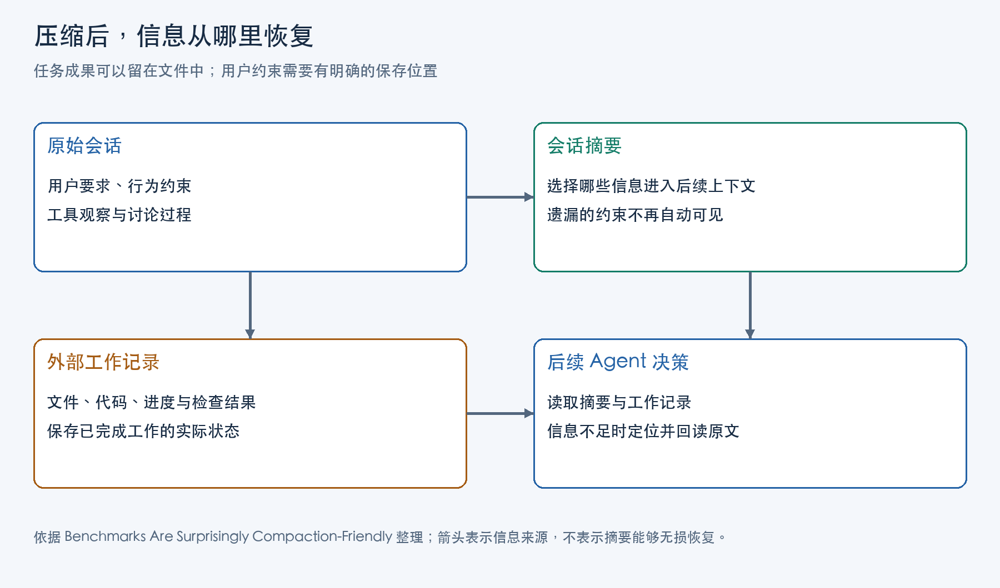

Agent 每调用一次模型，都要由运行框架组织这一轮输入：指令、会话消息，以及已经取回的工具结果。任务持续推进时，新的搜索结果、文件内容、尝试和修正不断加入历史；模型的上下文窗口却有容量上限，长任务不能始终把完整轨迹放进每次调用。

上下文压缩（context compaction）通常在接近窗口预算时，把较早的对话与工具记录改写成摘要，再用摘要组织后续输入，为新交互腾出空间。Anthropic 的工程文章《Effective context engineering for AI agents》把这种做法与窗口外的持久笔记区分开来：笔记保存之后，仍需在后续调用中重新取入。磁盘上的代码、文件和测试结果可以继续存在，只有运行框架把内容加入输入，或 Agent 调用工具读回内容，它们才进入这一轮模型可见的材料。

压缩要解决的问题，是缩短输入之后，Agent 仍能依据必要的信息继续工作：目标是什么，哪些事实已经确认，工作做到了哪里，还有什么没有解决。用户指定的修改范围、执行顺序和后来补充的要求，也属于这些信息。摘要若只记下进度，后续执行仍可能遗漏要求、重复失败的尝试，或者把尚未验证的工作当成已经完成。

## 哪些信息应该优先保留

核心信息取决于接下来要完成的任务。判断一项内容是否需要保留，可以先问：后续执行看不到它，会不会改变目标、选错操作，或者误判结果？再看它能否从已有文件、系统状态或原始记录中重新取得，以及重新取得需要多少工作。

按这个标准，压缩前可以先整理以下内容，再决定如何缩短历史：

| 内容 | 要保留的具体信息 | 丢失后可能影响什么 |
|---|---|---|
| 任务目标与完成条件 | 要交付什么，依据什么判断完成 | 后续执行偏离目标，或过早结束 |
| 必须遵守的要求 | 可修改范围、执行顺序、用户后来的纠正 | 操作越界，或沿用已经失效的要求 |
| 已确认事实与决定 | 工具观察、选定方案及决定理由 | 重复调查，或把猜测当成事实 |
| 当前工作状态 | 产物位置、对应版本、检查结果 | 接错版本，或把旧检查当成当前结论 |
| 未完成事项 | 尚待验证的判断、阻塞原因与下一步入口 | 漏掉剩余工作，或重复无效尝试 |

这些信息不必全部展开写进摘要。当前目标、关键要求和未决事项需要让下一轮直接看见；较长的测试输出、文件正文和探索记录，可以保存到窗口之外，在摘要中留下可定位的入口。已经被后续结论替代的中间讨论，则可以减少篇幅，同时保留仍影响方案选择的原因。

压缩前要先确定后续工作需要什么，再生成摘要。只要求“保留重要内容”，却把重要性的判断完全交给摘要生成器，仍可能漏掉那些出现次数少、却会改变下一步操作的要求。

## 工作文件能恢复哪些信息

Jeanne Salle 等人在 2026 年论文《Benchmarks Are Surprisingly Compaction-Friendly》中，固定 OpenCode 执行框架，替换上下文压缩策略，观察长任务成绩与摘要中的信息保留。理解这项研究，可以先看它所用任务的一项共同条件：任务目标固定，工作进展能够留在文件系统中。

在这种条件下，摘要即使省去了许多探索过程，Agent 仍可以重新读代码、检查当前文件、查看已有结果，推断接下来该完成什么。文件承担了窗口之外的一部分状态保存职责。基准若主要根据最终成果评分，就会奖励这种恢复能力。

用户对过程和范围的要求，未必在成果里留下可逆推出的痕迹。代码显示某项功能已经实现，却无法单独说明用户是否允许改动依赖版本；测试结果显示目前哪些测试通过，却不能说明用户先前是否要求先讨论方案、再执行修改。许多不同的工作要求都能产生同一个最终文件，因而不能从文件唯一重建原来的要求。

论文对 SWE-chat 中 44 段真实人机编程会话做了进一步审计，从中提取 269 条用户提出的要求，包括功能、工作过程和不应改动的范围，再让模型判断它们是否保留在下一份摘要中。功能要求的遗漏比例为 6.2%，过程要求为 35.9%，范围排除为 36.8%。测量对象是摘要是否记下要求，而非后续执行是否违反要求；更换裁判后，整体遗漏率从 19% 变为 24.5%，两位裁判都显示过程与范围要求更容易丢失。

功能要求与当前产物关系紧密，摘要容易围绕“正在做的东西”组织；过程要求可能只存在于较早的用户消息里。一旦摘要没有把后者带入新窗口，后续 Agent 就少了一条本来应该影响选择的依据。

## 多轮压缩中的信息遗漏

Guanghui Min 与 Chen Chen 的研究用四部分描述它所研究的压缩边界：固定提示、上一份摘要、此后新增的交互，以及最近一次交互。运行框架在每轮输入中继续加入固定提示；压缩器把旧摘要和较早的新增交互替换为新摘要，最近一次交互原样保留。下一次模型调用因此收到固定提示、新摘要和近期交互。这里的固定提示包含最初的任务指令；其他 Agent 是否保留近期消息、保留多少，需要看各自的压缩策略。

如果某项要求既不在固定指令里，也没有在近期消息重述，新摘要就是它进入后续上下文的主要通道。摘要漏掉它之后，下一轮压缩器看到的已经是缺少该要求的旧摘要。压缩器再认真地“更新进度”，也没有依据补回那条原话。

Salle 等人的论文在 ProgramBench 中观察到的就是这种累积路径：任务的三类规则只在开头出现，第一次压缩平均已经遗漏约一类，后续摘要继续沿用前面的缺失。保留提示里写着“保留约束”，仍需检查输出是否实际包含了这些约束。每条具体规则是否进入摘要，需要逐项核对。

工具输出清理则发生在另一层。Salle 等人所测的一种策略只替换较早的工具返回值，保留调用的工具名和参数；用摘要替换会话历史，会重新选择并改写跨消息的信息。前者可能去掉重新查看状态的材料，后者还会改变用户要求与工作决策的表述。两种操作可以组合，检查时应分别追问删掉的对象是什么。

图中的工作记录负责指向当前成果；原始会话负责保留要求与观察的出处。只有后续执行确实沿指针读取了材料，这些窗口外的信息才会参与当前决策。

## 摘要中的错误推断

压缩不只是删除。为了写清“当前状态”和“下一步”，压缩器会解释先前发生的事情，这一步解释也可能产生错误。

Guanghui Min 与 Chen Chen 的论文《Prune the Summary, Not the History: Source-Judged Compaction for Long-Horizon Agents》研究了这条路径。它所分析的结构化摘要包含决定、待办和用户待处理请求。摘要中的一项待办可能来自实际工具观察，也可能是压缩器根据任务自行推断的安排；后续 Agent 看到它们时，两者已经具有相近的文字外观。

在论文提供的 AppWorld 基准轨迹中，用户要求复制昨天的习惯记录，并将今天的冥想项记为否。摘要却把这个要求解释成删除冥想这一行。后续 Agent 按摘要中的安排执行，就会把“保留条目、修改值”变成“移除条目”。错误发生在两种操作之间的语义转换，并不需要丢失整个任务目标。

作者提出的 Source-Judged Compaction，简称 SJC，在候选摘要生成后逐条检查来源。它按标题下的条目拆分摘要，为每条检索相关环境输出，再连同旧摘要交给来源裁判；低于判定阈值的整条删除，保留的条目保持原文。论文的实现用 BM25 找到相关文本片段，再扩展到较完整的上下文块，以免只凭孤立短句作判断。

旧摘要也在来源池里，因此 SJC 检查的是候选条目有没有依据，不会逐轮回到最初原文重新核实所有事实。已有来源中的错误仍可能被带过来；合理但尚无观察支持的新计划也可能被删去。

在上述习惯记录轨迹里，删除那条缺少支持的摘要安排后，Agent 重新读到了仍然原样保留的用户要求，最终将值设为否。原要求还在当前上下文中，错误待办遮蔽了它；移走待办后，模型可以重新解释原要求。原要求若已被压缩掉，恢复时还需从原始记录取回。

这一恢复依赖实验保留的固定任务提示与最近交互。多轮会话中，较早的用户修正可能属于被压缩的消息；要延续这些要求，还得为它们保留摘要之外的回读路径。

## 摘要、工作记录与原始记录的分工

依据这两项研究中的信息依赖，可以把后续执行需要的材料组织成三类：摘要让接手者知道方向，工作记录定位成果，原始记录回答精确要求与观察从何而来。

摘要适合保存当前目标、主要进度、未决问题和下一步入口。会改变后续操作的要求，应简明写出；需要精确核对时，再附上对应原消息的编号与位置。运行框架维护这些引用，并记录后来哪条消息更新了要求。这样，下一轮既能直接看到当前要求，也能按引用取回原话，而不用从一个含混的“详见历史”重新搜索。

工作记录可以把产物位置、对应版本、已做检查及检查结果连起来。接手者读到“某项检查通过”时，必须知道检查针对哪个版本；否则文件已经改变，旧结论仍可能被当成当前状态。对于尚未验证的工作，记录应保留其身份，避免在摘要中被缩写成“已完成”。

原始会话与工具记录承担精确回查。运行框架可以在相关决策前按记录编号取回当前有效的消息，把原文及适用范围加入下一次模型输入；也可以提供检索工具，由 Agent 发起读取，再将返回内容带入窗口。前一种安排由框架触发，后一种还依赖 Agent 选择何时读。持久索引保存对应关系，读取动作才把窗口外的原话交给当前执行者。

这也解释了落盘方案的一个难点。第一篇论文在压缩前把完整历史序列化到文件，再在摘要里告知路径，实验并未显示它稳定优于默认摘要。文件保存只解决“还能否取得”，没有替 Agent 完成“何时应读、去哪里找、找到后怎样影响行动”。若只给一个庞大历史文件，执行者仍可能直接沿摘要往下做。

可供检查的读取规则应靠近决策点：准备扩大修改范围时核对范围要求，准备把未决事项写成完成时核对产物和检查记录，准备执行摘要里的待办时核对它是用户要求、已定决定还是压缩器的新推断。每次回查都有一个需要回答的问题，才不至于把“保存历史”变成另一个很少使用的功能。

## 如何检查核心信息有没有丢失

检查可以从压缩前整理的核心信息开始，逐项核对压缩后的输入：当前目标和完成条件是否还在，较新的要求是否覆盖了旧要求，已确认事实是否保留来源，未完成事项是否仍被标为未完成。用这份清单对照新摘要，才能发现本轮少了什么；只比较新旧摘要的相似程度，可能会继续接受旧摘要已经发生的遗漏。

对于移到窗口之外的内容，还要检查引用能否取回正确版本，以及需要它的那次调用是否实际读到了它。成果检查回答文件是否达到目标；执行轨迹则回答 Agent 是否依据保留下来的信息采取了正确操作。例如摘要写着某项检查已经通过，应能定位受检版本；文件后来改变时，这条旧结果不能继续充当新版本已经验证的依据。

对有来源检查的摘要，还可以逐项追踪：某条决定依据哪段观察，删除后是否仍有足够材料继续，保留下来的错误是否来自旧摘要。这样能够分清“没有把原要求带过来”和“带来了一项无依据的新安排”，修复时也就知道该补保存路径，还是该限制摘要生成的新解释。

[Agent 压缩总成本分析](/posts/agent-compression-total-cost/)讨论压缩在后续运行中带来的成本变化。评估压缩是否有效，还要看省下上下文之后，Agent 能否继续完成原来的任务：关键内容留在当前输入，详细材料有可用的读取入口，摘要里的事实和待办能与来源核对。减少文本的同时保住这些信息，压缩才有实际收益。

## 主要参考资料

1. Anthropic，《Effective context engineering for AI agents》，2025。
2. Jeanne Salle、Hardik Bhatnagar、Matthias Bethge、Sahar Abdelnabi、Maksym Andriushchenko，《Benchmarks Are Surprisingly Compaction-Friendly》，2026。
3. Guanghui Min、Chen Chen，《Prune the Summary, Not the History: Source-Judged Compaction for Long-Horizon Agents》，2026。
