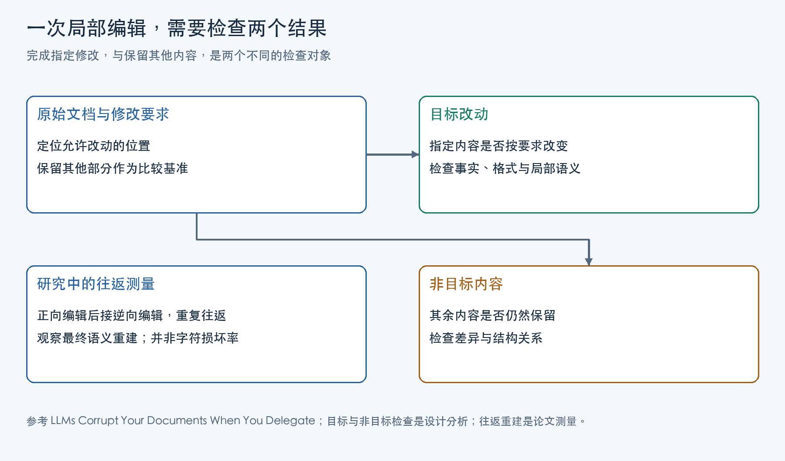

让 Agent 修改文档时，要求往往同时包含两部分：指定对象按要求改变，其余内容继续成立。第一部分出现在修改指令中，第二部分常常隐含在“只改这里”“保持其他内容”的表达里。

如果 Agent 重新生成整份文档，未要求修改的内容也会再次经过生成过程；检查者若只看指定修改是否出现，就会漏掉这些区域发生的变化。Agent 编辑的正确性因此需要两个观察对象：目标关系是否改变，以及非目标内容是否保留。

这两项检查怎样落地，取决于编辑对象。替换一个字段，可以要求字段之外的内容保持；把账本按类别拆成多个文件，几乎所有记录的位置都会变，应当保留的是记录内容及其关系。验收要先定义哪些变化属于任务，再决定比较字节、字段还是整条记录。

## 定义编辑对象与允许修改的范围

文档在文件系统中是一串字节，在编辑任务中却可能有不同粒度的对象。对逐字替换，目标是由上下文定位的一段文本；对 JSON 字段修改，目标是某个对象中的键和值；对账本分类，目标是每条记录与输出文件的归属关系。位置、内容和对象身份要分别考虑。记录换了行号，未必变成另一条记录；同一个位置上的值没变，也未必仍属于原来的对象。

可以把一次编辑记为原始版本 D、允许改变的对象及属性 A，以及预期改变关系 T。候选结果 D′ 需要同时满足两类条件：T 在结果中成立，A 之外应保留的内容与 D 一致。A 应细到属性：允许移动整条记录，不意味着允许改动其中的金额。

| 任务中的对象 | 允许发生的变化 | 保留检查的依据 |
|---|---|---|
| 精确定位的文本片段 | 替换该片段 | 片段之外的字节保持一致 |
| 结构化对象的字段 | 指定字段的新值 | 对象身份、其他字段和值保持一致 |
| 拆分、重排中的记录 | 所属文件或排列位置 | 记录数量、重复次数及应保留字段一致 |

原始版本是这些比较的共同参照。只留一份修改后的文件，检查者可以判断它是否能解析、排序是否正确，却无法知道某个值是否被改写、某条记录是否被遗漏。编辑开始前保留源版本，也使“只改这里”有了可核对的含义。

格式有效性属于另一项基础检查。合法 JSON 中的数值可以与原文不同，能够解析的账本也可以少一条记录。解析器使检查者取得对象，随后仍要验证对象是否按要求改变、是否与原对象对应。

## 局部补丁的内容保留范围

当任务是修改一个边界清楚的局部值，允许写入的范围可以很小。精确文本补丁只替换匹配区域，其余字节由应用程序从原文件保留，不必让模型重新预测。这种写入方式只允许明确的补丁区域进入文件。

保留范围还与编辑工具操作的层次有关。文本补丁可以保留区域外的原始字节；结构化编辑器修改 JSON 的一个字段后，可能重新序列化整个对象，空格和键顺序随之变化。后者可以保留其他字段的值，却未必保留原文件排版。若要求逐字保留，应让写入方式和验收都落在字节层；若允许重新排版，就按字段及对象关系比较。

RFC 6902《JavaScript Object Notation (JSON) Patch》给出了结构化补丁的具体规则：操作用 `path` 指定位置，`replace` 要求目标位置已经存在，`test` 将当前位置的值与给定旧值比较。按这一规范，可以在同一路径上先执行 `test`，确认当前值符合预期，再执行 `replace`。操作按数组中的顺序处理，遇到错误时停止，整个补丁不能视为成功。

这里有三个不同的问题。路径回答“写在哪里”，旧值检查回答“这里是否仍是预期输入”，编辑要求回答“这个对象是否应该改成这个新值”。前两项成立，第三项仍需要独立判断。Agent 可能给错误对象选了一个有效路径，也可能在正确对象上填入不符合要求的新值。多个对象具有相同旧值时，`test` 尤其无法单独识别目标身份；应依据稳定键或明确上下文确定对象。

源版本检查处理的是更大的范围。目标字段的旧值相同，其他字段也可能已被另一位编辑者更新。若候选结果根据旧版本生成，覆盖当前文件可能抹掉这些更新。记录源版本标识，在应用前核对当前版本；版本变化时重新取得文档、定位对象并生成候选，才能继续使用原先的保留基准。

对必须逐字保留的区域，可以比较字节差异或分块哈希。检查所有差异是否落在获准范围内。一次很短的意外差异，也可能改变重要数值；一次很长的指定替换则可能完全正确。差异范围检查与目标新值检查结合，才覆盖这次局部编辑的两项要求。

图中把局部编辑拆成目标与非目标两条检查路径。对于全文重排，这一区分仍然成立，但“非目标”要按应保留的内容属性划分，不能直接沿用原来的行位置。

## 账本拆分与合并的完整性检查

微软研究院 Philippe Laban、Tobias Schnabel 与 Jennifer Neville 在 2026 年论文《LLMs Corrupt Your Documents When You Delegate》中提出 DELEGATE-52。其账本任务采用非营利组织 Hack Club 的真实文档：正向任务按支出类别拆成多个文件，逆向任务再按时间顺序合回一个账本。

这个任务移动了几乎全部记录，用“不许改动其他行”描述保留范围没有帮助。依据任务要求，可以把一次拆分的验收分成分类结果与记录内容，再为合并增加顺序检查。以下是从这一真实研究任务推导的验收设计。

先从源账本取得完整记录，明确一条记录包括哪些字段，以及类别怎样判断。类别可能依赖账户或其他记录属性；分类检查需要有独立于候选文件名的规则，才能判断归属是否正确。若仅看到输出文件名包含类别名就通过，文件内部仍可能放错记录。

取得候选文件后，逐条检查其中的记录是否属于该文件对应的类别，要求的类别是否各有对应输出。这是目标验收。所有原记录原样留在一个文件里，即使一条都没有损失，也无法通过拆分要求。

接着把所有候选文件的记录合在一起，与源记录对应，核对日期、金额、账户及其他应保留字段。记录有稳定身份时，可以按身份逐条比较；没有稳定标识时，可以用应保留字段组成记录表示，比较其多重集合。多重集合保留每种记录出现的次数，普通集合会先去重：把两条字段完全相同的记录错误地合成一条，普通集合仍可能相等。

这里的对应关系还决定检查该放在哪一层。只分别验证各输出文件内部没有重复，无法发现一条源记录被写进两个文件；只数全部记录，无法发现少了一条、又多了一条。把所有输出与源记录一起比较，才能同时观察遗漏、重复和字段改动。

逆向合并要求按时间组织，检查者应验证日期排序，同时核对全部记录是否仍然存在。若任务没有指定同日记录的次序，可以要求日期非递减，并保留同日记录的完整内容；若已有明确的同日排序规则，再把它加入目标关系。排序只约束记录的排列，不负责证明记录齐全。

各类别金额汇总可以作为辅助不变量，但相同总额也可能由一笔漏记和另一笔重复相互抵消，所以总额不能代替逐条对应。记录保留、分类归属与排序各自回答不同问题。完整记录可能分错文件，顺序正确的账本也可能有缺项。将它们合成一个笼统的“编辑成功”判断，会失去定位错误的依据。

## 用往返编辑实验检测内容丢失

上述验收需要源版本作参照。DELEGATE-52 利用可逆变换，将这一思路扩展到多次编辑测量：原始文档 s 经正向编辑得到 t，再执行逆向编辑得到重建文档 ŝ。若两次编辑都正确，ŝ 应与 s 在该领域的语义上等价，原文因此成为重建结果的参照，不必为每种中间形态人工制作标准答案。

主实验覆盖 52 个领域、310 个环境和 19 个模型，连续完成十次往返，共二十次交互。每次编辑都在独立的单轮会话中进行，前一次输出作为下一次输入。论文把 k 次交互后的重建分数记为 RS@k；RS@20 比较的是十次往返后的文档与原文。这个测量观察信息如何经过连续变换传递，一次往返的损失本身不能定位错误发生在拆分还是合并。

重建比较也需要选择对象粒度。DELEGATE-52 为各领域定制解析器与相似度；食谱领域把内容解析成原料、步骤与提示，权重分别为 40%、40% 和 20%。“200g”改写为“0.2kg”可以保持语义得分，“200g”变成“800g”则会受到扣分。字符差异的大小与内容变化的重要程度并不相同。

往返方法还要求模型实际执行变换。若它一直原样退回文档，最终仍会很像原文。论文另行检查指令执行，发现部分执行可能高估完整任务能力。对应到拆分任务，即使最终重建分数很高，也仍需检查中间结果是否真的按类别组织。这正是目标验收不能被内容保留检查替代的原因。

工具也要放到实际写入方式中判断。论文的基础工具环境提供文件读写与代码执行，模型仍可选择直接写出文件；四个参与工具实验的 GPT 模型表现都低于各自直接生成的设置。文件写入工具既可以装载一份全文生成结果，也可以保存程序化变换的结果。仅知道“Agent 有工具”，还无法知道哪些内容由程序保留、哪些内容再次经过生成；工程设计要检查具体写入范围与验证过程。

## 候选版本的校验与替换

实际编辑不必每次做一遍逆向操作。可以以保存的源版本为参照，在候选版本中检查目标关系和保留内容，全部满足后再替换工作版本。

对账本拆分，候选是完整的一组类别文件。先解析全部文件，再核对分类与记录多重集合；合并时还要检查顺序。任一条件失败，保留源文件和候选差异，修正就能针对具体的错分、遗漏或字段变化展开。若先覆盖唯一原件，再让 Agent 凭记忆检查，比较依据已经失去。

检查完成与写回之间，工作版本还可能发生变化。因此提交候选时仍要核对源版本，核对与替换应由能防止中途插入其他写入的保存机制衔接。多文件拆分还要以整组候选为单位管理切换，避免工作目录只更新了部分文件。JSON Patch 经 HTTP PATCH 使用时有相应的原子性要求；普通文件逐个写入则需要另行实现成组替换或恢复机制，不能从补丁格式推定这些能力。

自由文本的保留检查更依赖任务定义。重写表达时，可以逐项核对事实、数值、引用关系和必须保留的论证条件；没有稳定解析规则的含义，需要领域规则或人工审读。哈希适合判断字节相等，解析器适合取得结构，二者都需要先有“哪些内容应当保持”的依据。

选择写入与验证方式时，先问任务允许改变什么：边界清楚的局部替换可以用受限写入保留其余字节；拆分、重排和格式迁移则以字段、记录及关系为比较对象。目标关系决定候选要达到什么状态，保留要求决定候选必须继续携带什么信息，两者共同决定这次修改是否可以写回。

## 主要参考资料

1. Philippe Laban、Tobias Schnabel、Jennifer Neville（Microsoft Research），《LLMs Corrupt Your Documents When You Delegate》，2026。
2. Paul Bryan、Mark Nottingham（编），RFC 6902《JavaScript Object Notation (JSON) Patch》，2013。
