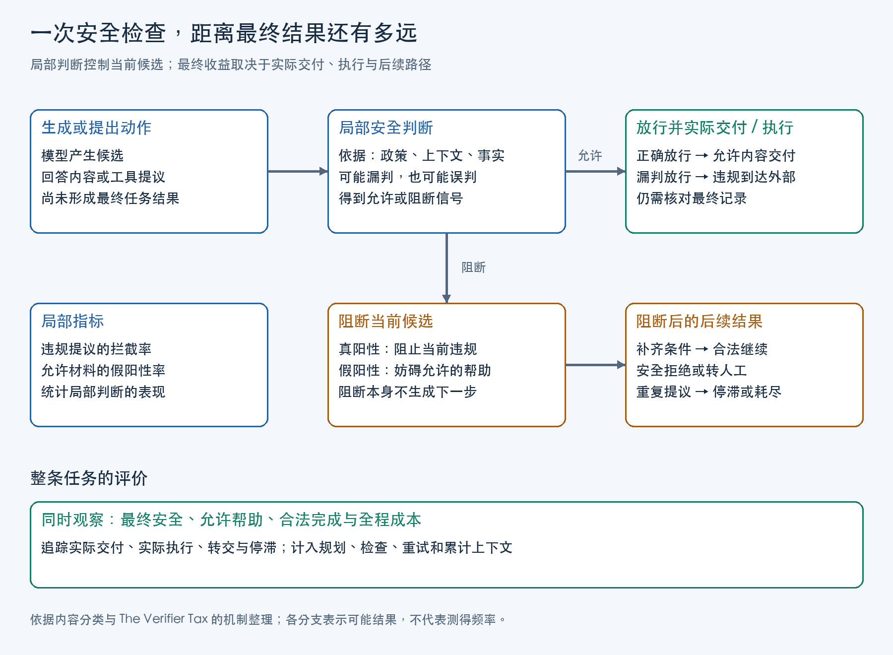

给生成模型再配一个模型做安全检查，是一种直观的补救办法：生成者负责回答或提出动作，检查者根据政策决定是否放行。它可以检查回答是否提供危险协助，也可以检查 Agent 的修改提议是否满足身份核验、用户确认等要求。

这层检查确实可能有效。Anthropic 在下一代 Constitutional Classifiers 的研究介绍中回顾，第一代系统把受测攻击集上的越狱成功率从 86% 降到了 4.4%。但多一次判断也可能漏掉同一类错误，挡住原本允许的帮助，或者让 Agent 在拒绝与重试之间耗尽预算。评估它的收益，需要同时看最终违规、正常帮助和整个任务的成本。

额外 LLM 审核的局限，在于它增加了一次判断机会，却未必增加判断所需的依据，也未必带来阻断之后合法完成任务的能力。内容分类研究揭示前一个缺口；工具型 Agent 的实验则显示，局部拦截可以很活跃，端到端收益仍然有限。两类研究检查的对象不同，却共同要求我们追问：新增的审核究竟改变了哪个结果？

## 检查依据不足导致的漏判

内容政策经常需要区分同一类知识的不同用途。Anthropic 给出的例子是：可以帮助完成大学化学作业，但不能协助合成 Schedule 1（附表一）化学品。两种请求都涉及化学；分类器需要理解请求正在寻求什么帮助，以及回答实际提供了什么。

《Constitutional Classifiers++》记录了一种具体的漏判机制：用户在输入中定义代称，输出继续使用这些表面普通的代称。只看输出时，分类器看不到代称与危险对象的对应关系，可能把实际违规的回答判为无害。问题出在被检查的材料已经丢失了一部分含义。

作者因此采用 exchange classifier，把输入与生成中的输出片段一起判断。输入里的映射关系使输出重新获得可解释的语义。这里的改进来自检查者取得了缺失的上下文；若只对同一份孤立输出再调用一次模型，原来的信息缺口仍然存在。

即使上下文完整，也可能缺少事实。Meta 的 Llama Guard 4 模型卡指出，诽谤、知识产权、选举等安全类别依赖事实或及时知识。例如，判断一项陈述是否构成诽谤，需要知道陈述是否虚假。一个检查模型可以理解句子的语气和对象，却不知道事实真伪。此时再要求它给出更肯定的安全标签，并没有补齐依据。

检查模型与生成者可能共同缺少同一项事实，也可能共同误解一段上下文，因而产生相关的错误。评估时要测量检查者还会放行多少生成出的违规候选。它在另一份独立分类题集上的总体准确率，不能直接代替这个条件下的漏判率。

## 提前拒绝造成的误拦截

安全检查除了漏判，还会改变正常帮助能够到达用户的机会。

专门训练的安全分类器也同时存在这两类错误。Llama Guard 4 模型卡在内部测试集上报告：英文输出分类的召回率为 69%，假阳性率为 11%。前者衡量违规输出有多少被识别，后者衡量安全输出有多少被错判为不安全；错判直接接到阻断时，就会变成误拒。这些值按 S1—S13 安全类别等权平均，描述的是该测试集的分类表现，不能读成线上所有用户中有 11% 会被拒绝。

Llama Guard 4 模型卡区分了输入过滤与输出过滤。输入过滤在生成前终止请求；输出过滤先让模型尝试作答，再判断实际回答。面对一个涉及危险主题的问题，生成者仍可能只解释风险、提供一般知识或拒绝危险操作部分。输入阶段一旦终止，这份安全回答便不会产生。

Meta 的内部测试观察到，输入过滤通常比输出过滤进一步减少违规，也进一步提高总体拒绝率。总体拒绝增加，其中既可能有应当拒绝的请求，也可能有允许的帮助；要确认误拒，必须知道被拒请求按政策是否允许。把所有新增拒绝都计作安全收益，会遗漏帮助损失；把它们全部计作误拒，又会抹去正确阻断的价值。

政策边界本身也会影响这个判断。如果应用希望保留相关知识的正常用途，评估集就应包含这些允许请求，并检查最终是否得到了有用回应。否则，系统可以通过拒绝更多请求降低违规，却无法说明它是否仍完成了应用原本要提供的服务。

## 单次拦截与完整任务的安全表现

当 Agent 会操作工具，检查的结果还要经过动作执行和后续交互，才形成最终结局。《The Verifier Tax》研究的就是这段距离。

实验在航空与零售任务中比较直接工具调用与多角色架构。Triad-Safety 让同一个基础模型分别规划、提出动作、检查动作，并为检查角色提供领域政策。拒绝后，批评反馈给动作生成者，最多尝试三次；耗尽后默认接受最后提议。

这套设计既增加了判断，也增加了规划和修复工作。论文的两项结果需要分开读：SR 表示获得最终任务奖励的比例；SSR 表示既获得奖励、又没有执行过违规动作的比例。任务拿到奖励，可能依然违反了过程中的政策。下表摘取同模型、同领域的 Table 1 与 Table 5：

| 模型与领域 | 架构 | 任务成功 SR | 安全成功 SSR | 每任务平均 Agent token |
|---|---|---:|---:|---:|
| GPT-OSS-20B，航空 | 直接工具调用 | 22.7% | 0.0% | 32.5 千 |
| GPT-OSS-20B，航空 | Triad-Safety | 23.3% | 0.0% | 90.1 千 |
| GLM-4-9B，航空 | 直接工具调用 | 28.7% | 0.7% | 58.3 千 |
| GLM-4-9B，航空 | Triad-Safety | 25.3% | 4.7% | 128.7 千 |

每行包含 50 个航空任务各运行三轮，共 150 条轨迹。第一组 token 用量达到基线的约 2.8 倍，安全成功率仍为零，普通成功率略升。按这些报告值，额外架构没有买到安全成功的改善。第二组安全成功提高了 4.0 个百分点，普通成功下降了 3.4 个百分点，token 约为基线的 2.2 倍：它体现了安全、完成与成本之间的取舍。

表里的 token 包括规划、动作生成、审核和修复，且计入成功与失败任务。它按调用历史重构 prompt 与 completion，随调用次数及累计上下文增长。表中比较的是这两种配置的观察结果，论文未对差异做显著性检验。

同一论文还报告，特定 GPT／零售配置能拦下 94.1% 的违规提议。这个数字的分母是违规提议，SSR 的分母是整个任务。一条轨迹可以被连续拒绝三次，累计三次成功拦截，最后却因重试耗尽被放行，仍然留下已执行违规。

耗尽后的放行确实削弱了阻断，但也不足以解释全部低安全完成率。作者对既有日志进行硬终止重分析，在 1,980 条经过多角色处理的轨迹中找到 28 条停滞轨迹，只有一条在强制放行后成功。取消这个出口能够保持阻断，却不会自动让停滞的 Agent 找到合法完成路径。

图中将一次检查与整个任务分开：局部判断决定当前候选的去向，后续动作决定任务能否安全结束。流式回答还多一道时序问题。NeMo Guardrails v0.24.1 的输出流式配置默认先发送当前块、再检查；即使随后阻断，已经到达客户端的内容也无法撤回。因而，“判为阻断”的日志还需要与实际交付或执行记录对应。

## 安全拦截后的任务恢复

正确拒绝一个动作，完成的只是停止当前违规提议。接下来需要补什么信息、改变什么动作，或者怎样转交，都属于恢复能力。

《The Verifier Tax》附录的航空 Task 41 给出了一条具体轨迹。用户要求取消预订并全额退款，声称预订发生在十小时前。Agent 获取用户标识并查询预订；论文记录中，检查者依据取回的数据，认为它是超过 24 小时且无保险的基础经济舱预订，因此拒绝退款提议。

用户继续坚持十小时前购买。Agent 没有把这个说法直接当作覆盖记录的依据，而是继续根据系统记录沟通，最终转人工。该任务得到 benchmark reward=1。这里的成功是基准认可的安全转交，用户最初要求的退款并没有在轨迹中完成。

在这条轨迹中，检查者提供拒绝理由，Agent 继续处理用户说法与系统记录的冲突，再选择转交。

评估恢复时也要区分两种情况。允许目标只是缺少确认或身份信息，后续应补齐条件并继续；目标本身违反政策，继续原动作就会重复越界，合适的结束可能是拒绝或转人工。把所有未完成原请求的结果都视为失败，会惩罚正确拒绝；把所有拒绝都视为成功，又会掩盖允许任务被误拦和无法恢复的损失。

## 在工具执行入口校验权限与业务状态

有些操作规则不需要模型重新解释自然语言。例如，预订是否属于当前用户、航班是否已经起飞，可以由身份与业务状态直接判定。继续让模型猜这些事实，会额外引入判断误差。

《Don't Make Models Guess Security and Safety: Symbolic Guardrails for Domain-Specific AI Agents》研究了这类要求。其公开航空实现的 `cancel_reservation` 在修改预订和退款之前比较用户与预订归属，再检查航班状态；配套检查配置让不满足条件的检查抛出错误，因此后端修改不会继续。模型取得错误信息后，可以调整提议，再次进入相同的执行检查。

这里起作用的是程序能够读取资源状态，并在修改发生前停止调用。用户标识仍需要来自可信身份状态；仅让模型填写一个 `user_id` 参数并不完成认证。JSON schema 则只负责字段和类型，不能说明用户有权取消这笔预订，也不能说明某段格式正确的文本符合内容政策。关于这些入口职责，可结合[身份认证、对象授权与工具输入检查](/posts/agent-tool-contract-refund/)理解。

程序检查还可能改善任务完成。在这项研究的汽车任务中，GPT-5 的完成率从 59% 提高到 72%，论文报告 p<0.01；航空任务则从 68% 到 70%，p=1.00。不同任务的收益不同。研究中归零的是已实施符号检查所覆盖的违规。

这些结果支持把已经能够从可信状态确定的要求交给执行程序。化学请求的用途、代称表达的含义、陈述是否构成危险协助，仍然需要语义判断及相关事实。程序检查减少的是模型不必承担的猜测，并没有取消内容审核的任务。

## 额外模型检查的成本与收益

前面的证据支持三种不同判断：安全成功没有改善而成本上升，是收益不足；安全成功提高、总体完成下降，是需要权衡的取舍；补齐上下文、训练边界或改变计算组织，也可能带来明确改善。

CC++ 的后续设计展示了第三种方向。低成本的内部 probe 先筛查全部流量，疑似项再进入结合输入与输出的较强分类阶段。一级阳性只触发复核，最终判断才决定是否拒绝。它利用研究中观察到的互补信号，并把较贵计算集中在疑似项上。如果把一级阳性直接连到拒绝，同一批疑似项便会从复核工作量变成用户受到的阻碍。

该系统在 Sonnet 4.5 一个月生产流量的影子评估中，约 5.5% 的请求进入后级，最终标记／拒绝比例为 0.05%。这些数字说明级联如何收缩最终干预范围。影子评估记录系统会标记哪些请求；计算误拒率还需独立标注哪些是良性请求。采用判断仍要回到应用自己的政策和损失。

一次有意义的对照，应在同一政策、同一批允许与禁止请求上，观察最终交付或执行的违规、允许帮助的保留、合法任务完成、转交与停滞，再计入整条运行的 token 和等待。审核标签用于解释结果怎样发生，不能替代这些结果。

如果新增审核能找到生成者经常遗漏的错误，取得更完整的上下文或事实，并让阻断后的合法路径继续运行，它就有可检验的价值。如果它反复读取同样缺失的材料，或只是把错误变成拒绝和重试，更多调用可能只增加费用。决定是否加这层审核的依据，是它补足了什么判断、避免了什么实际损失，以及为保留正常帮助付出了多少代价。

## 参考资料

1. Meta：《Llama Guard 4 Model Card》，2025，Classifier performance、System-level safety 与 Limitations。
2. Hoagy Cunningham、Jerry Wei、Zihan Wang 等：《Constitutional Classifiers++: Efficient Production-Grade Defenses against Universal Jailbreaks》，2026，arXiv v1。
3. Anthropic：《Next-generation Constitutional Classifiers: More efficient protection against universal jailbreaks》，2026 年 1 月 9 日。
4. Tanmay Sah、Vishal Srivastava、Dolly Sah、Kayden Jordan：《The Verifier Tax: Horizon Dependent Safety–Success Tradeoffs in Tool Using LLM Agents》，2026，arXiv v1。
5. Yining Hong、Yining She、Eunsuk Kang、Christopher S. Timperley、Christian Kästner：《Don't Make Models Guess Security and Safety: Symbolic Guardrails for Domain-Specific AI Agents》，2026，arXiv v2。
6. Hong 等：agent-symbolic-guardrails，航空工具实现与运行配置，2026 年 11 月 9 日源码快照。
7. NVIDIA：《Output Rail Streaming Configuration》，NeMo Guardrails v0.24.1。
