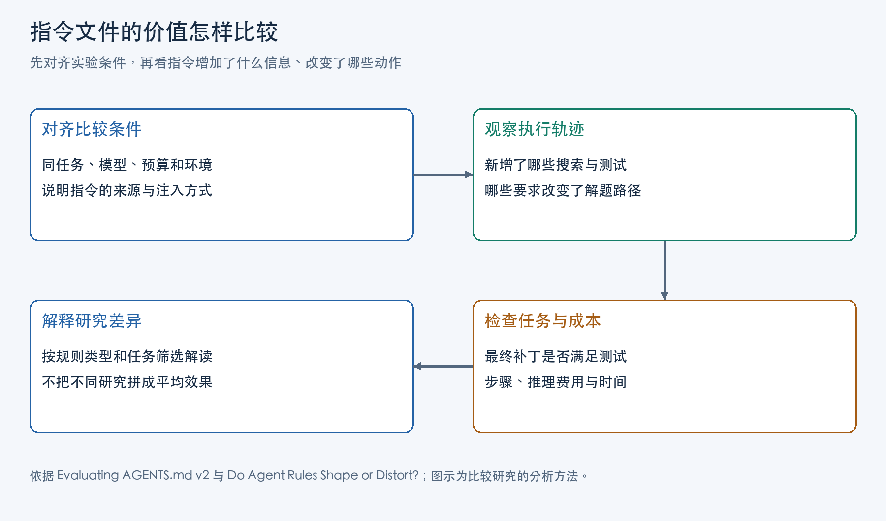

AGENTS.md、CLAUDE.md 是放在仓库里、给编码 Agent 看的说明文件。执行框架按适用范围加载这些说明。文件可以写明项目怎么跑测试、代码怎样组织，以及哪些地方需要保留原样。

加进指令的命令可能让 Agent 多搜几个目录、多跑一遍测试或多读几份文档。这些动作会花时间和 token，是否值得，要看它们对当前修复有什么帮助。

本文借 2026 年的两项研究讨论一条内容该不该留。一项测的是整份文件：有它和没它，Agent 修 bug 的成功率和费用差多少。另一项测的是单条通用规则：加上或拿掉一条，哪些任务变好，哪些变坏。先看这类文件是怎样被 Agent 读到的，以及两项实验各测了什么。

## 仓库指令文件的加载与使用

编码 Agent 的 harness 是连接模型与执行环境的程序：向模型提供读写文件、执行命令等工具，执行模型选出的调用，再将结果交回模型。仓库指令文件是自然语言背景，由 harness 按相应约定载入会话或适用范围。模型将它与任务、代码和工具结果一起用于选择下一步搜索、编辑或测试。

Thibaud Gloaguen 等人的《Evaluating AGENTS.md: Are Repository-Level Context Files Helpful for Coding Agents?》2026 年 6 月 v2，将任务恢复到修复前的仓库状态，分别提供无文件、模型生成文件、开发者已有文件三类条件。各编码配置按其机制取得文件内容，Agent 自行搜索、编辑和测试，评测环境再将生成补丁施加到仓库，用任务测试检查结果。无文件时仍可阅读代码和已有文档；新增文件改变的是提前提供的信息与动作要求。

Xing Zhang 等人的《Do Agent Rules Shape or Distort? Guardrails Beat Guidance in Coding Agents》2026 年 4 月 v1，则在工作目录放入不同的 CLAUDE.md，由 Claude Code 在会话启动时加载。它排除了项目专属规则，只测试可跨仓库的行为要求。两项实验从入口处就有不同：

| 比较内容 | 《Evaluating AGENTS.md》v2 | 《Do Agent Rules Shape or Distort?》v1 |
|---|---|---|
| 指令材料 | 每仓库自动摘要及开发者文件 | 排除项目专属内容后的可迁移规则 |
| 任务分布 | SWE-bench Lite 300 题、11 库；CTXbench 138 题、12 库 | 从 500 题中筛出的 58 个成功不稳定任务 |
| 编码配置 | Sonnet 4.5、GPT-5.2、GPT-5.1 mini、Qwen3-30B-coder 等配置 | Claude Code / Opus 4.6 |
| 主要问题 | 实际仓库文件增加什么修复收益与成本 | 通用规则怎样改变敏感任务的成败与组合效果 |

开发者文件只在拥有这类文件的 CTXbench 上比较。第二项研究先对 500 题各跑三次基线，保留成功一至两次的 58 题；它的主要对照没有纳入始终成功或始终失败的任务。指令是否提供了其他材料中没有的信息、实验筛选了哪些任务、由哪个模型生成动作，都会影响结果。因此，两篇研究的百分比要分别解释。

自然语言要求通过模型的选择影响执行。写下“不要修改某个路径”，模型据此避开动作；如果要让写入请求必然被拒绝，还需要工具或环境实施权限检查。文件内容设计首先处理的是模型怎样理解并选择工作。

## 工具知识与重复说明

一条工具说明可以同时包含事实和要求。说明仓库使用某个命令，为模型提供工具知识；要求它每次任务都运行该命令，则进一步增加了工作。前者的价值取决于原有材料是否容易发现，后者还要判断当前任务是否需要这次执行。

《Evaluating AGENTS.md》的工具轨迹提供了可观察的起点。文件提到 `uv` 时，Agent 平均每题调用约 1.6 次；未提到时不足 0.01 次。有文件时，Agent 还会做更多测试，搜索、阅读和写入更多文件，并使用更多仓库专属工具。工具名称进入上下文后，确实能够改变操作路线。

目录摘要的价值要看它有没有减少定位工作。研究以 Agent 首次接触原始修复补丁涉及文件之前的步骤数来衡量定位速度，仓库概览没有明显缩短这一过程。GPT-5.1 mini 的一些轨迹还多次寻找和读取已经进入上下文的指令文件。提前给出材料之后，模型仍可能新增“寻找说明文件”这项工作。

文档消融进一步检验了信息重叠。作者先生成指令文件，再移除已有 Markdown、示例和文档。在这个替代材料减少的条件下，模型生成文件提高了解决率，该项分析排除了 Claude Code。同一份摘要在别处还能读到相关信息时，与在其他信息来源减少时，具有不同的增量价值。

整理这类内容，可以先对照 README 与代码：文件是否给出了新的工具事实，还是换一种说法重复已有目录？若只是摘要，它是否让模型更早到达相关位置？若命令只适用于一部分工作，执行要求是否保留了这个范围？固定的工具事实可以直接保存；只有使用时机影响正确性时，才需要补充触发条件。

## 规则对搜索、修改和测试范围的影响

《Do Agent Rules Shape or Distort?》从 679 份文件提取 25,532 条规则，排除占比 64.9% 的项目专属内容。这使它更适合回答通用要求怎样改变工作范围。其 Appendix A 中的三条真实规则，可以用来练习内容判断。下表为释义：

| 规则 | 它要求或限制什么 | 整理时应保留的含义 |
|---|---|---|
| 4：做直接解决 issue 的最小、针对性修改 | 将修改集中到本次 issue | “最小”受解决问题的目标约束，不能只追求少改行数 |
| 6：不重构无关代码，不添加多余功能 | 排除与 issue 无关的重构和功能扩展 | 判断对象是“无关”“多余”；为修复所需的改动仍有空间 |
| 17：除非绝对必要，不安装新依赖 | 限制安装依赖这条路径，同时保留必要例外 | 删除例外就会把有条件限制改成全面禁止 |

这三条没有告诉模型仓库里的文件在哪里、测试工具怎么用，而是在改变可选择的动作。规则 4 给出修改目标，规则 6 划出应排除的扩展。两者即使用正、否定两种句式，也可能都使工作集中到当前 issue；判断依据是它们保留和移除了哪些路径。

规则 17 则显示例外为何有用。安装新依赖若只是图方便，限制它可以减少额外变更；若完成修复确实离不开新依赖，“除非绝对必要”保留了这条路。把它缩写成“禁止新依赖”，已经改变了原规则的含义。读者拿到另一条指令时，也可以先找动作、目标和适用范围，再判断是否限制了完成任务所需的工作。

规则 6 有一项具体的组合消融证据：作者从 18 条规则中逐条移除一条，在 35 个任务上观察结果。移除它后，解决率下降 20 个百分点，p 值为 0.016，是逐条分析中唯一达到显著水平的规则。

一种解释是，Agent 原本可能为了“改善代码”扩展修改，规则 6 收缩了这些候选动作，使工作集中于问题相关的变更。实验测到的只是从既有组合中移除一条的边际变化，这个机制尚待轨迹层面的实验检验。其他规则同样影响动作；作者测试的五组规则对中，有两组明显偏离简单相加。

在另外 17 个基线较稳定解决的任务上，单独加入规则仍会造成回归，依赖限制也在影响较差的规则中。限制型规则同样可能挡住任务所需的路径，写成否定句并不让它天然安全。论文标题中的 guardrails 指这些由模型理解的自然语言限制，实际遵循情况仍须从动作和补丁中观察。

## 指令带来的质量变化与额外成本



图中的比较顺序可以用于检查自己的文件：先固定任务、模型、预算与环境，再看新增的动作，最后判断[补丁与成本](/posts/agent-evaluation-system-design/)。只看“模型照做了”，会把规则遵循当作修复收益；只看最终解决率，又无法解释新增工作发生在哪里。

《Evaluating AGENTS.md》v2 中，模型生成文件没有普遍显著提高解决率，却使两套数据集的平均推理费用分别增加约 20% 和 23%。开发者文件相对无文件条件平均提高约 2.4 个百分点，p 值为 0.21；它显著优于模型生成文件，同时也增加步骤和费用。工具轨迹表明规则得到了响应，但新增搜索与测试在这些基准的修复目标上没有表现出普遍收益。

项目还可能要求检查安全性或维护性。保留额外验证，应说明它覆盖了哪项项目关心的行为，并观察是否实际发现问题。推理费用衡量的是 Agent 生成补丁的工作成本，无法直接代表这些额外质量目标的价值。

《Do Agent Rules Shape or Distort?》在选出的 58 题上，基线解决率为 50%，随机规则与整理规则均为 63.8%。同题配对能进一步看清这个增长：随机规则使 12 题从失败变成功，又使 4 题从成功变失败。

```text
净变化 = (被帮助的任务数 − 发生回归的任务数) / 任务数
       = (12 − 4) / 58 ≈ 13.8 个百分点
```

两组规则在样本中的净增益均为正；随机规则与基线的配对检验 p 值为 0.077，整理规则为 0.115，均未达到 0.05 的显著性阈值。这组结果描述的是规则对成功不稳定任务的影响；完整 500 题、其他模型或更广仓库上的平均收益，不在它的测量范围内。

两项研究支持的是不同内容在不同任务上的检查办法。前者让人追问信息是否冗余、调用是否增加成本；后者让人追问规则限制了哪条路径、组合中是否出现帮助与回归。解释指令效果时，需要一起核对它新增了什么信息、改变了哪些动作，以及实验包含哪些任务。

## 根据任务记录保留或删除指令

整理可以从实际发生过的任务开始。先标出每条内容提供的事实、要求或限制的动作，以及适用的任务范围，再对照同一任务有无指令的记录，检查新增搜索、测试、工具调用和修改。

对于工具知识，要找它是否改变了验证路线或缩短了发现过程；对于规则 6 这样的范围限制，要看被省去的是无关重构，还是修复所需的代码变更；对于规则 17，要检查必要例外是否保留，以及实际安装依赖的理由。这样才能判断应保留整句、缩小执行范围，还是删除重复内容。

比较时，把“原来失败、现在成功”和“原来成功、现在失败”的任务都数出来，步骤数和推理费用也一起看。同样修好了一个问题，可能是少走了弯路，也可能是多做了一串无关的事。一条内容要留下来，应该说得出它帮了什么：告诉了 Agent 一件它自己查不到的事，或者拦住了一类它常犯的错。

## 主要参考资料

1. Thibaud Gloaguen、Niels Mündler、Mark Müller、Veselin Raychev、Martin Vechev，《Evaluating AGENTS.md: Are Repository-Level Context Files Helpful for Coding Agents?》，2026 年 6 月 v2。
2. Xing Zhang、Guanghui Wang、Yanwei Cui、Wei Qiu、Ziyuan Li、Bing Zhu、Peiyang He，AWS 与 HSBC，《Do Agent Rules Shape or Distort? Guardrails Beat Guidance in Coding Agents》，2026 年 4 月 v1。
