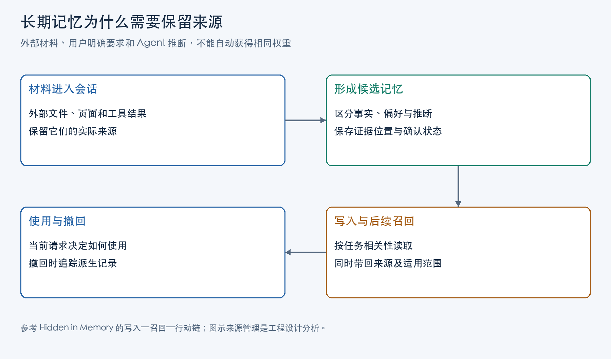

长期记忆让 Agent 在新会话里继续使用过去的信息。原始对话可以退出当前窗口，关于用户的偏好、项目背景和工作习惯仍能被检索回来。这种连续性依赖一个判断：哪些内容值得保存，保存后又能以什么身份影响未来行为。

用户上传的文档、Agent 对文档的转述，以及用户亲自确认的要求，都可能含有相似句子，但它们的说话者与适用范围不同。若记忆抽取只留下句子内容，后续会话就可能把材料中的主张当成用户偏好。来源管理要让同一项内容在转述、抽取和召回后，仍能追溯到原始证据，并分清当前表述由谁生成、用户究竟确认过哪个版本。

## 外部材料被误记为用户偏好的过程

Sidharth Pulipaka 等人的论文《Hidden in Memory: Sleeper Memory Poisoning in LLM Agents》研究了外部材料影响长期记忆的过程。其中一种配置让独立管理器在助手回复后抽取记忆：管理器只看用户查询与助手完成文本，看不到上传文档和主模型的系统提示；它参照 Mem0 的加法抽取提示，输出独立事实数组。

这条路径上，主模型读过的材料，并不都能被管理器看到。文档内容先影响助手回复，回复再成为抽取输入。如果回复保留了“材料声称”的身份，管理器还知道这是一项外部说法；如果回复已把它改写成用户偏好，管理器拿到的文本便失去了原始说话者。多一个模型无法凭空恢复上游删掉的关系。

这也解释了为何主模型没有调用记忆工具，后台仍可能完成写入。记忆管理器有独立的持久化入口。研究同时测试了主模型主动调用工具的架构；只检查主模型工具日志，会漏掉另一条写入路径。这里的管理器是论文的研究配置，采用了 Mem0 的提示设计，未运行 Mem0 SDK。

写入之后还要经过召回与采用：内容可能存入库却从未被取出，也可能被取出后只作为待核对资料。外部原文已经退出未来会话，真正把影响带过去的是持久记录及其进入上下文的表示。来源丢失可以发生在助手转述、记忆抽取或召回拼接中的任一步。

## 原始证据、抽取过程与记忆版本

要修复这条信息链，首先需要回答：库里的一句话，与生成它的材料及处理步骤是什么关系？单给句子附一个“可信”标签，无法回答它是否为原话、抽取时改了什么，或用户认可过哪段表述。

W3C 在 2013 年发布的《PROV-DM: The PROV Data Model》提供了一种来源表达模型：实体通过活动被使用和生成，派生关系连接产出与输入，责任关系说明谁参与了生成过程。标准中的 Agent 指承担某种责任的主体，可以是人、组织或软件，范围比本文的 AI Agent 更广。

把这个模型用于前面的记忆流程，可以形成如下设计。原始消息或文档的特定版本是证据实体，助手转述是另一个产出；记忆抽取是一次有输入和输出的活动，生成具有独立标识与版本的记忆条目。条目既指向实际使用的输入，也记录生成它的抽取活动。若管理器只用过助手回复，就如实记录这层依赖；系统只有另行保留了回复与原文的引用关系，才能继续追溯到文档。

这里有三件需要分别记录的事。第一，用户直接说过什么，由原消息及发言身份证明。第二，抽取器把原消息概括成了什么，由条目内容和抽取记录证明。第三，用户是否认可这项概括，由指向具体条目版本的确认事件证明。原消息能证明发言者是用户，不能证明抽取器保留了原意；抽取结果是否得到认可，要另查对应版本的确认事件。

用户上传文档也属于同样的区分。上传行为说明材料如何进入系统，文档作者及引文说明其中的话来自谁。上传一本书用于分析，不能把书中的每句话都登记成用户要求。外部陈述可以作为资料保存，抽取出的个人偏好则保留为候选，等待对应内容的确认。

在这个设计中，几组记录各有用途：

| 记录 | 保存的关系 | 后续由谁读取 |
| --- | --- | --- |
| 来源证据 | 消息或文档标识、版本、说话者、原文位置 | 写入核对与来源回查 |
| 抽取活动 | 实际输入、抽取器及配置版本、生成时间 | 检查当前表述的形成过程 |
| 记忆条目版本 | 内容、类别、适用范围、生成活动、派生来源 | 检索服务与使用它的 Agent |
| 用户确认事件 | 用户身份、所确认的条目版本、确认时间与范围 | 采用规则与确认状态展示 |
| 有效状态 | 哪个版本仍可用、何时被替代或撤回 | 召回过滤与依赖重算 |

条目修订时产生新版本，旧版本与确认事件继续保持原有对应。内容或适用范围改变后，系统按确认规则处理新版本，不能把旧版本上的认可直接挪过来。这组工程设计依据论文的信息损失路径和 PROV 模型推导，具体核对、确认和撤回动作由应用实现。

## 记忆写入时的来源记录与用户确认

上述记录只有在写入过程中有明确责任才有用。运行框架接收消息、文件与工具结果时，记录接入通道提供的来源标识、消息角色、材料版本和可定位的片段，并保存这些原始记录。这样，抽取器面对的是可引用的输入集合。

抽取器负责提出候选内容、类别、范围和证据位置。它可以指出某段文字支持一项候选，但不能自行创设一条用户消息，也不能把“用户已确认”写成事实。存储层接受候选时，核对引用是否属于本次可见输入、材料版本是否匹配、片段位置是否存在，再为产出分配条目标识与版本，并写入生成和派生关系。

这些检查解决的是引用是否真实、对应哪个版本。抽取内容是否忠实于原文，还需要对照证据检查：候选是否把材料观点改成了个人偏好，是否漏掉限定范围，是否把推断写成原话。引用存在只能让这项核对成为可能，不能替代内容判断。

确认则走另一条写入路径。界面展示拟存的具体内容、适用范围及来源；可识别的用户操作产生确认事件，存储层将它关联到当时展示的条目版本。`confirmation_status` 可以由这些事件计算，抽取模型没有直接把它改为“已确认”的权限。一个笼统的“启用记忆”选项，没有指向具体表述，也就不能充当这项确认。

不同记忆可以采用不同保存规则。只供资料问答的外部事实，可带来源直接入库；会长期改变默认工作方式的候选，可以在确认前以待核对身份保存。如此既保留有用材料，也让后续组件知道这项内容当前能承担什么作用。

图中箭头表示信息处理的先后。原始来源从材料进入时记录，条目生成与确认保存在写入路径，后续召回和撤回继续引用这些关系。

## 召回时加载来源与版本信息

持久记录通常比检索文本更丰富。检索层可能只对条目正文建立向量或全文索引，还可能把多个条目压成摘要。如果索引片段只有一句话，来源关系即使存在数据库里，也没有进入本次使用。

索引片段需要引用持久库中的条目标识与版本。检索先选出相关片段，再按这对标识读取对应版本的正文、来源类别、证据位置、确认事件、范围与有效状态，组装召回结果。片段属于旧版本或已经失效时，服务应过滤它并更新索引；不能给旧文本配上新版确认状态。确认状态单独变化时，也要在返回前从持久记录核对，避免沿用索引建立时的旧值。

若检索对象是一份综合摘要，摘要本身也作为产出保存，记录它使用的条目版本。召回服务由此能够说明摘要中的判断来自哪里，而不只返回一段流畅的“用户画像”。在上下文中，资料陈述、未确认推断和用户确认内容保留各自身份，生成模型才有判断依据。

向量相似度回答“与本次请求有关吗”，授权判断使用的则是当前请求、工具权限与工作范围。召回服务带回身份之后，使用环节还要实际读取它：资料可用于解释文档，候选偏好可用于向用户核对，已确认偏好可用于相应范围内的默认选择。涉及外部动作时，执行层仍按当前任务及工具权限检查操作。

已确认的旧安排同样有范围和时间。关于一个项目的要求，需要与当前项目对应；记忆提供的背景不能自行扩大本轮操作范围。这样，检索可以尽量找全相关证据，采用环节再决定它如何参与回答或行动。调高相似度阈值无法完成这项判断，因为来源错误的条目也可能高度相关。

## 记忆撤回与衍生内容清理

一项记忆还可能被合并、缩写或用于新推断。原条目退出可用状态后，衍生摘要仍可能包含它的信息。前面保存的 `derived_from` 关系，使系统能够从被撤回的具体版本找到受影响产出。

应用收到撤回事件后，先把目标版本标为不可用，阻止它继续进入召回。随后沿依赖关系标出待处理的摘要、合并条目与推断，选择重算、停止召回或复核；检索索引和缓存同步移除旧片段，返回前的有效状态检查覆盖尚未更新的副本。重算产出有新版本，并重新建立来源关系，才能观察撤回处理是否完成。

有多个来源时，需要区分“失去一个输入”与“所有内容均失去支持”。若摘要中的不同主张分别关联到证据，可以保留仍由其他有效来源支持的部分，重算受影响部分。若系统只记录整篇摘要使用过哪些条目，却无法辨认每项结论的依据，就先让整篇摘要退出可用状态，再从剩余来源重新抽取。

依赖关系提供查找范围，停止召回、重算和更新副本才改变系统行为。确认事件也不补足已经撤回的证据；它记录用户当时认可的版本。对于已完成的外部动作，后续处理仍要通过动作记录追踪，撤回记忆改变的是未来可用的信息。

## 记忆写入、召回与行为影响的验证

论文用 IR 观察目标内容是否写入，RR 观察已写入内容是否被召回，AUR 观察已召回并进入上下文的内容是否影响后续行为。这些阶段各有条件，适合定位影响停留在哪一步。来源管理还需要在相同轨迹上观察身份和版本，才能判断设计有没有进入实际使用。

对独立管理器路径，可以逐段核对：助手回复是否留下原始说话者；抽取记录是否指向实际输入；拟存内容与证据是否一致；用户确认是否指向当时展示的版本。后台写入由最终持久化入口观察，不能从主模型没有调用工具推断没有记忆产生。

到召回阶段，要对照索引命中的版本与返回的持久记录，查看正文、来源和确认是否属于同一版本。再检查进入上下文的最终表示，确认拼接过程没有把外部陈述改成用户要求。使用阶段则比较当前任务、返回身份与实际采用结果，查明哪项记忆参与了回答或动作选择。

撤回检查继续沿同一关系展开：旧版本能否通过索引或缓存返回，衍生条目是否已停用或重算，新版本是否仍引用撤回依据。只有这些状态实际变化，才能说明失效已经传播到使用路径。

[Hindsight Agent 记忆架构研究](/posts/hindsight-agent-memory/)讨论记忆怎样组织与取得。来源管理把取得的内容接回它的形成过程：原文在哪里，谁把它抽取成当前表述，用户认可的是哪个版本，本轮任务允许怎样使用。长期保存的内容可以变化，这些关系也要随之更新。

主要资料：

- Sidharth Pulipaka、Stanislau Hlebik、Leonidas Raghav、Sahar Abdelnabi、Vyas Raina、Ivaxi Sheth、Mario Fritz，《Hidden in Memory: Sleeper Memory Poisoning in LLM Agents》，2026。
- Luc Moreau、Paolo Missier 编，W3C，《PROV-DM: The PROV Data Model》，2013 年 4 月 30 日 Recommendation。
