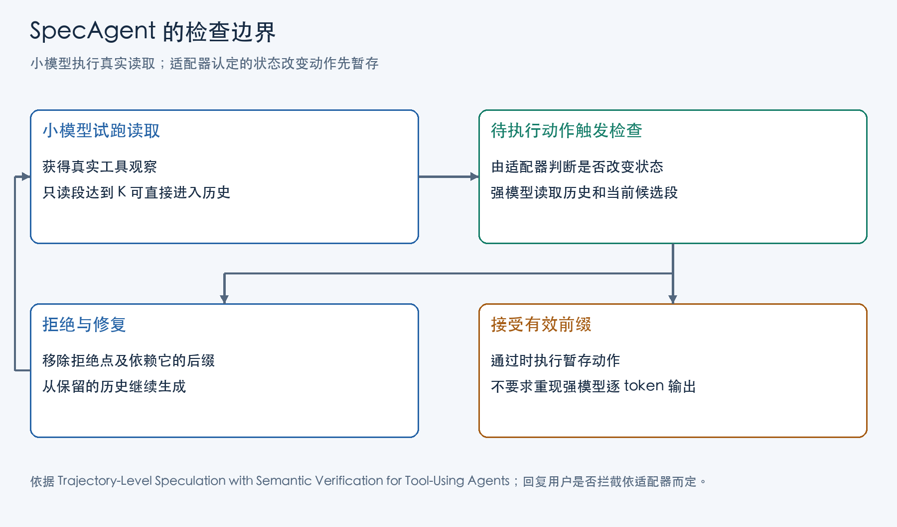

工具型 Agent 的一次任务通常要经过多轮“生成动作—执行工具—读取结果”。查询返回的对象标识决定下一次调用的参数，失败信息决定是否重试，用户的新回答决定哪些修改可以继续。因此，后续决策要等前一轮观察，不能只在任务开始时写完全部动作。

用一个强模型逐轮决策，可以把它的理解和判断能力用于整条轨迹，代价是每轮都要等待它生成动作。即使下一步只是依据已有标识读取记录，也仍由强模型逐 token 写出。全部换成小模型能减少这部分等待，但选错对象、漏掉任务规则等错误会通过后续参数传播，最后影响任务成功率。

SpecAgent 研究的是这两者之间的一种分工：让小模型生成并试跑常规步骤，让强模型审核已有进展，在需要时纠正轨迹。它希望减少强模型亲自生成的工作，同时通过审核补回小模型独立执行损失的质量。

## 小模型执行与强模型审核

只在难题出现时把执行权交给强模型，仍需要接管者从头生成当轮动作；让强模型每步都写一个参考动作，再与小模型比较，也仍保留了强模型逐轮生成的工作。即使用短裁决逐步审核，每个动作都要多等一次审核请求。SpecAgent 因而选择让强模型一次看一段已有动作，接受其中合理的进展，而不要求小模型复现强模型自己的选择。

这种分工利用了模型处理输入与生成输出的差异。已有动作及观察都是已知文本，可以在 prefill 阶段并行处理多个位置；从头生成动作需要 decode，每个新 token 都要等待前面的 token。审核仍要读取上下文、生成裁决，出错时还要修复，但有机会用短裁决替代多轮长生成。后面的成本分析将说明这种机会依赖什么服务条件。

要让一段动作成为有用的审核材料，首先得解决工具依赖。小模型若只写一长串计划，未执行的查询就没有真实返回值，后面的参数和判断只能依赖猜测。SpecAgent 让小模型实际执行读取，再依据真实观察生成下一步；遇到环境适配器认定的状态改变动作，才扣住它，请强模型审核。这样既取得后续决策需要的证据，也保留了审核后再决定是否执行修改的机会。

## 候选动作段与工具观察的记录

Zilin Wang 等人在 2026 年论文《Trajectory-Level Speculation with Semantic Verification for Tool-Using Agents》中，将小模型称为 Weak，强模型称为 Strong。两者面对同一个任务环境，通过动作取得工具观察。这里的环境状态是数据库记录、工作区内容等任务数据；读取取得观察而不改变这些数据，写入则修改记录或提交结果。模型看到的却是任务、动作和返回结果组成的历史，历史是它作判断的证据，并不是环境本身。运行器将已经纳入后续使用的历史记为 H。

Weak 的工作区还包含一个当前候选段。生成查询后，运行器真的调用工具，把返回结果追加到这个段里。Weak 下一步看到的是 H 加上当前段，所以它可以从真实返回值中提取标识、发现查询失败，或调整搜索方向。候选段不是一份脱离环境的文字草案。

这里有两种不同的状态变化。读取完成后，工具结果已经存在于候选段，但尚未进入 H；修改动作尚未执行时，环境数据库也尚未变化。运行器能删除前者，使后续模型不再沿用这段观察，却不能靠删除聊天记录撤销已经写入的数据库。因此，动作的分类决定了执行边界。

论文把分类交给环境适配器。这个分类直接决定哪些动作需要等待 Strong：τ² 和 VitaBench 中，发给模拟用户的回复不改变数据库，所以可以直接发出，用户下一轮回复成为新观察；AutomationBench 和 MCP-Atlas 的最终消息本身就是交给评分器的答案，适配器将它当成写动作扣住。在前一类环境中，一条回复已经发给用户后，删除候选历史也收不回来。论文在 τ² 上比较了扣住回复的设置：Strong 调用增至三倍以上，质量没有提高。这是适配器选择审核边界时的一项实验依据。



图中的检查点由动作语义决定。接入新工具时，需要先弄清一次调用改变的是任务数据、会话还是外部系统；HTTP 方法的名称不足以完成分类。读取也可能计费、消耗配额并留下访问日志，论文所说的可撤销主要指从模型历史移除读取结果。

## 只读段长度与写操作审核

试跑既需要保留真实观察，也需要控制当前可拒绝段的大小。为此，执行循环设置参数 K：连续读取达到 K 步时，运行器直接把整段追加到 H，清空候选段，让 Weak 继续。这个分支没有调用 Strong。

因此，K 不是“每 K 步让大模型检查一次”。它控制只读段累积到多长便纳入历史。Strong 真正被调用的时刻，是 Weak 产生了适配器认定的状态改变动作。运行器把这个动作连同一个尚无观察结果的标记加入当前段，退出试跑循环。

按论文算法取 K=6，沿一条连续读取八次后才准备写入的路径追踪状态：前六次读取已进入 H；第七、第八次读取留在新候选段；写动作成为该段第三步，尚未执行。Strong 将看到 H 和这三步候选材料。它能根据全部可见背景判断当前段，却不能通过返回一个较短的接受长度，把已经进入 H 的前六步重新移除。

进入 H 表示此后继续使用，其中可以包括达到 K 后直接提交的读取。改变 K 会改变这些读取怎样划入当前段，却不会凭空增加审核检查点；沿上面这条路径，把 K 调大到容纳八次读取，会让更多读取留到写入前的同一次审核中。

审核时，Strong 取得任务、历史、候选动作及已发生的工具观察，并结合工具输入要求和任务规则判断。论文的审核提示词要求区分原始观察与模型自己写下的假设；一个标识应来自任务、用户消息或已有观察，模型不能凭空制造它，再把基于它的查询当作有效进展。待执行修改还要满足任务规则：若政策要求用户明确确认，模型写下“用户应该同意”就不能代替那条用户回答。审核读取是否有依据、修改是否满足前提，分别检查的是已发生步骤与尚待执行步骤的有效性。

## 有效前缀保留与拒绝后的轨迹修复

Strong 返回三项信息：最长有效前缀的长度 j、首个拒绝点的原因，以及一个可选替代动作。审核标准是动作是否构成合理延续，不要求它重现 Strong 自己会选择的查询顺序。存在多种合法路径时，与强模型的偏好不同仍可被接受。

若当前段全部通过，运行器先把已经执行的读取纳入 H，再执行最后扣住的动作，把它的真实结果也纳入 H。只有这时，原先待执行的状态改变动作才实际发生。

若首个错误出现在段内第二步，运行器只保留第一步，丢弃第二步及其后缀。原因来自工具轨迹的依赖关系：后面的参数可能从前面错误的对象中提取，后面的写入又可能依赖这些查询结果。即使后续每个动作的 JSON 都符合工具要求，它们仍然可能针对错误对象。逐项独立投票会留下这种依赖已经断裂的动作。

被删除的读取已经执行过，但删除会改变下一次模型生成所依据的上下文。修复动作只能依据 H、已接受前缀和审核原因，不能把被丢弃后缀中的事实偷偷继续当作已确认材料。

Strong 若已经能给出一个替代工具动作，适配器先检查该动作是否可用，通过后直接执行；若没有可用替代，运行器再调用 Strong 生成一个纠正 turn。纠正动作执行后进入 H，Weak 从新历史继续。这里没有再套一层相同审核：协议把修复职责交给 Strong。适配器对替代动作的输入检查，也只是判断动作满足调用要求，不能代替语义判断。

修复后的历史决定 Weak 下一轮会依据哪些对象和观察行动。丢弃错误后缀后，Weak 的下一轮输入不再包含这些被拒绝的观察，减少了沿同一错误对象继续行动的机会；状态改变动作在审核前暂存，则把对外修改的执行时点留在裁决之后。

## 审核模式的 Prefill 与 Decode 开销

Strong 审核时，候选段文本和工具观察已经齐全。它主要通过 prefill 读取这些 token，再解码短裁决；只有部分拒绝需要额外生成修复。如果由 Strong 从头执行，它则要逐 token 生成每一步动作，在工具返回后继续生成后面的步骤。

prefill 可以同时处理多个已知位置，decode 则受自回归依赖约束，每个新 token 都要等前面的 token 出来。在小 batch、内存带宽受限的服务条件下，把长 decode 换成较长 prefill 加短 verdict，有机会减少强模型反复读取权重的开销。审核依旧做计算，读长上下文也有成本。

论文用一个一阶模型描述这种取舍。令每步接受概率为 p，一段长度为 n，Strong-only 生成普通动作的权重读取轮数为 d，审核裁决对应的轮数为 v，拒绝后需要单独修复的比例为 ρ。在小 batch、内存带宽受限的假设下，这些轮数近似对应时间和内存流量。再把各步接受近似当作独立事件，可得每个提交步骤的 Strong 成本相对 Strong-only 的比值：

```text
R = (1-p)/(1-pⁿ) × v/d + ρ(1-p)
```

接受率高时，一次裁决能摊到较长的有效前缀上；p 趋近 1 时，第一项趋近 v/(nd)。接受率低时，草稿中越来越多后缀被丢弃，修复成本也随拒绝增加。加长候选段既能摊薄裁决，也可能放大废弃，两种作用需要一起看。

这里 n 是成本模型中的待审段长，不是每隔 K 个读取就审核一次的计数器。实际算法在 K 个纯读取后直接提交，该分支不产生裁决费用；公式用来说明待审段的接受率和裁决成本怎样相互影响，实际任务还要统计这些直接提交的步骤。

设 Weak 每步时间相对 Strong-only 为 κ，加上小模型试跑时间后，忽略工具等待的每步端到端时间相对 Strong-only 近似为：

```text
L = R + κn(1-p)/(1-pⁿ)
```

当 p 趋近 1，Weak 项趋近 κ：所有小模型生成仍要付费。若小模型本身不便宜，或大量时间耗在外部工具等待上，即使 Strong decode 明显减少，总任务延迟也未必按相同比例下降。若服务负载转为计算受限，新增 prefill 和双模型工作还可能抵消内存读取收益。

## 任务质量、运行时间与 GPU 成本

论文在 NVIDIA H20 上用 Qwen3.5-4B 作为 Weak、Qwen3.5-397B-A17B 作为 Strong；Weak 使用单 GPU，Strong 使用 16 路张量并行，各方法在八任务并发负载下比较。这些条件让实验可以检验：审核是否补回小模型的质量差距，以及减少强模型生成能否缩短整项任务。τ² Airline 的 Weak-only 成功率为 80.0%，平均任务耗时 69.7 秒；Strong-only 为 86.0%、305.2 秒；SpecAgent 为 86.0%、126.2 秒。协议在这组任务上补回了观察到的质量差距，同时比小模型独立执行多花了审核和修复时间。

同一组 Airline 结果中，估计的 HBM 读取量从约 333—342 TB 降至约 148—150 TB，估计计算量却从 0.78 增至 1.01 PFLOP。这里的内存流量和 FLOPs 来自 token 与模型结构估算。它们解释了时间下降可以伴随算术工作增加：减少的是某种硬件瓶颈下昂贵的反复读取，并不是所有资源都同时变少。

论文的 Retail 结果则是成功率从 88.6% 变为 87.7%，耗时从 162.4 秒降至 87.5 秒。AutomationBench 上，成功率则从 Weak-only 的 6.8% 提高到 10.5%，仍低于 Strong-only 的 15.2%。审核与修复能保留多少质量，随任务和小模型能力变化；这也决定了需要付出多少重试与修复工作。

SpecAgent 的语义裁决允许多条有效执行路径。与 [token 级 speculative decoding](/posts/deepinfer-inference-design/) 保持目标模型采样分布的目标不同，这里的接受规则由 Strong 对任务进展的判断构成。工程上采用它，首先要确认工具如何分类、哪些已执行观察能从历史移除、Strong 能看到哪些审核证据。论文在 VitaBench 截断工具输出，在 MCP-Atlas 截断旧观察，审核实际依据的是这些可见材料。随后再测量接受前缀长度、修复频率和端到端成本。只有这些量能说明，本系统是否具备让强模型从逐步作者转为审核者的条件。

## 主要参考资料

1. Zilin Wang、Yinhong Liu、Chao Chen、Qun Liu、Zhijiang Guo，《Trajectory-Level Speculation with Semantic Verification for Tool-Using Agents》，2026，arXiv v1。
