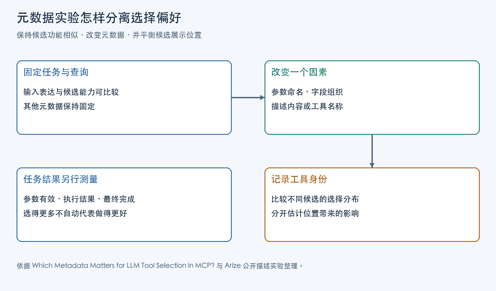

Agent 调用工具时，模型先根据应用提供的接口信息选择工具并填写参数，应用再执行调用。参数名、字段结构和描述因此有两重作用：说明怎样调用，也帮助模型判断当前请求适不适合交给它。后端能力相同，仅改变这些信息，调用倾向仍可能发生变化。

改进的目标取决于任务。Arize 团队曾发现，Agent 回答单条 trace（一次运行的调用记录）的问题时，频繁加载一项面向多条 trace 分析的技能。答案正确，却多做了工作。工具元数据设计既要帮助模型找到适用工具，也要让它知道何时无需调用。本文从已经呈现给模型的候选出发，解释这种判断受到什么影响，以及怎样评价改写的收益。

## 工具定义的获取与呈现

以 MCP 为参照，工具服务提供工具名称、用途描述和输入 schema。schema 定义参数的字段、类型及必填要求。MCP 的 2026-07-28 版《Tools》规范中，客户端通过 `tools/list` 取得可用工具定义；Agent 所在的应用再决定筛选哪些工具、按什么顺序、用什么形式提供给模型。[工具暴露方式](/posts/pi-mcp-tool-exposure/)改变了模型所见的候选集合，`tools/list` 的返回则是客户端取得的材料。

模型请求携带候选工具后，模型结合用户请求和这些接口信息，输出工具名称与参数。应用随后将名称和参数交给对应客户端，由它发出 `tools/call`，取得结果后供后续回答使用。这里有三个不同的判断位置：应用先决定让模型看见谁，模型从候选中作选择，执行过程与结果则用于评价这次调用。

Xiaofan Li、Fengchun Qiao、Xing Gao 的《Which Metadata Matters for LLM Tool Selection in MCP? Evidence from Controlled Factor-Level Interventions》研究中间这次选择。主对照让候选都能服务同一请求，只改 server name、tool name、description 或 parameter schema 中的一项，记录模型调用了谁。它将后端能力固定，因而能观察接口表达本身带来的偏好。

## 参数名称对输入含义的提示

最有解释力的一组定向实验来自邮件收件人参数。把 `to` 改名为 `recipient_id`，该候选在五个模型中的选择率降至 1%—10%；改成 `receiver`，选择率则保持在约 35%—51%。其他参数与候选功能保持不变。

`receiver` 没有出现在请求文本里，却仍有竞争力。偏好变化因此不能只用单词是否重合来解释。论文提出的行为解释是：`recipient_id` 暗示应传入某种内部标识，而请求给出的是邮箱地址；`receiver` 仍保留了接收者的语义。即使两个工具都可以接收这个地址，它们呈现出的输入要求也不同，模型可能据此偏向其中一个。

字段名给出的是简短信号，其他说明可以改变这个信号的影响。研究给两个工具的对应字段加上相同描述后，`recipient_id` 带来的降幅消失。这组对照支持“模型结合元数据判断输入适配”的解释；实验直接观察的对象是选择分布。

参数名首先应帮助调用者理解值的身份。内部系统若要求用户 ID，说明中应交代这个标识从哪里取得；若接受邮箱地址，却沿用暗示 ID 的名字，模型就需要用其他信息化解冲突。增加一句笼统的功能介绍，未必能解释清楚这个参数。

## 字段结构与用户请求形式

schema 还决定一项输入怎样映射成调用参数。论文区分了三种改动：

| 改动 | 研究里的对照 | 改变的输入关系 |
|---|---|---|
| 命名 | `to` / `recipient_id` | 同一个值被暗示为地址或标识符 |
| 组织 | 独立顶层字段 / `params_dict` 等容器 | 直接填写字段，或先组装一个对象 |
| 分解 | `owner` 加 `repo` / 单个 `repository` | 将复合输入拆开，或保留合并形式 |

在被测变体里，schema 引起的选择差异最大，也最一致，模型通常偏好独立顶层字段。但建 PR 的对照表明，这种偏好与用户怎样给出输入有关。

研究者准备 25 对相同意图的查询，一种分别提供 owner 与 repo，另一种把它们写成 `owner/repo` 路径。候选仍是独立 `owner`、`repo` 两个参数，以及单一 `repository` 参数。改成路径输入后，全部模型对拆分字段的偏好都减弱，其中一个模型转为偏好单字段。

任务目标和候选能力没变，变的是请求里的信息形状。分别给出的两个值能直接对应两个参数；合在一条路径里的输入，与单字段形式更接近。设计者因此需要连同真实请求一起检查 schema：它让模型直接使用已有值，还是要求先拆分、合并或补取信息？这一转换关系比单纯追求字段更多或更少更有解释力。

schema 也能表达任务是否可完成。论文另做了明确需求干预：邮件请求需要抄送，只有一个候选增加可选 `cc` 字段时，五个模型在有效试验中都选中了它，即使它排在第二位。增加的字段让模型看见满足要求的调用方式。同时把收件人改名为 `recipient_id` 后，一些模型选择兼容工具的比例又下降，说明能力信号与输入身份信号会共同影响选择。

这些实验采用发邮件、查天气、建 issue、下单和建 PR 五类任务，每类 50 条人工检查过的生成查询。测试覆盖五个模型在 2026 年 8—9 月的 API，候选数为 2、3 或 5。记录止于工具身份，未实际执行业务操作；因此“偏好独立字段”适合作为接口测试假设，采用时还要检查生成参数及任务结果。

## 工具用途与参数说明

名称让模型辨认动作，描述可以补上动作的适用条件、输入含义和返回内容。这几项信息服务不同判断。适用条件帮助决定本次是否需要调用；参数说明帮助判断已有输入能否使用、该放进哪个字段；返回内容帮助判断调用能否提供后续所需的信息。

主论文的描述对照，将简短功能介绍与增加参数或返回值解释的版本比较。更完整的版本通常更常被选中，即使简短版本已经说明了工具功能。结合收件人字段实验，可以理解这个变化：知道“能发邮件”还不足以判断邮箱地址应该怎样传入，参数说明补上了功能与当前输入之间的连接。

Arize 的问题则落在适用条件上。`phoenix-error-analysis` 用来跨多条 trace 寻找失败模式，Agent 通过 `load_skill` 工具加载这项技能，取得相应操作说明。回答单条 trace 的问题无需加载它，当前任务没有需要它承担的工作。描述优化在这里应帮助 Agent 缩小使用范围，成功表现为减少不必要的加载。

改写前先确定缺失的是哪项判断。模型已有所需输入，却犹豫该传什么值，可以补充字段身份和格式；模型在无需某项能力时仍调用它，就要检查用途与触发条件。把两种情况都归为“描述不够详细”，容易增加文字却没有改变决定调用的那条信息。

## 工具排列顺序造成的选择偏差

元数据改写后被调用更多，可能还藏着一个变化：候选被放到了前面。研究中若干只改名称的对照里，模型明显偏好第一个工具。若原版本总排第二，新版本总排第一，就无法辨别选择来自表达还是位置。

研究通过平衡变体分配和展示顺序处理这个问题，让同一变体出现在不同位置，再用条件 logit 同时估计两种影响。其核心可以写成：

```text
候选 i 的评分 = β × 元数据变体标记 + γ_i
选择概率 = exp(该评分) / 所有候选 exp(评分) 的总和
```

变体标记表示候选采用哪种形式；β 衡量控制位置后的变体偏好；γ 表示该位置相对最后一个位置的影响。同一候选既采用不同变体，也出现在不同位置，数据才有机会把两项分开。β 是 log-odds 系数，不能读作任务成功率增加了多少个百分点。

比较基线还要考虑候选组成。三候选里只有一个采用目标变体，均匀选择时其占比为 1/3；两个采用目标变体时，占比为 2/3。若都拿 50% 作基线，单靠数量差异就会制造“偏好”。论文因此按组成分别统计变体选择率，并另列位置选择率。



这张图把记录工具身份与评价任务结果分开。前者用来确定改写怎样影响调用倾向；后者用来决定这个变化是否值得采用。生产中的一次描述比较可以先轮换顺序、按位置检查结果，需要进一步分离多项影响时再使用这样的统计模型。

## 工具描述优化的任务效果

Nancy Chauhan 在 Arize 公开的《How to test agent tool descriptions with Harbor and Phoenix》中，记录了前述描述优化实验。团队使用含 117 条 TRAIL trace 的 Phoenix 环境，设置 18 个问题，每种配置各跑三次，同时评价最终答案并记录工具轨迹。

基线里，Codex MCP 配置的 54 次尝试中有 51 次加载了 `phoenix-error-analysis`，PXI 有 4 次，Claude Code 没有加载；三种配置的答案都通过。单看最终得分，会把执行路径的差异隐藏起来。

团队只修改 `load_skill` 的描述，重跑相同任务后，Codex 和 PXI 的不必要加载都降为零，结果评分保持不变；Codex 这一轮的总费用从 11.85 美元降至 8.34 美元。这个变化的价值来自减少无关步骤，同时保留正确答案。描述设计应把工具适用范围说明白，让 Agent 为当前任务选择足够的操作。

结果评价也需要识别等价答案。团队发现 `page_down` 与 `PageDownTool` 的名称差异会让正确回答被误判，于是修正评分说明，按是否识别目标工具判断。否则，评分规则本身的偏差就会掩盖改写是否改善了任务。

## 元数据改动的对照实验与效果评估

一次元数据优化先要确定变化由何而来。固定用户请求和候选能力，只改一类信息，轮换候选顺序，分别记录工具身份与位置。如果新版本只在排第一时被使用，就要继续区分位置偏好与表达效果。修改字段组织时，还应像 PR 实验那样保留相同意图、改变输入形式，观察效果是否依赖用户如何提供信息。

接着判断变化是否符合优化目标。检查生成参数是否符合 schema、值的身份是否正确、复合输入有没有拆错，再观察实际执行与最终结果。一个候选被选得更多，参数却更容易填错，意味着它看起来适合请求，但调用说明仍有缺口；两个版本都能正确完成，某个版本多加载一项技能，则可以继续缩小适用范围，并比较减少步骤后的费用。

受控比较解释元数据的影响，任务评价决定是否保留改动。参数名让模型理解值，schema 让它组织输入，描述让它判断用途与前置条件；把这些信息和真实请求对上，再看执行轨迹，才能知道一次改写究竟帮助 Agent 做对了哪一步。

## 主要参考资料

1. MCP，2026-07-28 版《Tools》。
2. Xiaofan Li、Fengchun Qiao、Xing Gao，《Which Metadata Matters for LLM Tool Selection in MCP? Evidence from Controlled Factor-Level Interventions》，2026 年 10 月 v1。
3. Nancy Chauhan，Arize，《How to test agent tool descriptions with Harbor and Phoenix》，2026 年 10 月。
