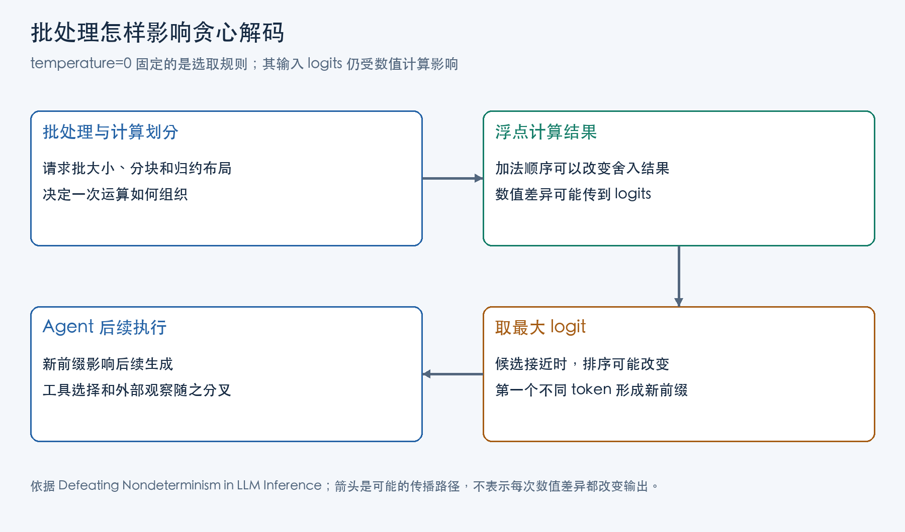

temperature=0 通常意味着贪心解码：每一步选择 logit 最大的 token。它取消了从概率分布随机抽取 token 的环节，却仍然依赖前向计算交给解码器的数值。如果同一请求进入不同批次时算出的 logits 略有变化，最大值的位置也可能变化。

Thinking Machines 的 Horace He 与合作者在 2025 年工程文章《Defeating Nondeterminism in LLM Inference》中，把这条因果链定位到 batch invariance，即批不变性：同一个请求的数值结果，应当不随同批请求的数量及相关计算组织变化。它比“同一个 kernel 重复运行得到相同结果”多了一层要求。

本文沿这份报告解释批处理怎样改变归约顺序，以及作者怎样固定这些数值路径，再据此讨论 Agent 分叉的排查。

## Logits 扰动对贪心解码的影响

将某一步输出词表上的 logits 写成 z，贪心解码选择：

```text
a = argmax_i z_i
```

设第二名为 b，第一名与第二名的间距 m=z_a−z_b。另一条计算路径给 logits 加上数值差异 δ，那么在下面条件成立时，b 会超过原来的 a：

```text
δ_b − δ_a > m
```

这个关系是从最大值定义直接推导的。它解释了两种都可能发生的结果：数值虽变，候选间距足够大，token 保持不变；候选很接近，较小扰动就可能改写排序。因而“有浮点误差”与“输出一定不同”之间还隔着候选间距。

一旦某个位置选出不同 token，下一步收到的前缀就不同了。此后的差别不再只是同一函数输入下的舍入差异，而是模型确实在处理两个不同前缀。一个很早的细微变化，最终可以表现成语句、工具名称或者调用参数的差别。



图中展示数值差异经过 token 选择、工具执行和新观察逐步传播的路径；候选间距决定其中一次数值变化是否会进入后续轨迹。

## 浮点加法顺序与舍入误差

实数加法满足结合律，浮点加法要在每次运算后把结果舍入到有限精度。将一个很小的数加到一个很大的数上，小数的有效位可能在这次舍入中丢失；之后再减去大数，丢掉的信息不会自动回来。

报告使用的极端数值可以直接显示这一区别：

```text
(0.1 + 1e20) - 1e20 = 0.0
0.1 + (1e20 - 1e20) = 0.1
```

第一行先做大数与小数的加法，0.1 被舍去。第二行先让两个大数抵消，最后再加 0.1。这个演算说明归约顺序会影响结果；实际神经网络并不需要出现同样极端的数值才会出现舍入差异。

归约是把很多数合并成一个数，例如向量求和、点积和均方。为了并行，计算库可能把输入分成若干块，每块先算一个部分和，最后再合并。即使每个分块内部和最后的合并顺序都固定，两套不同分块方案仍可能得到不同结果。

分叉也可以完全不依赖随机线程竞争。每套计算本身都重复一致，但批大小变化使计算库选择了另一套固定方案。把所有差异都归因于“GPU 并行线程谁先完成”会错过这一层。

## 确定性与批不变性的区别

假设某请求的表示占输入矩阵的一行。第一次让它单独与权重矩阵相乘，第二次把它与其他请求一起组成大矩阵再相乘。数学上，这一行的结果只取决于它和权重，同批其他行不会参与它的点积。

计算库却会依据整个矩阵形状选择 kernel、tile 大小以及归约策略。单行输入和多行输入，可能分别落到适合小矩阵与大矩阵的路径上。两条路径各自反复运行都一致，并不能推出它们对同一行给出逐位相同的数值。

由此可以分开两种性质：

| 检查对象 | 保持什么不变 | 检验什么 |
| --- | --- | --- |
| 重复运行的确定性 | 完整输入、形状、执行环境 | 相同计算是否重复一致 |
| 批不变性 | 目标请求的输入 | 改变同批数量与计算组织后，目标结果是否一致 |

在线推理服务会根据同时到达的请求组合 batch。用户固定了自己的 prompt，却没有固定服务同时处理的全部请求。因此，从服务完整输入看可重复的一套前向计算，仍可从单个用户视角表现为不一致。

跨请求影响可以只经过矩阵形状和 kernel 选择发生。固定随机种子主要约束随机过程，无法让两个不同的浮点归约树自动变成同一棵。

## RMSNorm、矩阵乘法与 Attention 的归约

Horace He 的实现分析依次处理 RMSNorm、矩阵乘法和 attention。三者都有归约，但要稳定的计算边界不同。

RMSNorm 在每一行特征上计算均方，再对各维缩放：

```text
RMSNorm(x)_i = x_i / sqrt(mean_j(x_j²) + ε) × g_i
```

跨特征维的均方就是归约。如果每行始终由同一个程序按照同样顺序处理，增加其他行可以增加并行工作，而不改变该行结果。小 batch 的行数少时，GPU 上可能没有足够多的并行任务。为提高利用率，另一实现可能把一行拆给多个程序计算；若是否拆分由 batch 大小决定，同一行的求和顺序就变了。性能上的拆分决策因此成了数值路径的一部分。

在这类矩阵乘法中，M 是同时处理的 token 表示行数，K 是每行参与点积的特征数。一个请求可以带来多行 token，M 因此不等于用户请求数。每个输出元素都要将该行与一列权重的 K 对乘积累加。batch 变化会改变 M，计算库可能据此改变 tile 和拆分策略：沿 K 一次累加到底，或先算几段部分和再合并，会让同一输出元素经历不同的舍入。要保持批不变性，需要固定这些乘积怎样分组、怎样累加。只锁定数据类型，或只要求每个被选中的 kernel 自身确定，都不足以做到这一点。

attention 用当前位置的 query（q）与各位置的 key（k）做点积，softmax 将分数变成权重，再用这些权重对 value（v）加权求和。KV cache 保存已处理 token 的 k 和 v，后续 query 可以直接复用。这里既有特征维的点积归约，也有沿 KV 序列的 softmax 和加权求和。实际引擎还会分块处理 prompt，也就是 chunked prefill，并复用前缀缓存，计算布局随缓存边界变化。

报告给出的分块分析取块长 32：若已有 80 个 token 的缓存，又新增 48 个 token，分别处理两部分需要 3 块和 2 块；若将 128 个 token 按统一布局处理，只需 4 块。若缓存部分和新增部分分开处理，两边会各自累积 softmax 的局部最大值、指数和与加权 value 部分和，最后还要按共同尺度合并。5 块与 4 块由此对应不同的累积和合并过程，相同序列长度仍可能得到不同舍入结果。作者先将新增 k、v 写入 KV cache，并更新记录缓存位置的 page table，再让 attention 沿统一的 KV 布局读取，消除“已缓存/刚新增”对分块边界的影响。

decode 阶段 query 数量少，只按 query 并行可能无法充分利用 GPU，所以还会把 KV 序列拆开计算，即 Split-KV。若按当前并行负载决定拆成几份，query 数量变化就可能改变份数与每份 KV 长度。即便固定份数，均分时的边界仍取决于本次处理的 KV 长度；prefill 切片与 decode 处理不同范围时，同一 query 所需的前缀也可能被分到不同块中。报告采用固定 split size，按固定块长划分序列，末块处理余数，让同一 KV 前缀维持相同分段。例如长 1000、split size 为 256 时，分段为 256、256、256、232，query 批数量的变化不再重划这几个边界。

这些设计共同追求的是稳定一个请求自己的归约过程。它不要求服务拒绝动态 batch，但会约束某些原本可自由选择的性能优化路径；性能代价需要在具体模型与负载下重新测量。

## 输出差异实验及其对 Agent 的影响

2025 年报告用 Qwen3-235B-A22B-Instruct-2507 的 non-thinking 模式，以关于 Richard Feynman 的 prompt 做 1000 次贪心补全，每次生成 1000 token。报告观察到 80 种输出，前 102 个 token 相同，从第 103 个 token 开始分叉；采用作者的 batch-invariant kernels 后，1000 次输出相同。

这组观察支持该实现中计算路径可以影响贪心生成，以及固定相关路径能消除该实验的差异。按这一机制推导到 Agent，工具调用名称和 JSON 参数也是生成序列的一部分，因此 token 变化可能改变工具选择，工具执行又会带来不同观察，进一步扩大轨迹差别。报告本身没有以 Agent 工具成功率实验测量这条传播链。

Agent 的另一种分叉来源是工具输入变了。检索库更新、外部服务返回新的记录、当前时间变化，都会使模型收到不同观察。即使推理数值完全重复，这些变化也足以产生另一条轨迹。只有把推理前缀和工具观察分别记录，才能判断分叉从哪一层开始。

## 推理差异的分层排查

排查可以按照逐层放开变量的顺序组织。先固定权重、tokenizer、硬件、软件版本和解码设置，对同一个完整 batch 重复前向计算，检查 logits 和首个不同 token。若这一步已出现差异，就应先研究重复运行的确定性。

随后保持目标请求不变，改变 batch 大小和同批请求，再检查目标行的数值。若前一层稳定、这一层不稳定，批形状带来的计算路径变化便成为直接线索。接着固定这些条件，分别测试 prefill 切块和前缀缓存路径，检查 attention 布局是否引入额外变化。

最后才把完整 Agent 放回环境，并保存每次工具观察。比较轨迹时，先找到首个分叉：若此前输入 token 与观察一致而 logits 不同，继续查推理数值；若工具观察已经不同，就从环境变化查起。服务若不提供 logits，可先对齐输入与输出 token，确定最早差异位置，再向服务侧取得 batch、缓存路径或数值记录。仅有最终文本或工具调用的差异，还不足以将原因定位到某个 kernel。只重复最终任务并统计成功率，可以[评估稳定程度](/posts/agent-evaluation-system-design/)，却很难定位原因。

temperature=0、重复执行同一计算得到一致结果、跨 batch 数值一致、完整 Agent 环境可复现，分别约束了不同对象。明确当前要复现哪一个对象，才能为它选择正确的控制变量。

## 主要参考资料

1. Horace He 与 Thinking Machines 合作者，《Defeating Nondeterminism in LLM Inference》，2025 年 9 月 10 日。
