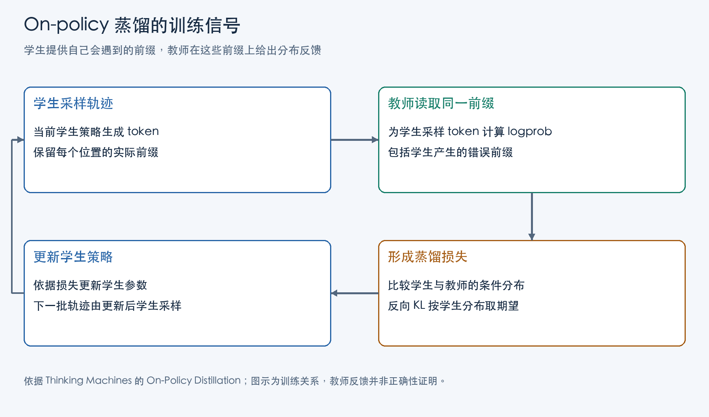

语言模型蒸馏要把一个模型已有的生成行为迁移给另一个模型：提供学习目标的叫教师，接受训练、之后独立使用的叫学生。常见用途是让较小、推理成本较低的学生保留教师在特定任务上的能力。教师应具备希望迁移的行为；它也可以是同等规模、经过不同训练的模型。

最直接的做法是让教师先回答一批问题，再用这些回答训练学生。训练时，给学生问题和示范回答的前半段，提高它对下一个示范 token 的预测概率，逐位置重复。另一种监督更丰富：在给定前缀上，取得教师对各种下一 token 的概率，让学生学习这份分配，而不只学习示范里选中的一个 token。这两种做法都可以在事先收集好的文本上进行。

这里有一个训练与使用的差别。训练时，学生接着给定的示范往下预测；独立生成时，它接着自己刚写出的文字往下预测。学生一旦在较早位置选了教师很少选择的 token，后面的上下文就可能偏离教师轨迹。即使它在教师示范上学得不错，也未必学过如何应对自己走偏后的前缀。

On-policy 蒸馏把学生实际会到达的前缀纳入训练：当前学生先生成，教师在同一条学生轨迹上提供反馈，优化器据此更新学生，下一批再由更新后的学生生成。理解这一循环，需要分别看清训练状态从哪里来、教师提供什么信号，以及信号怎样改变学生。

## 学生采样与教师反馈

设输入问题为 u，学生已经生成 y₁ 到 yₜ₋₁。这里的 token 是模型逐步生成的文本单位，前缀包括问题与此前所有已生成 token。当前位置的状态可写成：

```text
h_t = (u, y₁, …, yₜ₋₁)
学生：q_θ(· | h_t)
教师：p(· | h_t)
```

θ 是学生参数，q 和 p 分别表示学生、教师的下一 token 概率分布；“·”代表词表中的各个候选 token，“| h_t”表示在这个前缀已给定的条件下。两个分布面对同一个 h_t，比较才有意义。教师读取的是学生实际写出的前文，不必另起一条自己的正确解答，再将两条不同回答逐位配对。

只用教师生成的解答，学生主要在教师访问的状态上学习下一步。让当前学生生成，则连它漏掉条件、选错解题方向后的状态也会进入训练。学生提供“在哪里学”，教师提供“在这里更偏好什么”。学生写错的内容因此可以成为取得反馈的材料，随后更新的是它的生成倾向。

Rishabh Agarwal 等人的《On-policy Distillation of Language Models: Learning from Self-Generated Mistakes》用 Generalized Knowledge Distillation（GKD）分别控制学生数据占比和分布差异函数：可以混合学生生成与固定数据，也可以使用不同方向的 KL 或 JSD。on-policy 描述采样来源；同一批学生前缀，可以配合不同的教师监督目标。

## 一轮蒸馏训练的执行流程

以 Kevin Lu 与 Thinking Machines 合作者在 2025 年《On-Policy Distillation》中给出的实现为例，一轮训练包含以下交接：

1. 当前学生回答一批问题，生成轨迹（rollout），保存各位置的前缀、选出的 token，以及当时学生赋予该 token 的概率。
2. 教师读取这些轨迹，计算每个已选 token 在其前缀下的概率。教师执行的是对给定文本的概率计算，无须自己再生成一批解答。
3. 训练程序比较学生与教师对同一选择的相对概率。学生给得比教师高的选择得到抑制信号，教师给得比学生高的选择得到增强信号。
4. 优化器利用这些信号更新学生参数，教师保持固定。更新后的学生重新回答下一批问题，后续训练接触到的前缀也随之变化。



这套循环可能有效的原因有两层：反馈落在学生自己容易到达的状态上；同一条回答的中间位置也能得到反馈，不必等最终结果出来才有信号。教师需要在这些状态下提供有用的概率判断，学生也需要已有足够的基础能力，才能生成值得调整的轨迹。GKD 的实验从经过监督微调的学生开始，Thinking Machines 的主要实验也先做中间训练，再进行这一步行为训练。

学生可以做全参数更新，也可以只更新 [LoRA 参数](/posts/rl-post-training-environments/)；这是可训练参数范围的选择。哪种参数收到梯度，与轨迹是否来自当前学生分别配置。

## 冰块题中的逐 token 反馈

Thinking Machines 的 Illustration 展示了 SimpleBench 中一道冰块题。决定答案的前提是冰块放在平底锅里会融化，因而正确选项是“B. 0”；学生 Qwen3-4B-Instruct-2507 忽略了物理情境，把题目当成纯数学计算，沿着数量运算推导出错误结论。

教师 Qwen3-235B-A22B-Instruct-2507 能正确解答该题。它为学生轨迹计算概率时，对某些引出错误方向的短语起始 token 给出较强的抑制信号。这些位置还存在推理分岔：继续数量运算与把融化条件纳入判断，会使后续回答走向不同方向。

但这条轨迹的最终错误答案没有受到处罚。教师在最后一个位置看到的，已经是学生写出的整段错误推导。在这些前提都已给定时，接着写出那个错误结论可能完全可预测。教师在独立解题时能选对，与它在错误前缀之后认为哪个 token 顺理成章，是两个不同的条件概率问题。

因此，逐 token 反馈能细到中间分岔，却不能按“每个 token 都有正确或错误标签”理解。结果验证器根据题目与最终答案判错；这里的教师根据题目加当前前缀计算概率。冰块题也说明了为什么覆盖学生前缀有用：训练能接触它忽略物理条件、开始机械计算的位置，而不只是让它反复读教师的正确解答。

## Reverse KL 与逐 token 反馈

实现通常保存概率的对数，称为 logprob。对数把概率之比变成差值，便于计算教师与学生对同一选择的相对偏好。把生成本批轨迹时的学生记为 q_old，对一个已采样 token y，Thinking Machines 的训练优势为：

```text
a(y) = log p(y | h) − log q_old(y | h)
     = log [p(y | h) / q_old(y | h)]
```

h 是该位置已给定的学生前缀，a 是交给训练程序的反馈数值。教师概率低于学生时，a 为负，训练倾向抑制这个选择；反之则提供增强信号。若教师对某个 token 的概率为 0.1，学生原本给 0.01 时，a=log 10，为正；学生原本给 0.5 时，a=log 0.2，为负。反馈校正的是相对分配，只看教师的绝对概率还不足以决定更新方向。

这个优势对应逐 token reverse KL。固定一个前缀 h，省略公式中的条件部分，把学生分布记为 q、教师分布记为 p：

```text
D(q || p) = Σ_v q(v) [log q(v) − log p(v)]
           = E_(y~q) [log q(y) − log p(y)]
```

D 表示 KL 差异，v 遍历同一词表，Σ 表示求和；E_(y~q) 表示按学生概率采样后取平均。方向是学生到教师，外层权重来自学生：学生经常选择的 token，更频繁地进入期望。当学生给某 token 的概率比教师高，log(q/p) 为正，这部分增大损失；相反的概率比例贡献负项。完整 KL 非负，单个采样 token 的 log-ratio 则可以为负。上面的 a 恰好取这个 log-ratio 的相反数。

方向换成 D(p||q)，外层权重就来自教师。教师认为重要、学生很少生成的 token，在 forward KL 中仍有教师赋予的权重；reverse KL 更直接地检查学生自身正在投入概率的选择。学生容量有限、无法完整拟合教师时，两者会导向不同取舍。GKD 中仍可由学生生成前缀，再在这些前缀上优化 forward KL：产生状态的策略与比较分布的方向是两个选择。

Thinking Machines 实际取得的是已采样 token 的教师 logprob，没有取出完整词表分布或 top-k logits。这里的“稠密反馈”指每个生成位置都有信号，与仅在回答结束后给一个结果奖励相对；公式中的全词表期望由采样来估计。

## 用策略梯度更新学生模型

采样结束后，q_old 的概率与教师反馈保留为本批数据；正在接受优化的学生记为 q_θ。训练用带重要性比率的 policy-gradient 损失，将优势转成参数变化：

```text
r_θ(y|h) = q_θ(y|h) / q_old(y|h)
L = − E_(y~q_old) [r_θ(y|h) × stop_gradient(a(y))]
```

r_θ 表示新学生对同一选择分配的概率相对于采样时改变了多少。a 为正时，减小损失 L 倾向提高这个概率比；a 为负时，倾向降低它。stop_gradient 表示本批优势被当作常数使用，教师保持固定，学生通过 r_θ 接收梯度。

采样刚结束、尚未更新时，q_θ=q_old，所有比率都是 1；虽然此时损失数值是优势平均值的相反数，r_θ 随学生参数变化，仍能产生梯度。一次采样后做若干优化微步，学生会逐渐偏离 q_old，这个比率保留了两者的差别。它处理给定前缀上已选 token 的概率变化；下一批重新采样，才能更新训练所访问的前缀。

## Reverse KL 的梯度推导

为何不直接把 log q(y)−log p(y) 作为普通损失反传？关键在于 reverse KL 中，q 同时决定了采样权重和对数项。固定前缀 h、教师不变时，对学生参数求导：

```text
∇D = Σ_v q(v) [log(q(v)/p(v)) + 1] ∇log q(v)
   = E_(y~q) [log(q(y)/p(y)) ∇log q(y)]
```

∇ 表示对学生参数的梯度。第二行利用归一化分布满足 E_q[∇log q]=0，消掉了 +1 项。留下的梯度由 log-ratio 加权：不同选择的相对偏差决定它们对更新的贡献。上节的 policy-gradient 损失在 θ 等于采样策略参数的位置，正好给出这一固定前缀目标的梯度。

若采样后仅把 log q(y)−log p(y) 当作普通可微损失，固定已采样 token 并直接反传，期望梯度会成为 E_q[∇log q]=0，丢掉希望得到的相对偏好信号。把 log-ratio 转成固定优势，再乘上可求导的策略概率比，才保留了需要的梯度权重。

### Softmax 归一化对梯度的影响

设学生 q=softmax(z)，z_j 是词表中第 j 个 token 的 logit，即归一化之前的分数。对应梯度为：

```text
∂D/∂z_j = q_j [log(q_j/p_j) − D(q||p)]
```

q_j、p_j 是学生与教师给该 token 的概率，D 是该前缀上的完整 KL。调整一个 logit，会通过 softmax 同时改变所有 token 的概率。因而单个 logit 的局部变化方向由其 log-ratio 相对于整体差异的高低决定，不能把各个 token 当成彼此独立的概率旋钮。采样优势的正负描述单项训练信号，实际参数更新则共同作用于整个归一化分布。

这些公式都把 h 固定。它们解释的是“在已经到达这个前缀时，下一步怎样学”；早期选择还会改变后续能到达哪些前缀，这要进入序列层面讨论。

## γ=0：即时反馈与序列回报的取舍

完整轨迹的概率是各位置条件概率的乘积，序列 log-ratio 因而是各位置 log-ratio 的和。早期选出一个 token，不仅影响当前位置的差异，还会改变下一步前缀，从而改变未来多步的反馈。精确的序列 score-function 梯度会把后续回报也分配给早期动作。

Thinking Machines 的逐 token 方法明确采用折扣 γ=0：每个位置只使用即时的教师与学生 logprob 差异，不把未来位置的差异累积回来。在冰块轨迹中，如果某个分岔 token 当下就得到抑制信号，它可以被直接调整；如果这个选择的负面作用只在后续位置显现，本轮的 γ=0 更新就不会把那些后续信号累积到它身上。

Yuxian Gu、Li Dong、Furu Wei、Minlie Huang 的《MiniLLM: On-Policy Distillation of Large Language Models》给出了包含未来 return 的序列梯度。这里 return 指从当前到后续位置的反馈累计值。它揭示了固定前缀目标与完整序列目标之间多出哪条影响路径，也说明前面的局部梯度对应不能直接写成“精确优化完整序列 reverse KL”。

γ=0 仍然会改变后续训练状态：早期位置自身的概率差先推动学生更新，下一批由新学生生成，访问的后续前缀随之改变。被省略的是本轮将未来反馈显式归给早期选择的路径。

识别一个 on-policy 蒸馏方案，可以沿这四处判断：轨迹是否由当前学生生成，教师在这些前缀上返回什么信号，用哪种分布差异形成更新，以及未来反馈是否累计到早期动作。它们分别决定学生在哪里学、依据什么学和怎样更新；教师规模与 LoRA 参数范围则是另外的配置选择。

## 主要参考资料

1. Kevin Lu 与 Thinking Machines 合作者，《On-Policy Distillation》，2025。
2. Rishabh Agarwal 等，《On-policy Distillation of Language Models: Learning from Self-Generated Mistakes》，2024 年 v3。
3. Yuxian Gu、Li Dong、Furu Wei、Minlie Huang，《MiniLLM: On-Policy Distillation of Large Language Models》，2026 年 v6。
