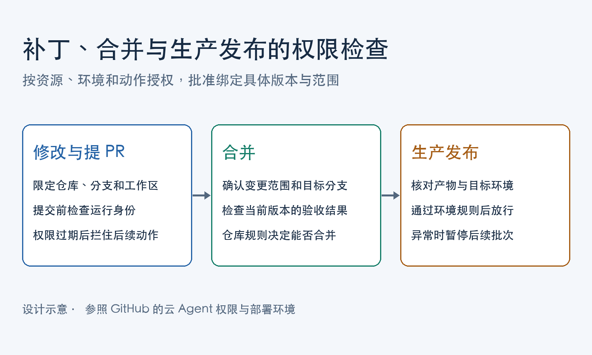

企业允许 Agent 自动改 Bug 时，最先开放的通常是读取日志、修改分支和提交 PR。生产变化还要经过合并、运行发布流程和部署。架构设计需要回答这些操作分别由谁执行，哪个系统会检查身份，某次批准究竟放行哪一次操作。

GitHub 对 Copilot 云 Agent 的设计提供了一个参照。自动化可以按时间或事件触发，管理员或创建者能选择允许它使用的工具。GitHub 在《Risks and mitigations for GitHub Copilot cloud agent》中分别讨论了自动化的工具授权、事件来源、PR 审核和工作流批准。生产环境自身还有独立的部署保护规则。即使一家企业使用不同的代码平台，也可以沿这条路径检查权限是否在实际执行的位置生效。

## 用动作和资源定义授权范围

「允许修复某个项目」需要落到具体资源和操作。日志工具只返回任务对应服务和环境的必要字段。代码工具限定仓库和分支，工作区允许编辑与测试。打开 PR 时再次校验目标仓库、分支和变更范围。合并、触发有写权限的工作流、获取生产凭证和部署由不同的受控入口承担。

允许调用某个工具也要限制它能操作的对象。一个读日志入口如果能查询任意租户，即使它是只读工具，也可能越过数据边界。检查资源归属和对字段做最小化处理，应在结果离开查询系统之前完成。PR、告警和工单中读取到的文字用于解释上下文。授权依据来自任务记录、实际资源和当前身份。

企业可以把权限挂在一次运行上，指定项目、环境、动作、到期时间和可用次数。领取任务时发放短期身份。提交动作时，服务端查运行是否还有效，再核对目标和政策。重新派发后，旧运行失效。通过外部队列调用时，执行端在消费动作前也应检查有效性，以免等待中的请求在撤销之后仍继续。

## 审批绑定交付版本和执行条件

把审批链接放在工单上很方便，然而工单可能关联多版补丁、多个环境。审批记录应说明具体交付版本、目标范围、运行条件和批准人。批准的是合并某份差异，还是部署某个产物，需要明确到动作。更新代码或改变目标环境后，按规则重新获取验收结果。发布事实以部署系统记录的产物版本为准。

GitHub 的部署环境展示了一种实现。按《Deployments and environments》，环境可以限制允许部署的分支或标签，配置审核人和禁止发起者自审。要求审核的作业通过配置的保护规则后，才可使用该环境的 secrets。部署保护因此发生在作业推进和凭证取得之前。若企业还有其他发布入口，它们同样需要检查权限，否则部署限制只能覆盖经过这条流水线的请求。

审批还要处理时效。比如批准后排队过久，目标环境发生变化，系统可以要求重新确认。若执行动作可能影响很多服务，审批应能看到作用范围、传播方式和回退条件。隔离环境里的测试报告可以说明该版本在受测条件下的行为，生产批准还需独立判断上线窗口和观察条件。

## 批量任务要能停在这一批

Spotify 使用 Fleetshift 识别目标、安排和跟踪跨仓库变更，Honk 执行其中的代码修改。这类任务的治理单位可以是单次变更、单个仓库和整批迁移。给批任务设定可变更目标清单、并发和批次大小，能够限制同一时间暴露的范围。首批通过后，下一批之前再查拒绝率、回归和发布观察；超过事先约定的条件，调度端停止派发。

停止、撤销和回滚解决的是不同问题。停止派发可拦住尚未启动的目标，取消运行尝试终止进行中的工作，撤销权限拦住之后的动作。已经送达外部系统的请求，要根据执行记录查询效果。已合入的变更可能需要反向提交或回退部署。涉及外部业务状态时，通常需要服务方提供的恢复流程。界面应分别显示待取消、已停止、影响已确认和待恢复的对象，值班人员才能知道还有哪些结果要处理。

## 用常见失败验证权限边界

试点时可以在测试环境检查四条路径：已被接管的运行能否再提 PR，已审批的补丁变更后能否复用旧决定，一个正常 PR 能否通过普通测试环境却拿不到生产身份，批次暂停之后队列中的请求还能否继续。每次检查都记录受控入口的实际结论。平台团队据此判断哪一层漏掉了检查，权限策略的变更也有可重复验证的对象。

授权和发布控制之外，Agent 工作区仍需要独立的计算与网络隔离。工作区内能执行什么，见 [Agent Runtime 架构](/posts/agent-runtime-workspace/)。

相关设计见 [企业自动化的试点、停用与事故责任](/posts/enterprise-agent-automation-governance/)。
