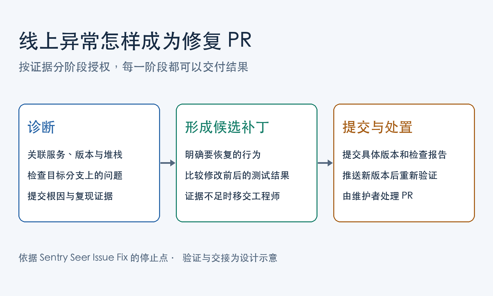

线上报错进入工单后，修复通常还没有真正开始。维护者要先找出受影响的版本，判断异常是否属于同一个问题，确认正常情况下应该发生什么，再决定能否在受控环境重现。Agent 能搜索代码、提出原因、修改实现和运行测试，平台仍要决定这次工作允许推进到哪里，以及下一步凭什么继续。

这决定了自动修复应怎样设计。若目标只是降低排查时间，一份带证据的诊断就可能完成任务；若目标是提交修复，执行者还要证明候选解决了已确认的问题，并检查相关正常功能；若工单承诺恢复线上服务，流程还要覆盖发布与观察。把这些终点分开，才能让不同缺陷进入合适的执行范围，也能在证据不足时留下可以接手的工作。

## 先决定交给 Agent 的是哪一种问题

适合自动修改的缺陷，通常具备三个条件：维护者能说明期望行为，执行环境能观察错误，候选改动的影响能够检查。范围明确的功能回归往往较容易满足这些条件。例如某个版本改变了既有输入的处理方式，旧需求和测试数据仍然可用，修改集中在一个模块。此时可以让 Agent 从复现推进到补丁，再把结果交给维护者审查。

另一些报错只能说明某次执行失败了。请求可能依赖已变化的数据，堆栈可能来自多个服务，业务期望也可能存在争议。先让 Agent 调查仍有价值：它可以找出版本差异、相关调用和缺失证据。但若尚不知道正常结果是什么，继续自动修改就会把选择业务规则的责任交给执行者。任务应停在待澄清，并把会改变方案的问题交给相应负责人。

Sentry 的 Seer 为这种分段推进提供了具体参照。《Start Seer Issue Fix》以 issue 启动异步运行，调用方可以指定停在根因分析、修复方案、代码变更或打开 PR，默认停在根因分析。已有运行可以通过 `sentry_run_id` 继续。平台可以采用类似安排：某类问题只开放诊断；当复现条件和期望行为补齐后，再授权同一任务生成代码。停止点应由任务条件决定，执行者不必把每个报错都变成 PR。

涉及数据迁移、权限含义和多服务接口的修改，还要先确认恢复代价。代码可以回退，已经写入的数据却可能需要补偿，另一个服务也可能已经开始依赖新行为。这类任务可以保留自动调查和候选方案，把实施与发布拆成需要进一步决定的阶段。

## 将线上证据映射到可修改的代码基线

任务入口至少要留下受影响服务、环境、发布版本、代表性事件和仓库。发布版本需要能映射到提交；同一服务存在多个在线版本时，还要知道报错来自哪一个。Agent 根据当前源码解释旧堆栈，容易把已经改变的控制流程当成事故发生时的流程。

调查因此涉及两个代码位置。一个是产生异常的版本，用于解释为什么出错；另一个是准备接收补丁的目标分支，用于判断问题是否仍存在，以及补丁能否落入当前实现。若目标分支已经有修复，任务可以关联那次修改并进入发布确认。若代码已大幅变化，需要重新建立复现，不能把旧版本上的判断直接当作新补丁的依据。

重复事件也在这一阶段处理。平台可以按项目、异常分组和受影响版本查找已有任务，将新增 trace 或输入特征追加进去。已经有开放 PR 时，由原任务吸收证据，避免多个执行者对同一模块重复修改。新增事件若暴露了不同触发条件，应更新问题范围，必要时拆成关联问题。

这份记录要让接手者区分观察与推断。堆栈指向某个函数是观察；认为某个默认值造成异常是待检验的原因；找到相关提交只能缩小范围。Agent 提出假说时，应同时写明下一步用什么检查区分它与其他解释。这样，调查失败时留下的是已排除哪些路径、还差什么输入，而非一段难以复查的结论。

## 在修改前固定预期行为与失败检查

普通功能回归的核心工作，是把“这里坏了”变成可以重复检查的行为。维护者先确认输入条件和预期结果，执行者再建立检查。在基线上运行它，应能观察到与问题相符的失败；保留运行命令、环境、输入及错误输出后，候选补丁才能接受同一项检查。

这里的先后关系会影响证据强度。若执行者先改实现，再按照新实现写测试，测试可能忠实验证了它自己的理解，却错过原需求。让失败检查先出现在基线上，可以检验这条检查是否真的触及原缺陷。测试失败的原因也要看：依赖下载失败、账号不可用或环境未启动，都没有证明原功能回归。

下面是一种供平台采用的修复记录结构，字段随项目已有工具调整：

| 记录 | 保存的内容 | 影响的决定 |
| --- | --- | --- |
| 问题版本 | 线上发布标识、对应提交、代表性事件 | 在哪里分析原症状 |
| 修复基线 | 目标分支及本次固定的提交 | 补丁准备改哪一版代码 |
| 预期行为 | 输入条件、应有结果、确认人 | 哪些变化属于修复 |
| 基线检查 | 检查标识、环境、失败输出 | 是否重现了原问题 |
| 候选检查 | 候选提交、相同检查的结果、相关回归 | 候选是否可送审 |
| 剩余问题 | 未覆盖条件、待决定项、下一位负责人 | 继续自动执行还是移交 |

期望行为有歧义时，记录要停在可以作决定的位置。例如“空值应该拒绝还是使用默认值”会改变实现和测试，负责人需要确认规则；“现有接口在哪一层校验空值”则可以先由 Agent 查代码。把这两类未知分开，既减少无谓等待，也避免调查时悄悄作出产品决定。

无法稳定复现时，可以先收集受控的脱敏输入、补足环境依赖，或把范围缩到一个可观察的函数。若这些工作超过授权或预算，本轮交付应包括目前证据、已尝试检查和具体缺口。线上错误暂时没有再出现，可以作为观察追加，不能取代候选与基线之间的对照。

## 让候选补丁同时接受缺陷检查和正常功能回归

Agent 修改代码时，应围绕已确认原因选择改动位置，并解释为什么这个位置能改变故障路径。为消除异常而吞掉错误、删掉调用或放宽校验，可能让原检查通过，也可能使正常功能停止工作。审核材料因此要展示行为变化，不能只呈现绿色的 CI 状态。

候选至少接受两组检查。第一组重跑基线上的失败检查，确认同样输入在候选版本获得期望结果。第二组覆盖与改动有直接关系的既有正常路径和边界条件，检查修复是否改变了相邻行为。测试范围可以按调用关系、数据结构和接口消费者选择；修改公共解析器与修改某个页面的展示逻辑，需要不同的回归范围。

Meta 的 SapFix 展示了验证怎样进入修复流程。在《Finding and fixing software bugs automatically with SapFix and Sapienz》记录的实践中，Sapienz 在上线前发现 Android 应用崩溃，配合 Infer 缩小代码范围。SapFix 生成候选后，由隔离的测试流程检查能否编译、原崩溃是否仍出现、是否引入新崩溃，之后交给工程师审查。该流程有效利用了测试系统能够再次触发并观察同一问题的条件。

这也解释了线上 issue 与受控测试缺陷的差别。前者可能只有症状，后者已经具备可重复运行的检查。采用自动修复时，需要补齐的是从症状到检查的这段工作。SapFix 论文还记录，回退引发崩溃的部分或全部改动，有时先用于解除高频崩溃对测试的阻塞，根因仍由工程师继续处理。交付记录应区分“缓解阻塞”和“完成根因修复”，让后续任务与发布决定对应各自目标。

测试本身也可能需要改动。合法情况包括补充原来遗漏的输入、为明确的新规则更新断言，或调整随接口变化的测试夹具。平台应把新增测试与修改既有断言分别列出。若断言变化是“原先要求返回结果，现在允许空结果”，审查者需要看到这项变化的需求依据；执行者不能仅因旧检查失败就降低要求。

验证可以利用不同来源降低共同误解。既有测试保留历史要求，Agent 提出的回归测试补充本次故障路径，独立 CI 在确定的候选版本上执行，维护者检查预期行为与测试之间的对应关系。让另一个模型再读一遍代码可作补充，但选择相同错误前提的两个执行者，仍会得到彼此一致的错误结论。

## 重试由失败原因决定，超出条件就移交

一次测试失败后，平台应先区分发生了什么。环境启动超时、临时网络中断，可以在保留原候选和原检查的情况下重跑；确定的断言失败，需要回到代码或假说；出现新的回归，则要检查改动是否扩大了影响。把这些失败统一交给“再试一次”，会消耗环境并不断扩大补丁。

每次修复尝试应从已知基线产生一个可识别的候选，并记录它针对哪条失败作了什么修改。下一次尝试若沿用上一候选，也要说明保留了什么。平台应能回到最近一次可解释的状态，避免把几轮互相抵消的修改作为最终交付。若每轮都换输入、改断言，结果之间也失去了比较依据。

自动预算可以同时限制尝试次数、执行时间、环境占用和允许修改的范围。达到任一限制后，任务进入待接管，停止继续写入。更早的移交条件还包括：原因需要新的业务决定，复现依赖无权访问的数据，修复必须越过原授权范围，或同一错误在多轮候选中反复出现而解释没有进展。

接管材料应让维护者可以从当前判断继续：原问题与预期行为、固定基线、候选差异、每项检查的命令和输出、已排除的原因、尚未解释的失败，以及建议的下一步。无效候选保留在本地任务记录，不必全部变成公开 PR。平台将任务转给维护者时，还要结束原执行者的写权限，避免人修改期间旧运行继续提交。

在平台上，以上规则可以落成几次有条件的状态变化。调查结束时检查预期行为和复现证据，满足条件才从“诊断完成”进入“允许修改”；候选生成后进入“待验证”，验证服务将结果写回指定提交；原问题检查通过且要求的回归完成，才进入“待审查”。失败则根据原因返回调查、重新修改或进入待接管。执行者可以提交阶段产物，阶段是否完成由相应检查决定。

第一版不必自建完整测试系统。任务服务保存目标、范围和基线，执行器在隔离工作区生成候选，现有 CI 接收候选提交并返回检查标识，代码平台接收 PR 与审核决定。平台负责关联这些对象并限制阶段转换。这样，团队可以先验证一条功能回归流程是否真的减少复核与返工，再增加模型自主选择检查、自动反馈迭代等能力。

## 从可审查补丁走到已恢复的业务

送审前，平台应核对候选仍面向正确仓库和目标分支，检查结果覆盖当前提交，改动没有越过范围。PR 描述可以先写缺陷触发条件、原因及修复行为，再列出验证和未覆盖条件。审查者据此判断是否需要补测、改方案或直接接管，而不必重新展开整个调查。

Sentry 的内部自动调试实践将开 PR 与寻找审核者分开处理：适合的问题生成 PR，后续流程检查状态并推荐审核者。团队还发现，部分未合并 PR 已被其他修复覆盖，部分被工程师更全面的方案替代。因此，平台应区分错误候选、证据不足、被替代和已接受修复；合并率混在一起，难以解释流程究竟在哪一步浪费了工作。

PR 迭代会再次触发验证。Sentry 的《Seer now iterates on the pull requests it opens》介绍了按反馈或部分 CI 失败更新同一 PR、并限制自动尝试的做法。平台采用这种方式时，每次新提交都要重新关联检查与审查。旧提交的通过记录可解释历史，当前是否可合并取决于最新候选。仓库还可以配置撤销过时批准或要求最新更新得到审核。

合并之后，若任务目标是消除线上症状，就继续关联部署版本和观察结果。观察应覆盖受影响环境、代表性请求和必要时间窗口，并保留流量、采样及代码路径是否被触发的信息。发现回归时，负责人依据影响决定回退、停止扩量或另行修复，任务记录沿用原缺陷关系。补丁已合并但尚未发布、已发布但尚无足够观察，都应有可区分的状态。

最初落地可以选择一类已有测试、变更集中且维护者接收能力充足的功能回归，把发现、复现、修改、验证和人工处置连起来。评估时同时记录诊断耗时、产生有效候选的比例、复核与补测时间、返工及发布后问题。若主要收益来自调查，就扩大诊断范围；若同类修复反复产生可复核结果，再扩大自动提交范围。修复流程的终点，由原来的工作目标和已有证据共同决定。
