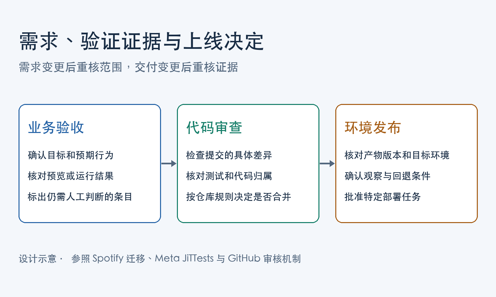

企业把需求实现交给 Agent，希望它能依据已确认的目标完成修改，并交出负责人可以检查的结果。人工验收需要解决的是，如何判断交付符合需求、如何识别未完成的部分，以及不符合时怎样让下一轮执行取得明确输入。

难点首先是需求未必完整。已有行为可以调查，业务规则却可能需要人选择。其次，产物、测试与需求可能分别更新，审核者容易拿旧证据检查新代码。最后，实施速度提高后，若每份交付都需要维护者重新调查，省下的工作会转移到验收队列。

委派时，需求负责人先确定完成条件。执行者按这些条件实施，并记录本次使用的要求版本和生成的产物版本；交付时，再逐项附上验证材料。验收者据此接受结果或指出偏差，平台将决定交回执行流程，安排继续交付或返工。

## 验收流程需要先确定哪些职责

需求负责人负责确认目标、处理范围争议，并指定谁有权接受结果。执行者负责提供实现和证据，不能单凭自己生成的完成说明关闭业务要求。代码维护者检查实现及其相关影响；涉及发布时，服务负责人再根据当前环境决定能否上线。小团队可以由同一个人兼任，系统仍需要区分这些决定覆盖的对象。

一项要求可以沿四个状态推进：未澄清、实施、送验和交付。未澄清时，Agent 先调查事实，涉及业务选择的部分等待负责人决定。规则明确后，执行者开始实施；候选及证据齐备后提交验收；验收者接受后，再进入相应的交付阶段。退回时保留原要求和具体偏差；要求改变时形成新版本，再决定已有结果可复用多少。这个流程的起点是把未知事实与未作出的选择分清。

## 委派之前，区分未知事实与未作出的决定

一项可委派需求需要说明：哪些使用者在什么条件下遇到了问题，希望改成怎样的行为，涉及哪些对象，本次不处理哪些相邻问题，以及谁有权确认规则。范围并不要求一次写到完美，但会改变实现的未决问题要先显露出来。

Agent 可以通过调查补齐事实。例如查明某字段的消费者、现有接口的校验位置、已有测试覆盖了哪些输入，这些结果有代码或记录可查。另一些问题属于选择：旧数据是否一起迁移，空值是否代表缺失，权限变化是否适用于现有用户。选择会改变行为、数据和回退成本，应由任务负责人或相应领域负责人决定。

因此，开工可以分成调查与实施两段。调查结束后，Agent 交付发现、候选方案和各自影响。负责人决定会改变结果的业务问题，平台将决定保存到需求中，执行者再依据更新后的需求修改代码或数据。若某个问题只影响局部，也可以先推进不依赖答案的部分，同时把受影响部分置于等待。执行者需要知道等待的是哪项决定，负责人也需要知道不回答会阻塞什么。

Linear 的工单委派提供了一个有用的职责参照：工单保留人工负责人，同时可以委派给 Agent；Agent 会话又有工作中、等待输入、完成等状态。平台可以沿用这种区分，把需求归属留给负责人，把一次运行的进展留在执行记录里。Agent 结束一次会话后，未解决的需求仍有接收者和下一步。

## 完成条件要能区分“做过”和“达到要求”

“完成迁移”“优化体验”描述了工作方向，验收还需要能观察的结果。迁移涉及哪些消费者，哪些字段必须替换，哪些语义保持原样，怎样检查读取与输出，分别需要写清。对于体验类需求，也应给出要改善的操作路径、代表性条件和负责人可以判断的结果。

完成条件可以按判断方式分成四组：自动检查、人工体验与业务确认、代码审查、发布后观察。自动检查处理有明确输入输出、能重复执行的条目；需要看实际交互或业务含义的条目，由负责人操作确认。代码维护者检查结构、依赖和维护影响；服务负责人通过发布后的运行观察确认真实效果。同一需求可能跨越这些检查，不能用其中一次通过替代所有结论。

条件越早写清，越容易发现当前无法验收的地方。测试账号不存在、关键样例数据不可用，或者只有用户本人能确认某种结果时，团队可以先准备资源或调整范围。等代码写完才发现没有检查方法，会把不确定性集中到交付末尾。

验收条件也要覆盖应保持的行为。需求常常只描述变化的部分，但一次修改还可能影响相邻用户和旧数据。负责人可以指定必须保持的规则，维护者依据调用关系补充回归范围。这里不需要穷举整个系统，而是围绕本次变更会触及的路径建立检查。

## 用一份材料连接要求、版本和证据

验收材料可以放在现有工单与 PR 中，平台负责维持它们的关联。首页先给出任务目标、当前需求版本、候选提交或构建标识、范围变化以及仍未决定的问题。随后按要求展开证据，审查者不必从运行日志中猜哪些输出对应哪一项承诺。

下面是依据迁移实践抽象的验收条目结构，可用于设计表单；它展示每种材料怎样影响决定：

| 要求 | 检查方式 | 随交付提供的证据 | 验收者的决定 |
| --- | --- | --- | --- |
| 使用已确认的新字段 | 对照映射表检查改动，并运行相关检查 | 本次采用的映射版本、涉及位置、同提交结果 | 映射是否准确应用 |
| 保持原有业务含义 | 用有代表性的输入比较输出 | 输入、预期、前后差异和用途说明 | 差异是否符合业务意图 |
| 用途相关字段暂缓处理 | 对照目标清单检查保留项 | 保留位置、原因、可选方案及负责人 | 接受分段交付或补充决定 |
| 变更可进入目标环境 | 检查部署与恢复条件 | 待发布构建、配置变化、必要回退条件 | 何时发布及如何观察 |

每个条目还要有验证状态和对应版本。“未运行”“运行失败”“结果待人判断”应分别呈现，因为下一步不同：未运行可能缺环境，失败可能需要修改，待判断则需要有权决定业务规则的人。没有覆盖的条件列在相关条目旁，验收者据此决定补证据、缩小接受范围，还是暂停交付。

证据需要可复查。自动测试保留检查标识、运行环境和输入输出；人工体验提供能进入指定构建的入口、账号条件及操作步骤；输出比较保留使用的数据范围和差异。截图可以显示界面结果，涉及交互行为时还要提供操作路径。执行者写的总结帮助导航，判断存在争议时能回到原始材料。

版本关联直接影响决定是否有效。平台可以把一次送验记录保存为“需求版本、候选提交、证据集合”的组合；验收者的结论附在这份记录上。后续提交更新时，新版本先进入待验证，相关条目重新运行或确认。原记录保留作历史，界面显示当前还有哪些要求没有得到新版本的支持。

## 测试由谁写，决定还需要谁检查什么

执行 Agent 熟悉自己的改动，让它补测试能降低准备成本，也能把排查发现转成可重复检查。风险来自同一个理解同时决定了实现与断言：若它误解字段含义，代码和测试可能一致地使用错误规则，CI 仍然全部通过。

审核时可以把测试变化拆成三个问题。新增输入是否对应需求或已有缺陷？修改断言改变了什么可接受行为？删除检查是否因为行为已获准移除？平台在证据条目中展示这些变化，而非只给测试文件差异。业务负责人核对行为依据，维护者核对断言是否真正检查了该行为。

实际作决定时，验收者先读已确认的要求，再看输入与期望值，最后对照测试及结果。若原要求保留某类旧输入，而新断言将它改为允许失败，审查者就有一个明确的退回理由：候选降低了该条要求，需恢复原行为或取得范围变更决定。对于原来就存在的检查，可以在基线和候选上对照运行；对于新增行为，负责人先确认预期，再检查候选。这样能把“测错了目标”从一份全绿报告中分离出来。

既有测试、独立 CI 和人工复核分别提供不同信息。既有测试保留历史要求，CI 在确定的环境与提交上执行，人工确认需求与检查之间的对应。另一个模型可以辅助找遗漏，但如果沿用同一份错误假设，额外生成一组测试仍可能重复误解。独立性来自不同依据和明确职责。

Google 在《Accelerating code migrations with AI》中介绍的广告系统迁移说明了这种分工。领域工程师先利用 Code Search、Kythe 和脚本圈定可能需要将 32 位 ID 改成 64 位的位置，工具生成变更并运行单测，部分测试随之更新。工程师继续检查和补改，再将变更拆开交给相应代码所有者。单测支持受测行为的判断，范围选择、测试变更和跨模块影响仍有各自的接收者。

## 测试基础不同，人工接手的位置也不同

Spotify 的数据集迁移提供了另一种条件。团队用 Backstage 和代码搜索寻找下游消费者，再让 Honk 协助迁移。Devon Edwards Joseph 在《Background Coding Agents: Supercharging Downstream Consumer Dataset Migrations》中记录，团队最初将面向工程师的迁移指南改成 Agent 材料，模型仍会猜错字段映射；随后团队把映射明确写成表。部分字段需要按用途决定，Agent 保留原字段并在代码旁留下迁移指引。

在这批目标仓库中，构建时单元测试很少，下游团队在合并前还需要自己测试。接收材料因此要同时指出已经完成的映射和仍待业务判断的字段。若只说“迁移完成”，下游会误以为所有语义已确定；若只给 PR 差异，下游又需要重新查找指南和遗漏项。

对照 Google 的实践，可以看到验收深度由两类条件共同决定：团队是否已经确定变更含义，以及现有检查能否覆盖这种含义。规则明确且测试充分时，自动化可以先完成较多验证，再交给人审查差异。规则依赖用途、测试基础薄弱时，平台要准备可操作的验证材料，并安排领域人员接手。增加一个统一的“人工批准”步骤，无法补上缺失的输入和知识。

落地时可以为不同仓库保留各自的检查方式，同时统一要求与证据的关联。自动检查强的项目接收 CI 结果；依赖人工测试的项目接收操作记录和输出比较；仍有歧义的条目进入待决定。平台先让覆盖情况可见，再据此缩小或扩大自动通过范围。

## 验收人如何作决定，退回之后怎样继续

验收者打开任务时，先确认当前送验的需求与产物版本，再看执行者列出的范围变化和未完成项。目标已经改变或送验版本过时，就先处理版本，避免审核即将被替换的结果。目标与版本一致后，按条目检查证据，优先处理影响主要行为和恢复代价的部分，对有疑问的结果重跑或要求补充。

业务验收通过，表示指定版本满足已确认的业务条件；代码审查通过，表示实现可以按仓库规则接收；发布批准则允许某个构建进入指定环境。一个人可以兼任多个角色，记录仍应说明每次决定覆盖什么。GitHub 的受保护分支规则可以要求代码所有者审核，并在差异变化后撤销过时批准；环境审核可以单独决定部署，并可配置禁止发起者自审。平台可以连接这些已有决定，避免自己复制一套状态却与真实合并、发布脱节。

退回也要成为可执行输入。理由应指向具体条目，说明观察到的结果、期望结果和需要补充的证据。若实现偏离原要求，保留需求版本，建立新的修复尝试；若负责人决定改变行为，形成新需求版本，并标出受影响条目。执行者先读取差异，确认哪些原结果仍可复用，再继续修改。用一句“效果不好，重做”退回，会让下一轮再次猜测。

用户在执行中更改需求时，平台先判断变化影响哪些正在进行的动作。只补充说明且不改变结果，可以作为同版本的澄清附上；改变范围、输入规则或完成条件，则生成新版本，暂停依赖旧决定的写操作。已经形成的补丁可以复用其中仍符合要求的部分，但要按新版本送验。新增 PR 提交同样触发候选更新，受影响的测试和批准重新进入待确认。

长期无人处理时，任务进入等待，并显示等待的负责人、所需决定与影响。平台按事先约定的时限提醒或转给代理负责人，仍无人接收则暂停后续动作。多人意见冲突时，保留各自理由，由需求负责人协调，跨领域争议交给预先指定的裁决者。执行 Agent 可以整理候选方案和影响，不能把最后一条评论自动当成授权。

## 控制验收负荷，要改变进入队列的工作

人工接收能力会限制自动化规模。任务增加时，应观察等待时间、实际复核时间、补测和返工分别消耗多少，而非只看生成速度。大批低质量 PR 会把省下的实施时间转移到维护者身上。材料难读、重复任务和缺少环境，也会让审核者把大部分时间花在准备判断。

可以根据后果、可恢复性和验证覆盖选择验收深度。范围固定、结果可独立检查且容易撤回的任务，可以先由规则通过，再抽查实际结果；影响客户数据、权限或不可逆状态的任务，应在动作发生前安排相应负责人判断。抽查要覆盖自动通过的任务，包括不同仓库和不同条件；一旦发现同类遗漏，先缩小对应任务的自动通过范围，补齐规则和检查后再恢复。

对于发现类工作，还可以先筛选证据再联系工程师。Meta 的 JiTTesting 实践会挑选有风险的改动，生成并执行展示行为差异的测试，经筛选和排序后，将足够重要的发现交给工程师判断是否符合意图。这种组织方法适合有可执行差异的发现队列。需求交付仍要处理全部承诺项，但可以同样优先展示需要人决定的差异，减少翻查无关日志。

平台初期可以从一种重复工作做起：用现有工单保存需求，在 PR 中关联逐项证据，通过 CI 和指定环境完成检查，由明确负责人处理退回与接受。观察哪一步仍需要大量人工重新调查，就改进那一处材料或前置条件。验收的完成标志是有权接收的人能够依据当前证据作出决定，执行系统据此继续、停止或移交；原来承诺的业务效果需要发布观察时，任务还要把这段工作交到具体负责人手里。
