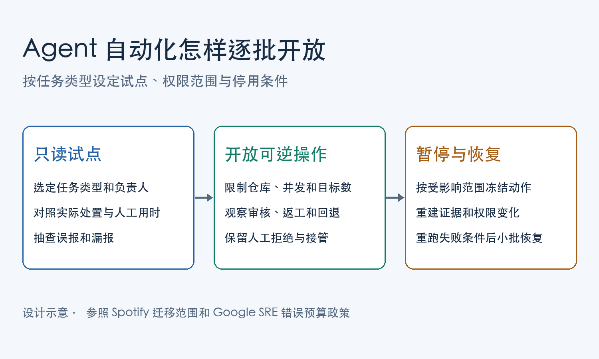

企业希望用 Agent 减少重复劳动、加快工作完成，又需要控制数据访问、错误变更和生产事故的后果。组织治理要决定哪些任务可以委派、谁有权扩大范围、出现问题时怎样停用，以及各方对自己的决定承担什么责任。

这几项安排如果脱节，员工就很难判断是否应该使用。发起者节省了操作时间，可能又承担更多复核和解释成本；审核者需要签字，却未必看得到关键证据或有权暂停；平台团队提供执行能力，也需要对权限控制是否有效负责。这些是设计制度时要检验的风险，而非对所有企业采用现状的概括。

讨论应从一类具体工作的收益和后果开始，确定准入条件，配置负责人所需的信息与控制权，再通过试点评估是否扩大。事故责任也沿这组实际决定追溯。

## 先形成一份可以执行的授权安排

开放一类任务时，需要确定任务范围、自动执行阶段、验收标准、暂停信号和处置人员。任务范围说明哪些服务、仓库或业务记录可以交给 Agent；执行阶段规定 Agent 可以调查、提 PR，还是继续发布；验收标准说明怎样检查调查结论或代码修改。还要约定何种异常触发暂停，并指定有权处理异常、恢复业务的人员。缺少其中任何一项，员工都可能无法落实“允许使用”的决定。

这份安排由业务、平台和服务负责人共同形成。业务方说明目标及不可接受的后果，平台方说明权限与停止机制能覆盖什么，服务团队确认验证、发布和恢复能力。准入决定记录范围与依据，执行数据用于复查它是否仍成立。员工随后在已授权的范围内选择任务，遇到条件不满足时能够退回或暂停，也能知道问题会交给谁处理。

治理的难处是让这些安排持续影响日常行为。评价只看产出数量，会遗漏返工与审核；任何失败都归给发起人，会使报告问题变得不利；任何局部问题都只能总停用，又会让其他工作承担长期冻结。因此需要先统一收益口径，再分别讨论准入、岗位权力、试点、暂停和责任。

## 先把收益和新增工作算给同一件任务

Agent 能很快生成一批 PR，但企业要完成的是修复并恢复服务。提出任务、准备上下文、等待审批、审查、返工和观察生产，都属于这份工作的成本。若平台只统计生成数量，业务团队承担的额外复核就会消失在报表里。扩大使用越快，审核队列反而可能越长。

因此，评价单位应是一类任务从进入到结束的全过程。原先人工调查要多久，使用 Agent 后人花多少时间准备材料、核对结论、处理失败，结果等待了多久，都要有同口径记录。被拒绝、被替代和中途退出的任务同样进入分母。某个任务没有得到补丁，但提前排除了错误方向，也可以有价值；价值需要从后续工作减少了什么来判断。

这会改变使用者的处境。为试点投入的复核时间应纳入工作安排，主动报告失败也应留下有效成果。若只奖励采用次数和快速交付，员工会倾向挑选容易成功的任务、压后报告问题；若任何模型错误都由发起者个人承担，员工又会倾向回避使用。前者损害评估，后者使组织无法学习。管理者需要为受控试验分配时间，并把按规则报告的失败用于修正规则。

审核也是一种有限资源。确定试点规模时，要先确定谁能审核调查结论或候选补丁，以及何时审核；审核积压超过约定等待时间，就降低派发量或暂停新增交付。业务负责人可以接受少量等待，却不能在没有接收能力时批准大批自动生产结果，再把“迟迟无人审核”解释成员工不配合。

## 准入要决定一类任务做到哪一步

“允许研发使用 Agent”无法指导一次实际工作。准入决定要写明 Agent 可以处理哪些服务或缺陷、可以做什么，以及必须在哪一步停下。例如，可以允许 Agent 对指定服务的常见异常做只读调查；对能够复现的缺陷，再允许它修改代码并提交 PR；生产发布仍由服务团队决定。调查范围、提交 PR 的条件和发布权限可以分别评估、分别调整。

判断时先看结果怎样验证。日志调查可与人工诊断和后续事实比较；代码修复可用原失败、相关回归和代码审查检查；修正业务数据时，还要确认修改符合哪条业务规则、记录属于哪个用户或租户，以及记录当前的值。越难在生效前识别错误，越需要把自动化停在候选方案处，或者缩小首批作用范围。

再看影响和恢复。错分一张内部工单可以重新分派，跨租户泄露信息无法靠删掉结果消除，错误付款也需要业务冲正。任务发生频繁、执行错误又容易纠正时，值得投资完善自动执行；低频且后果难以挽回，可以长期保留人工决定。数据敏感性同时影响调查阶段：只读任务也可能因为资料范围过宽而无法准入。

最后看人能否接手。遇到准入规则未覆盖的情况时，平台要能把任务交给具备相应业务知识和操作权限的人，并提供已经取得的证据、尚未解决的问题。一个人挂在负责人字段里，却无权查看数据、暂停运行或安排恢复，不能提供这种能力。接收能力不足时，可以先开放不产生外部影响的研究工作，等待交接条件补齐。

Spotify 在下游数据集迁移中，通过血缘和代码搜索圈定仓库，再给出字段映射；团队当时停止尝试写法较难标准化的 Scio，集中处理 BigQuery Runner 和 dbt 项目，部分按用途判断的字段留给下游团队。这支持一种准入方法：在同一迁移目标下，把输入能说明、结果能检查的部分先交出去，将仍需业务判断的部分留在明确的交接点。

准入记录因而需要解释“为什么到这里停止”。如果缺的是复现环境，建设环境后可以重评；如果缺的是业务规则的确定性，换更强模型并不会自动解决；如果缺的是接手人，扩大并发只会让问题变大。这些原因决定下一笔投入应放在哪里。

## 让决定权跟着可见信息和控制能力走

业务负责人判断任务目标及可能的业务影响；平台负责人管理执行身份、调度和工具权限；审核人检查调查结论或候选补丁；值班人员在异常发生时停止后续变更、组织恢复。这些职责可能由同一个人兼任，也可能跨团队，重要的是每一项决定都有相应的信息与操作能力。

| 决定 | 决定者需要看到什么 | 决定者需要能够做什么 |
| --- | --- | --- |
| 开放一类任务 | 历史任务、验证能力、可能影响、接收容量 | 限定任务范围、投入复核资源、缩回授权 |
| 接受一次交付 | 当前版本、需求差异、检查结果、未覆盖条件 | 退回、要求补证据、拒绝接受 |
| 推进生产变化 | 产物、目标清单、观察条件、恢复路径 | 延迟、暂停扩量、发起恢复 |
| 恢复一类自动化 | 受影响对象、原因修正、失败路径验证 | 限制首批范围、指定观察人、再次停用 |

审核人的批准应只覆盖界面所展示的版本和判断范围。如果批准的是实现符合需求，发布系统仍需检查运行条件；不能因为已有签字，就让审核人同时承担未展示的租户权限和生产状态判断。需要多人共同决定时，应把未决问题分别交给掌握事实的人，避免几个人在同一份不完整材料上重复签字。

平台团队也需要自己的明确责任。它不替业务决定客户状态，但要保证撤权实际阻断后续动作、检查结果对应真正执行的版本、记录能还原过程。业务团队在政策允许的范围内委派工作，可以依赖这些控制；平台若保留绕开保护的入口，就不能把控制失效都解释为使用者选错了任务。

岗位授权可以落实到一次具体交接：审核人发现证据不全，点击退回后，任务进入待补充，当前交付的批准失效，调度器停止推进发布；审核人若发现同类结果集中异常，可以暂停该任务族的新增交付并通知服务负责人。若审核人只能留言，系统仍会自动推进，组织就不能要求他承担阻止变化的责任。扩大授权的负责人应先补齐这个控制入口，或者把最终推进决定交给已有停用权的人。

当交付长期无人处理，可以按预设顺序转交候补审核人，再退回任务或暂停继续执行。高后果动作保持等待，不能通过审批超时默认放行来消化积压。审核人有权因证据不足退回，也有责任说明缺少什么，否则执行者只能反复生成更长的报告，交接成本持续上升。

## 用影子运行取得真正可比的证据

试点开始前，先确定任务集合、原流程、通过条件和不可接受事件。集合中应保留困难任务、资料缺失和失败样本，标记哪些任务被准入规则排除。否则选择过程本身就可能制造高成功率，推广以后才遇到此前被悄悄跳过的情况。

对风险较低、又有历史资料的调查，可以先做历史回放。Agent 只能取得当时可见的输入，不能读到后来形成的根因总结、修复提交和人工答案。用事后资料完成的调查会夸大判断能力，拿这种结果批准自动响应，会在真实信息不足时暴露缺口。

OpenAI 的 Performance Factory 先从工程师辅助调查推进到可重复的调查流程，再让告警自动启动任务。其历史评测以原始告警进入，排除记忆和事故复盘等事后材料；报告交给工程师能否接续工作，另用任务快照评估，合并和发布仍由工程师决定。这里可借鉴的是分别验证调查质量和交接质量，再据此扩大调查阶段的范围。

历史资料已经过期或缺失时，可以做影子运行：保留人工流程作为实际处置路径，Agent 并行调查并保存当时可见的输入和建议，但不自动触发外部动作。随后比较它发现了什么、漏了什么、是否选对接手人，以及人工为核对这些输出付出了多少工作。影子输出应与实际处置隔离；若人工提前使用了建议，应标记这一影响，避免再把人工结果当作完全独立的对照。

进入受限写入试点时，只增加一个有明确效果的动作。例如从提出工单建议扩大到创建指定项目工单，新增评估便是重复率、误分配、接收负荷和恢复方式。调查正确率高，可以支持扩大调查覆盖；它没有回答自动开单、修改代码或生产发布分别会增加哪些错误。

## 扩大授权，必须改变一个可说明的范围

一轮试点结束后，决策材料应同时呈现收益、常见错误和严重后果。平均处理时间降低，但审核时间增长，需要解释净收益；通过率较高，但困难任务几乎都被排除，需要说明推广仍限于原范围；没有出现严重事故，还要检查有多少次真正触及可能造成该后果的动作。小样本中的“从未发生”不足以证明罕见风险已被控制。

可以把扩大限定在一个维度：增加同类任务数量、增加资源范围，或增加一个执行阶段。先固定其他条件，才能在质量变化时定位原因。更换模型、提示、工具权限和验收规则也属于可能改变行为的变更，应保留版本，并用代表性成功与失败任务重评；影响关键判断时再缩小首批范围观察。

有些失误可以在受限范围里消化：多开了可以合并的工单、候选补丁被检查拒绝、调查结论被工程师纠正。前提是它们没有越过已授权边界，且复核返工没有吞掉收益。另一些事件应在发生一次时就触发限制，例如越权访问敏感数据、执行未批准的业务写入、在暂停后继续产生影响、关键动作无法追溯。它们表明控制条件已经失效，不能与普通错误平均成一个总成功率。

严重后果还应在试点前用演练检查防线。让旧运行在接管后再次写入，让批准后的产物变化，让外部请求已经生效但响应丢失，检查系统能否拒绝、识别和恢复。组织不能等真实客户承担第一次验证成本。若无法隔离影响、也无法验证恢复，就把自动化停在方案和证据交付阶段。

## 暂停范围由失效原因决定

暂停需要一个当班人员立即能用的入口。单次任务的证据互相矛盾，可以暂停该任务；同一修改模板反复产生错误，可以暂停同类任务的写入；共用身份校验失效，则暂停经过该入口的所有写入，并确认是否已有数据暴露。暂时不知道范围时先扩大限制，查明后再按证据缩小。

误报过多则先限制产生通知和工单的环节，保留静默调查样本，查清是采集错误、判断阈值还是归属规则导致噪声。用修正后的规则回放被误报和未上报的样本，确认减少通知没有同时扩大漏判，再小范围恢复通知。它与越权失效的处置不同：后者需要先撤销共用写入或数据访问能力，直到权限边界重新经过验证。

这样设计有两个效果：能够在事故时迅速阻止传播，也让正常工作不必永久承担其他任务的风险。若企业只有总开关，每次局部问题都可能演变成全面停用；若企业只允许停单个任务，共因故障又会继续在其他运行中发生。平时记录任务、规则、工具和运行版本的对应关系，事故时才能找到合理的暂停集合。

Google SRE 的错误预算政策样例，事先规定可靠性越界时暂停变化、保留哪些例外以及争议如何升级。它给予团队根据数据转向可靠性工作的依据。Agent 自动化也需要把暂停条件连到实际资源安排：谁能停止普通工作，谁处理恢复，紧急修复经过什么入口，不能只写成“视情况停用”。

决定恢复自动化前，需要完成影响清点和控制修复。先确认哪些请求未执行、哪些已经生效、哪些效果仍未知，必要时恢复数据或进行业务补偿。再验证修复后的权限或暂停规则是否能阻止原来的错误路径。服务负责人确认当前服务能够承受恢复后的执行负荷和影响，平台负责人确认共用控制已修复，再以小批次重新开放。规定复核时间和明确的恢复证据，也能避免“先停再说”变成无人负责的长期冻结。

## 责任要追到当时能够作出的决定

事故后先还原事实：当时任务为什么准入，使用了哪版规则，审批者看到了什么，运行取得哪些权限，异常何时出现，谁在那个时刻能够停止后续变化。这些记录让调查者能追到造成事故的具体决定，而非把最后一次点击者当作所有环节的负责人。

若员工按允许的任务范围操作，系统却执行了更广的写入，首先要检查授权实现；若交付材料隐藏了关键检查缺失，要检查生成与呈现；若负责人明知条件不满足，仍主动绕过限制，则需要针对该决定处理。模型判断错误也要继续追问：这种错误是否在准入时已预计，验证为什么没能发现，影响为什么超出预定范围。复盘中的每项整改应指向能改变下一次结果的角色和控制。

允许试错需要事前说明允许的范围，事后也按同一标准处理。按规则提交失败和主动暂停的人，应得到排查资源，而不是因为问题首先由他报告就承担全部责任。隐瞒影响、伪造检查或绕过授权则破坏了共同使用证据，不能与受控范围内的合理失败混在一起。这样区分，员工才有理由尽早暴露问题，管理者也能保留必要的问责。

一套可持续的安排，最终应让团队能回答三个日常问题：这件工作现在能交到哪一步，发现异常后我能立即做什么，按规则执行仍失败时组织怎样处理。答案来自准入记录、审核信息、停用能力和真实的复盘处置。企业据此逐项扩大有效的自动化，也有依据让某些高后果决定长期由人掌握。
