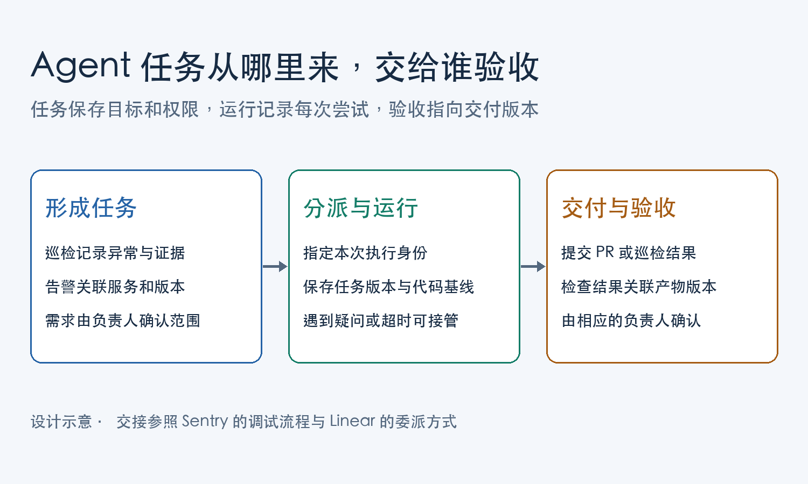

企业级 Agent 协作平台要承接三类工作。定时巡检需要自动检查受管对象，将值得处理的发现交给负责人；自动修复需要从已确认的问题形成补丁，完成验证并进入审核；需求实现需要先澄清业务目标，再把实现结果交给有权验收的人。企业建设平台，希望减少人反复收集资料、分派执行和跟进结果的工作，同时保留对数据访问、业务变更和生产发布的控制。

这些需求不能只靠给一个 Agent 增加工具来完成。巡检拿到的异常还不一定构成可修复的问题，需求描述可能缺少业务决定，代码执行成功也不说明用户要求已经满足。平台首先要解决这些交接处的信息与权限问题，随后才有依据决定让谁执行、可以执行到哪里。

下面先说明三类工作分别怎样进入平台，以及现有工单、观测和交付系统需要补上哪些连接，再据此设计任务、调度、协作和验收。

## 三类工作分别需要什么输入和结果

巡检从受管对象清单和检查规则开始。采集程序读取指定时段的数据，确定性规则计算是否超时、缺失或超过阈值；需要理解日志或关联多源信息时，再让 Agent 请求材料、提出解释。发现记录至少指出对象、观察时间、触发条件和原始证据。已有同类问题时更新原记录，数据没取得时留下覆盖缺口，需要人决定严重程度或处置方式时进入待确认。检查完成和问题解决由不同条件判定。

自动修复从一项被接受的问题开始。输入需要指出受影响行为、相关版本和期望结果。调查者读取日志及对应代码，提出可检验的原因，再用复现或测试验证。如果证据足以支持修改，而且范围在授权内，平台才启动修复执行；缺少业务规则就向负责人提问，缺少数据就保留待补材料。修复者交付的是带验证结果的候选变更，维护者决定是否接收，发布系统负责将接受的产物送到目标环境。任务承诺恢复线上行为时，还需读取发布后的观测结果。

需求实现从请求及负责解释目标的人开始。Agent 可以调查已有实现、依赖和测试，整理出待决定问题；哪些用户行为应改变、哪些数据应保留，由负责人确认。执行开始后，交付按这些要求逐项提供结果。验收失败时，先判断实现偏离要求还是要求本身变化，再分别启动返工或更新任务。这样，需求变化和执行失败才不会都被当成“再让模型试一次”。

三条路径可以共用执行环境、运行记录和身份管理，开始条件与完成条件则分别配置。巡检无需等待代码合并，修复不一定需要重新讨论产品目标，需求实现也未必来自异常。平台按工作类型选择路径，再在每个交接处检查进入下一步所需的证据。

## 现有工具之间缺少哪些连接

采用工单、代码库和 CI 的团队，通常已有存放目标、代码和检查结果的位置。新增平台首先要连接这些事实。一个工单可以对应多次运行，一次运行可以产生多版候选，某次 CI 只覆盖其中一个提交，某条批准也只允许特定变更。若这些关联仍依赖人翻聊天和复制链接，换一个执行者就可能重复调查，收到旧提交的通过消息也可能错误推进新版本。

还有一类困难发生在控制权变化时。人补充了需求，原执行者可能还在按旧要求写代码；工作进程失联后重新派发，旧进程也可能恢复；发布请求超时，目标系统可能已经开始部署。解决这些问题需要把任务版本、当前执行权和外部结果保存为系统可检查的状态。

据此可以划出五项职责。入口适配器负责收取事件和人工请求、保留来源；任务服务保存目标及决定，并判断下一步条件；调度与运行器准备环境、领取工作并执行；工具入口限制实际读取和写入；验证与交付接口把产物送到 CI、审查和发布系统，再带回结果。人的操作界面使用同一组记录，能够回答问题、退回、暂停和接管。

一次交互由任务服务串起。它确认任务可开始后交给调度器，运行器领取并固定输入版本，通过受控工具执行，把产物写回任务；验证接口取得产物版本，触发检查，收到对应版本的结果后才转给审核者。任何一环缺少前提，任务就保留明确的等待原因。这些职责可以先放在同一个服务里，实现时最先固定的是数据归属和状态转换。

## 入口怎样校验与归并请求

任务入口应先保留原始来源，再形成一份可修改、有版本的工作说明。至少包含目标、涉及的资源、完成条件、业务负责人，以及当前允许的操作。例如，一项“排查新版接口错误率上升”的工作，初始范围可以是指定服务、环境和观察窗口，允许读取日志、发布记录与代码，交付是有证据的原因分析。调查发现需要改代码后，再由负责人确认是否进入修复阶段。调查期间仍可推进资料搜集，无需提前取得生产写入权限。

完成条件决定平台什么时候能够关闭工作。“产出原因分析”“提出候选补丁”和“恢复服务指标”需要不同的证据与权限。若一开始约定的是恢复线上行为，生成 PR 只完成其中一段；若约定的是调查，得到足以支持下一步决定的诊断就可以交付。平台据此选择后续流程，避免把所有任务都推进到部署。

同一问题还可能同时从告警、巡检和人工反馈进入。入口先用来源事件标识防止重复接收，再用业务对象和规则判断是否应关联到已有任务。例如，同一服务、同一环境、同一观察窗口内的同类错误可以归到正在调查的问题下；一次新的发布是否另开任务，要看版本变化是否改变了调查范围。无法确定共同原因时，先关联为相关任务，保留各自状态。

这里需要区分业务负责人和执行者。负责人维护目标、解决范围争议并接收结果；执行者完成当前委派。Linear 的工单委派设计就分别保留人工负责人和 Agent：把执行交出去之后，工作仍有明确的人承担业务判断。对于本文的平台方案，负责人缺失应阻止进入需要业务决定的步骤，执行者暂缺则可以让任务留在待派发队列。

## 任务、运行与交付怎样关联

一项任务可能重跑、更换执行者或修改需求。如果所有信息都追加到一个会话里，平台很难回答“这次批准针对哪版结果”“第二次运行使用了什么基线”。下面的记录划分可作为实现起点。

| 记录 | 保存的关键内容 | 它支持的决定 |
| --- | --- | --- |
| 任务及其版本 | 目标、范围、完成条件、负责人、来源 | 当前要完成什么，范围是否已经改变 |
| 单次运行 | 任务版本、输入快照、执行者、工作区、授权、预算和状态 | 这次尝试可以做什么，失败后从哪里接手 |
| 交付版本 | 产物位置、代码或数据版本、证据、未完成项 | 审核者实际在检查什么 |
| 决定记录 | 决定人、对象版本、同意范围、条件和时间 | 哪一步已经获准，后续变化是否需要重审 |
| 外部操作记录 | 动作标识、目标、请求状态、外部结果标识 | 请求是否已经生效，能否安全重试 |

任务记录提供长期归属；运行记录描述一次尝试。运行结束可以是交付、失败、等待或取消，任务则可能仍在继续。交付版本保存可检查的结果，并引用产生它的运行。决定记录引用交付版本，使批准与具体内容建立关系。

Netflix Pensive AI 的故障诊断说明了稳定标识的作用。它把一次工作流步骤的失败尝试作为诊断对象，Data Portal、MCP 与 API 可以取到同一份完整结果。并发请求通过条件写入竞争生成权，浏览器关闭后，后台生成仍可继续。这个设计依赖诊断对象明确：几个入口询问的是同一次失败。若诊断依据后来增加，平台应保存新的证据版本；若跟进对象是不断增加提交的 PR，还要记录本次检查所对应的提交。

运行恢复也不宜只读取一段对话摘要。可恢复材料应包括已完成步骤及其产物、尚未解决的问题、待执行动作、正在确认结果的外部请求，以及下一步的前提。对话可以帮助解释判断过程，文件、版本和外部结果则让新执行者核对实际状态。

## 调度器怎样选择执行者并让它开始

任务满足启动条件后，调度器先筛选有资格的执行者，再决定何时派发。资格来自任务所需能力、可访问项目、工具种类和执行环境。例如，日志调查者需要读观测数据，代码修改者需要对应语言的构建环境和仓库写入范围。执行者宣称能够完成任务，不能替代资源权限检查。

在符合条件的候选中，再比较剩余容量、等待时长、任务期限和预计成本。紧急调查可以进入独立队列，批量迁移按仓库限制并发，避免占满构建机或挤压人工审核队列。一个任务需要多个受限资源时，应先确认能否取得这一组资源；否则执行者启动后长期等待，只会把排队转移到昂贵的运行环境里。

领取时，平台以条件更新把任务从待派发改为执行中，同时创建运行记录和本次领取的有效标识。条件包含任务版本仍为预期值、当前没有有效领取者。竞争失败的进程读取最新状态，不再自行启动。运行器随后准备隔离工作区，固定代码基线与材料快照，并取得仅覆盖这次运行所需动作的身份。模型收到这些材料后，才开始规划或调用工具。

固定流程与模型规划可以在同一任务里配合。准备环境、校验权限、创建交付版本、触发 CI 和等待审批适合由确定的流程控制，因为它们有明确顺序和完成条件。阅读日志、提出原因假说、搜索相关实现与选择下一项检查，则可以让模型根据新证据调整。模型提出超出当前范围的步骤时，平台将其转成待决定事项，获准后生成新的任务版本或授权。

执行预算也应跟随运行保存。它包括时间、模型费用、工具次数、构建资源及自动尝试上限。临时下载失败可以按规则重试；同一检查持续失败时，继续使用相同输入通常不会增加信息，应转入重新分析或交给人。预算耗尽后，平台保留当前产物、失败证据与下一步建议，负责人据此决定续跑、缩小目标或结束调查。

## 多个 Agent 怎样分工，结果又由谁合并

增加执行者有用的前提，是任务可以拆成有明确输入和输出的部分。分析不同日志源、检查不同仓库依赖、独立审查同一份补丁，都可以并行进行。几个执行者同时修改同一套文件，则需要额外的整合过程。

一种可实施的安排是由主任务指定协调者。协调者先固定共同基线，把子任务的目标、允许修改范围、依赖和交付格式写入记录。例如，一个子任务分析错误样本，另一个定位相关代码，两者输出证据与判断，由协调者对照是否指向同一原因。信息冲突时，协调者保存分歧并追加能区分假说的检查，不能仅按多数意见确定根因。

代码并行修改时，各子任务使用独立工作区，交付引用各自基线与提交。整合者按依赖顺序应用变更，处理文本冲突之后，再在合并结果上运行相关验证。两个补丁各自通过测试，仍可能对同一接口作出不兼容假设；组合后的检查才覆盖这种相互影响。数据库迁移、共享配置及同一外部对象的状态写入，可以直接规定单一写入者，减少后续合并的复杂度。

共享信息通过任务产物和版本传递。子任务写入新结果，协调者读取后决定是否进入下一步；其他执行者若依赖旧版本，平台可以标记其结论需要复核。聊天适合补充解释，当前有效结果则要有明确位置。拆分带来的等待、合并与复核成本若超过并行收益，单个执行者按顺序完成会更容易控制。

## 等待、唤醒与接管怎样延续同一项工作

长任务经常需要等人的回答、CI 或外部系统。等待时，运行器先保存可恢复位置，再注册明确的唤醒条件，最后释放不必保留的计算资源。比如，补丁提交后保存提交 SHA、CI 运行标识和待检查项目，任务进入等待验证。CI 回调到达，入口按事件标识去重，检查它是否对应当前交付版本，然后唤醒后续验证步骤。旧提交的成功消息可以存档，不能把新提交直接推到待验收。

执行中遇到业务歧义时，Agent 把问题、候选做法及其影响保存下来，任务进入待决定，业务负责人选择或修改目标。人的回复绑定问题与任务版本；编排服务核对回复是否齐全、范围是否已经改变，再把任务转回待派发。新的运行取得这次决定和已有检查点，继续执行。注册等待与检查事件到达之间还可能交错，因此事件应先持久保存；任务登记等待后再核对已有事件，避免答案早到了片刻，任务却永久睡眠。

审核退回也沿明确的决定继续。审核者指出不符合哪项完成条件，负责人确认这是补齐原目标，还是修改需求；前者追加返工项，后者形成新任务版本。调度器据此派发新的尝试。若等待期间代码基线已更新，新执行者先比较旧基线、当前基线和现有补丁：无关变化可以整合后重跑检查，接口或目标行为变化则将差异交给负责人重新决定。新的交付引用新的基线，原有测试与批准只保留为历史证据。

工作进程失联则由租约处理。运行器定期续租，超时后调度器标记原运行失联，允许新运行接管。新运行读取检查点、核对工作区产物，并先处理结果不明的外部操作。每次接管增加领取代次，后续写入请求携带该代次，由实际执行写入的入口核对是否仍然有效。旧进程恢复后即使还持有本地工作区，也不能继续提交有效变更。

外部系统若无法核对代次，平台需要通过受控代理发送写请求，并单独管理在途操作。已经发送的请求不会因本地租约失效而消失。创建工单请求超时时，先按稳定操作标识查询目标是否已有结果；支持幂等键的接口可以使用同一键重试。无法确认时，将该操作标为结果待核对并交由人处理，接管者不能再次盲目发送。

暂停批量工作也沿这条边界处理：停止派发尚未开始的目标，取消尚未发出的请求，列出已发送与已生效的操作，再决定观察、撤销或补偿。暂停按钮之后，界面要能展示这些不同状态，值班人员才知道影响是否已经停止。

## 交付怎样进入验收，什么时候算完成

执行者交付时，把目标逐项映射到产物和证据。对于代码任务，可保存需求版本、基线与提交 SHA、验证命令和结果、预览环境以及未覆盖条件。自动检查通过后，平台把对应版本交给负责人；验证失败则回到运行，附上具体失败行为和原始结果。

审核界面首先展示变了什么、哪些目标已被验证、哪些仍需人判断，再允许审核者追到代码和日志。需求负责人确认行为，代码负责人审查实现，发布负责人决定上线时机。需要哪些决定由任务类型指定，已有代码托管和发布系统能表达的规则应继续在那里执行。

审核意见退回后，执行者形成新的交付版本。平台根据改动重新运行受影响的检查，并核对原决定是否仍适用。GitHub 保护分支可配置取消过时批准，使影响差异内容的更新触发重新审核。平台自己的业务验收也需要类似关联：批准对象变化后，向审核者展示差异，重新取得受影响部分的决定。

Sentry 的自动调试实践揭示了另一段经常遗漏的工作。Seer 提出 PR 后，定时流程还要查询 PR 是否仍开放，依据相关代码及提交历史推荐审核者，并避免反复发送相同提醒。工程师可以合并，也可以关闭并采用更完整的修复。产物已经生成，交接仍需要持续管理；平台应把“已有替代修复”“不再需要”和“验收失败”分别记录，避免无意义地重试。

最终完成状态取决于任务目标。只读调查可以在负责人接受分析后结束；代码实现可能止于合并；恢复线上问题还要跟踪发布版本和约定观察窗口。若症状通过回退得到缓解，根因调查可以继续关联在另一项工作中。这样，任务状态能反映实际完成了哪一层目标。

## 从已有系统接出最小平台

已有工单、代码库和 CI 的团队，可以先让工单继续保存业务目标与负责人，代码库保存产物和审核，CI 保存检查结果。新增一个小型编排服务，维护运行、等待、外部操作及交付版本之间的映射。入口收到任务后落库；后台进程领取并执行；结果先持久化，再由可靠的待发送记录触发 CI、工单更新或通知。发送失败只重试相应动作，不重跑整项工作。

这个起点可以只有一个数据库和一组后台进程。外部回调经适配器转换为内部事件，写操作经统一入口核对运行身份和资源范围，负责人从原工单进入结果页。出现多种执行环境、队列竞争和大量等待以后，再独立扩展运行器与队列。需要跨工单系统管理生命周期时，才进一步建立统一任务库，并明确每个字段由哪个系统维护，避免两个系统相互覆盖状态。

第一批任务应有可确认的范围和可负担的验收。Spotify 的下游数据集迁移先利用血缘和代码搜索圈定仓库，选择较标准化的框架，自动交付后由下游团队测试。需要按用途判断的字段保留并附指引。平台设计也可以用相同方式选择起点：哪些判断能提前确定，哪些材料能自动收集，剩余判断由谁接手。

上线后观察整条工作路径：执行花了多少时间，负责人等待了多久，审核与返工增加了多少负担，交付是否真正被采用。如果生成速度持续超过验收能力，应先限制派发、补齐证据或缩小任务范围。企业协作平台完成的工作，是让一次委派能持续推进到有依据的结果；运行次数和产物数量只有放回这条路径，才能说明自动化是否降低了完成工作的总成本。
