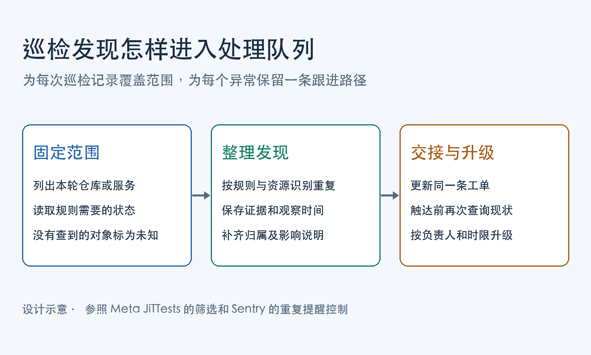

企业希望巡检自动承担的工作，是按照约定范围定期检查资源，把需要处理的问题及时交到负责人手里，并持续跟踪是否处理完。检查过期配置、缺失备份和长期未审核的 PR，分别需要不同的数据和判定规则，但都要回答是否查全、是否值得处理、谁来处理。

落地困难出现在三个位置。数据可能延迟或读不到，同一问题会连续多轮出现，新增发现也可能超过团队的处理能力。若只要求模型每天写报告，采集缺口容易被当成正常，重复发现容易变成多张工单，通知增加也可能掩盖紧急问题。

因此先设计检查范围、异常判定和处置规则，再确定 Agent 承担哪段分析。后面的流程依次处理采集、解释、跨轮次跟进、通知及受控修复。

## 先明确巡检完成和问题处理的区别

巡检完成，表示计划对象在约定时限内取得了足以判断的数据，并记录了未覆盖的部分。问题处理完成，则需要原异常满足恢复条件或负责人明确接受其他处置。一个检查任务可以正常结束，同时留下数个仍在处理的问题。

这一区分直接决定系统要保存什么。每轮运行保存对象清单、数据窗口和覆盖结果；每个长期问题保存首次发现、后续观察、负责人和处置状态。运行失败时重跑采集，问题未恢复时继续跟进，两种重试分别调度。负责人报告已处理后，巡检用新观察复核，无法取得新数据时仍保留待复核。

以“打开的 PR 超过团队约定期限仍未审核”这一文档用法展开设计，可以直接读取开放状态和审核时间；讨论中是否存在等待事项，则需要额外解释。下文以它说明记录和动作之间的关系，其他对象需替换各自的异常与恢复条件。

## 从检查目标确定周期和数据要求

设计巡检的第一项输入，是它要支持什么决定。检查未审核 PR，是为了让负责的人接手；检查备份，是为了及时补做并确认可恢复性；检查代码风险，是为了在问题扩散前拿到可复核证据。这些目标决定检查对象、发现时限和交付形式。只有一个“每天运行”的计划，还无法据此判断巡检有没有完成任务。

发现时限可以从后果倒推。允许下一工作日处理的积压项，可以每天汇总；需要数分钟内干预的服务故障，则应由满足时限的监控入口负责发现，Agent 在后续补上下文和分诊。完整的等待时间还包括数据到达、排队、采集、分析及通知。即使每五分钟触发一次，若查询等待半小时，也无法实现五分钟发现。

Netflix Atlas 的告警演进提供了相称的证据。一次批量增加告警规则后，轮询查询受到限流，重试和退避进一步拉长间隔，关键健康告警曾迟到 45 分钟。团队随后将多数查询迁到流式求值路径，让新到指标推动计算。选择触发方式时，除了检查频率，还要核对数据和计算方式能否在负载增加时守住时限。依赖历史比较或流式尚不支持的运算，仍需采用相应的数据与求值路径。

接下来定义每条检查的输入。可以先写一份检查说明：对象从哪个目录产生、按哪个时区确定时间窗口、什么数据算足够新、异常条件是什么、负责人从哪里查询，以及何种证据足以确认恢复。阈值属于业务或运维政策，应明确版本；模型可以帮助解释异常，不能在每轮运行中自行改变“超时”的含义。

## 固定本轮范围，才能知道哪些还没有查到

一轮巡检开始时，先生成运行记录，并从资产目录或受管项目清单固定对象快照。运行记录保存计划时间、实际开始时间、检查规则版本、数据窗口和预期对象数。采集器按快照分页查询，逐个记录结果。运行期间新增对象可以留到下一轮，明确标记紧急补查的对象则加入独立批次，以免本轮范围不断变化而无法收口。

范围来源应尽量独立于本次采集权限。例如，先从受管仓库清单取得预期列表，再向代码平台查询各仓库。如果直接把“当前凭证看得见的仓库”当作全部范围，一次权限收缩可能让某些仓库静默消失，报告却仍显示完成。

采集结果至少要区分下列情况。

| 覆盖结果 | 本轮知道什么 | 下一步怎样处理 |
| --- | --- | --- |
| 已取得足够新的完整数据 | 可以运行规则或分析 | 保存观察结果并判断异常 |
| 数据过旧或晚到 | 当前窗口尚不能判断 | 标记延迟，等待补查 |
| 查询失败或权限不足 | 没有取得所需数据 | 重试或交给数据源负责人 |
| 按已批准规则跳过 | 本轮主动不检查 | 保存跳过理由与有效期限 |

对象覆盖与异常状态分别保存。一个服务已有待处理问题，本轮查询失败时，该问题继续存在，覆盖记录增加未知项。数据缺失不能成为恢复证据。若缺少数据本身已经超过服务约定，可另行产生“巡检数据不可用”的发现，由观测链路负责人处理。

采集还应保存来源时间和获取时间。日志在九点查询成功，若最新记录只到八点，就只能支持八点以前的判断。迟到的数据补齐后，系统按原观察窗口补算，并注明何时真正发现异常。这样才能区分业务恢复、数据回补和巡检迟到。

## 让规则计算确定事实，让 Agent 解释未明关系

以“打开的 PR 长期未审核”为设计示例。系统可以直接查询开放状态、审核记录、提交时间、草稿状态和最后活动时间。是否超过团队约定期限由规则计算。Agent 可以进一步阅读讨论，判断是否已经有人明确承诺审核、是否等待作者补材料，并结合服务目录给出负责人候选。GitHub Copilot 的自动化文档提供了定时检查打开 PR 审核状态的用法，覆盖、去重和升级则需要在团队工作流中补齐。

模型分析之前，先按对象和时间窗口过滤数据。把相关 PR 的变更摘要、讨论和审核记录一起提供，比让模型在全部仓库里反复搜索更容易追踪依据。日志巡检也可以先按服务、错误类型和时间聚合，将代表性样本及统计来源交给模型，必要时允许它请求更多材料。采样规则和截断位置需要留下记录，因为它们影响分析能覆盖什么。

分析结果应区分可核对的观察、对观察的解释和建议动作。比如，“超过约定期限且没有审核记录”是规则结果；“维护者可能正在等待接口决定”来自讨论解释；“建议交给某负责人确认”是下一步。保存规则版本、输入来源、模型配置、证据片段及结果，处理者便能在原记录更新后追踪当时的依据。

缺少关键讨论、上下文冲突或模型无法作出稳定判断时，可以输出待确认发现，说明缺哪份材料和它影响什么决定。有限预算应优先补齐能改变决定的信息。只有一段笼统的严重度评价、却没有对象和证据的输出，可以留在分析记录中，暂不进入通知队列。

Meta 的 Catching JiTTests 对这一步有具体实践：夜间筛选前一天有风险的代码变更，用模型生成并运行能够暴露行为差异的测试，再结合规则和模型对发现排序后联系工程师。工程师接到的是可以复核的测试及观察到的变化。代码测试是这个场景获取证据的方法；其他巡检也应先确定能让负责人作判断的材料，再选择模型承担哪段分析。

## 用问题记录连接连续多轮观察

本轮发现描述一次观察，问题记录负责跨轮次跟进。同一个 PR 连续三天未审核，会产生三次观察，但通常只需一条问题记录。可以用“租户、仓库、PR 编号、规则及其语义版本”组成识别键；观察记录再带本轮标识，防止同一轮重跑重复写入。

识别键应由稳定字段计算。错误巡检可以按服务、环境和稳定错误签名识别，若版本改变会显著改变问题含义，再把版本纳入区分。时间窗口通常属于观察，不宜直接加入长期问题键，否则每个窗口都会生成新工单。模型提出的原因可以修改，因此不适合作为唯一识别依据。

每次新观察到来，平台先按识别键查询问题。不存在时创建，存在时更新末次发现、证据、影响和持续时间。并发采集器通过唯一约束或条件更新处理竞争，失败的一方读取已创建记录。任务重跑因而仍落到同一条跟进路径。

问题可采用以下状态，状态变化由对应的新事实触发。

| 问题状态 | 进入依据 | 允许的后续变化 |
| --- | --- | --- |
| 待确认 | 有异常线索，关键含义仍需核实 | 确认为待处理，或记录排除原因 |
| 待处理 | 异常条件成立，需要负责人接手 | 被认领、受限抑制或升级 |
| 处理中 | 已有负责人和处置计划 | 更新进展，进入待复核 |
| 待复核 | 负责人报告已处理或恢复 | 用新证据关闭，或回到处理中 |
| 已关闭 | 满足该规则的关闭条件 | 再次发生时关联新的发生记录 |

抑制可作为带期限和理由的处理属性，防止例行维护期间重复提醒，同时继续收集观察。对于容易抖动的指标，可以规定连续满足恢复条件若干次后关闭；关闭后的异常作为复发，关联前一轮处理。确切次数和间隔由业务容忍度决定。对于未审核 PR，出现有效审核或 PR 已关闭可以成为复核依据，草稿转换和“无需审核”等例外则应由已定义规则处理。

跨服务问题可以关联到主事件，但要保留各对象的观察。如果多个服务都随同一发布出现错误，系统可以展示共同发布线索；是否合为一次处置由确定关联或负责人确认。一个服务先恢复时，只更新它的状态，主事件是否关闭继续检查其他受影响对象。

## 创建工单、通知和升级各自有状态

问题一旦确认，平台根据服务目录查找负责人并生成工单。查不到负责人时，进入明确的兜底队列，由平台或值班协调者重新分派。不能只把工单创建成功当成已经有人接手，认领时间和当前处理人需要单独记录。

工单创建通过稳定的问题标识防重复。创建请求超时，先向目标系统查询是否已经存在；确认没有或接口支持同一幂等键时再重试。内部问题记录还要关联外部工单编号。后续通知失败只重试通知，避免为了提醒再次创建待办。

一次通知可以保存问题标识、接收组、通知类型、所依据的状态版本和发送结果。发送前再读取当前状态：若已关闭、已被处理或相同级别提醒仍在冷却期，就取消这条待发送通知。Sentry 的自动调试流程采用了类似的交接方式，定时跟进前重新检查 PR 是否仍然开放，并避免重复提醒。巡检快照用于发现，临近发送时的状态用于决定是否还需要打扰人。

升级依据要拆开配置。严重程度来自既有告警政策或经确认的异常类型，业务影响来自受影响服务及当前业务指标，持续时间来自问题的首次确认时间，处置时限来自响应约定。模型可以给出影响解释和建议，真正触发值班通知的条件则由这些可核对字段计算。例如，低影响积压项进入日报，明确超时的待办交给工作队列，达到既有高严重级别或处置时限的事件立即升级。

持续时间不要简单取两次时间戳相减。中间若数据长时间缺失，只能说首次发现至今经过多久，不能确认异常始终持续。工单应同时显示已确认的异常窗口和未知区间，升级政策据此决定是否按保守方式处理。

提醒还需要限制整体负荷。相同负责人在一个窗口内的普通发现可合并摘要，高严重级别走独立通道；大量同源发现先关联主事件再通知。限流之后仍要保存待发送队列和最迟处理时间，超过期限应转到兜底渠道。对方没有确认接收时，平台按事先约定升级，不能靠不断重复同一消息替代交接。

## 发现怎样进入受控修复

巡检读到了异常，并不意味着当前进程已经有权修改目标系统。对于动作明确、影响有限且有验证方式的检查，可以配置允许的自动处置，例如在限定项目内重跑一次明确失败的任务。其他发现交给负责人决定，或创建独立的修复任务。

修复任务继承问题标识、证据版本、目标资源与停止条件，再取得自己的写入授权。执行前重新读取目标状态，核对异常是否仍然存在、是否已有其他处理者、相关版本是否改变。修复完成后保存外部结果，再用新的观察确认目标条件是否恢复。命令返回成功只说明请求得到执行，问题关闭仍需满足原规则。

自动处置应规定尝试次数、冷却时间和升级条件。同一动作后异常很快重现，可以转人工并保留前一次动作和复发证据；修复过程失败，问题仍由原负责人接收。巡检下一轮看到相同异常时，查询正在执行的修复任务，避免再次启动。对于缺少当前状态或无法检查结果的对象，先恢复观测和人工判断，不能靠自动重试扩大操作范围。

## 让巡检能力跟得上对象数量

对象增加后，时间预算首先会消耗在查询和等待上。可以用“对象数乘以平均单对象处理时间，再除以有效并发数”粗估本轮所需时间，然后单独加入数据源限流、长尾调用和模型分析开销。若粗估已经超过周期，新增计划只会形成积压，需要减少扫描量、增加合法容量，或改变检查方式。

常见安排是按项目分片、错开启动时间、缓存本轮可复用的元数据，并对已知发生变化的对象优先检查。增量扫描可以降低费用，仍需周期性全量核对，发现事件丢失或对象清单变化。一次运行未完成时，调度器明确选择继续当前轮、合并后续轮或中断低优先级检查，保存实际覆盖，避免两个全量任务同时争用同一数据源。

重试使用独立预算，对短暂错误退避并错开时间。凭证失效或权限撤销应进入修复入口，继续重试相同请求不会增加覆盖。采集器还应避免让单个慢对象拖住全部结果：成功对象正常进入分析，失败对象进入补查队列，整轮状态显示部分完成。高风险对象优先补查，普通对象可以延后到下一轮，但延后的原因和时间仍然可见。

## 用遗漏和处置结果判断巡检是否有效

试运行时先保存观察，由人工按原流程继续工作。对照本轮对象清单，检查数据缺失是否被识别，再抽查提单与未提单两类结果。提单样本能判断噪声与重复，未提单样本才能发现筛选过严、权限缺口或分析遗漏。后来人工发现的问题也可以回查：当时对象是否在范围内、数据是否已到达、规则是否命中、模型在哪一步将它过滤。

指标要围绕完整处置过程读取。覆盖率的分母是计划对象；确认率需要区分待核实、误报和已有处理；发现延迟从异常满足条件或数据可用时起计算；接手延迟观察从发现到有人承担处理。再加上重复工单、提醒数量、复发及人工复核时间，才能判断巡检是否减少总工作量。只看工单关闭率，缩小检查范围或快速关闭不确定问题也可能让数字变好。

上线可以分阶段增加影响：先写观察记录，再创建工单，然后接入分级通知，最后为少数可验证动作增加自动处置。每次扩展都检查新增对象和动作是否仍有足够证据、明确负责人和可接受的接收负荷。巡检承担工作的依据，是重要异常能在约定时间内交到有能力处理的人手中，同时让未知范围可见、让重复运行沿原问题继续推进。
